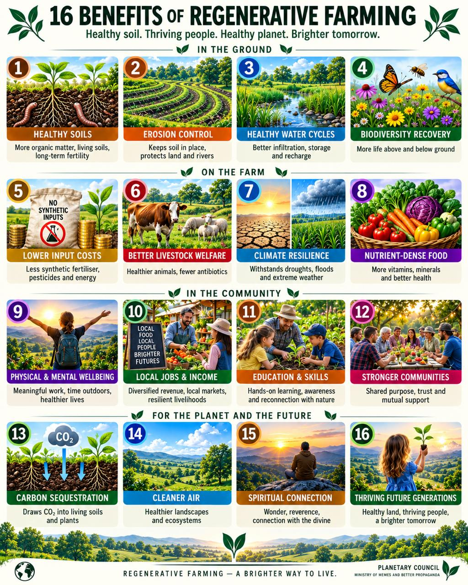

# Can Britain Feed Itself? Store and grow: a plan for UK food resilience

**Version:** final draft, 24 October 2026 (after three rounds of adversarial review)
**Project:** UK food security, climate, resilience and regeneration; a ~14-page public briefing (one page per chapter) for MPs, officials and the public.
**Repository:** `planetarycouncil/food-security-climate-regeneration`, branch `claude/focused-mendel-5qswh8`. Research notes are in `research/notes/` (26 notes) and the models in `research/model/` (two Python models).

---

## 0. How to read this document

**Labels:** **[P]** primary source · **[S]** secondary source (press, trade body, NGO) · **[E]** our own estimate or model · **[I]** interpretation or position (a value judgement, not a fact) · **[?]** not yet verified. Most primary sources were checked through search extracts and independent cross-checks; anything load-bearing should be re-opened before print.

**Conventions:** the date is 24 October 2026. UK means the United Kingdom unless England, GB or a devolved nation is stated. Figures are labelled by value or volume. **Calorie denominators:** Defra's requirement is 2,119 kcal per person per day; our planning figure is 2,250. We say which one we use.

**Structure:** each chapter has **Included claims** (for the page) and **Proactive criticism and context** (caveats, counterpoints and cut claims). A short **related concept** (Homes, Land and Livelihoods) follows chapter 14; it is not part of the costed plan.

**Resilience through transparency.** We publish our own critique, and we welcome critical thinking and adversarial scenarios. Tell us where this breaks.

---

## 1. The argument

1. **Britain is resilient on paper, fragile in practice.** Its farms grow just enough calories in a normal year (a margin of 31 kcal per person per day). But it depends on imported gas-based fertiliser, imported soya for animal feed, a just-in-time supply chain and weather that is getting more volatile. It holds **no public food reserve**.
2. **Nature gave Britain world-class farmland per hectare but little land per person.** What we grow, and who eats it, is the key choice. Soils can recover.
3. **Food is the foundation of social stability and a tool of geopolitics.** Price shocks and unfairness, not empty fields, break public trust.
4. **The answer has two equally important pillars: STORE and GROW** (equal in importance, not in budget: grow costs less new money because it also redirects existing farm support).
   - **Pillar 1: STORE, the UK Strategic Food Reserve** (about £10 per person per year). Human food first and food for everyone:
     - bread from 4 Mt of food-grade wheat;
     - a 3-day no-cook ration and vitamin tablets for all;
     - specialist food for those who need it;
     - seed, safe nitrogen, protein feed and imported staples.

     It is run by a lean, open, automated agency through a decentralised network of port hubs, district stores and local points.
   - **Pillar 2: GROW, domestic resilience** (about £4.50 per person per year of new money, plus pointing ~£70 per person of existing farm support at resilience):
     - soil that holds water and nutrients;
     - water storage and moisture monitoring;
     - seed we can multiply ourselves;
     - nitrogen and phosphorus we can recycle or make at home;
     - more home-grown protein;
     - regenerative farming where it pays.
   - **The reserve buys time; domestic resilience decides what we can grow with that time.** Neither works alone.
5. **Work and a food-producing nation.** Both pillars need people: about **3,500 funded permanent jobs** (~1,070 in the reserve, ~2,500 in the resilience programme), plus construction while stores and reservoirs are built. A separately funded work-in-nature pilot and wider regenerative farming could add more, but no study yet shows displaced office workers moving onto farms, so we do not promise a number. The chance is to make farming a prestigious career again. Britain should **grow a surplus of what it grows best**: sold abroad in good years, kept at home in bad ones. A surplus is a reserve only for crops Britain already grows in surplus (barley, oats, lamb, milk powder), and only if an export-licence trigger can keep it at home.
6. **A contingency ladder above both.** Fair rationing, a livestock destocking order and safe nitrogen are written down in advance: a contingency to the contingency, rarely needed and never improvised.
7. **Second-order benefits.** A reliable reserve helps stabilise neighbours and earns modest income in calm years, at fair, pre-agreed prices, never by gouging in a crisis.
8. **A wider transition:**
   - one consistent carbon price across jurisdictions, with no free allowances, no subsidies for emitting, and CO₂ treated as a commodity (the destination; free allowances are phased out jointly with the EU, as linking requires);
   - payment for verified removal;
   - meaningful work in farming and nature as AI changes office work.

   Together these are a **shift in how we see food**: from cheap product to shared foundation.
9. **Resilience through transparency.** Every claim carries its source and confidence label.

---

## 2. The plan in three tables

### 2A. Pillar 1, STORE: the UK Strategic Food Reserve, about £10 per person per year

[E] Model: `research/model/reserve_basket.py`; research notes 16, 19, 22 and 23. UK population 69.5 m (ONS mid-2025 ≈ 69.48 m). **An illustrative carrying-cost model with explicit allowances, not a procurement estimate**: prices, fees and allowances are assumptions to be replaced by quotes.

**Design principles.**
- **Human food first:** grain is held to food specification and used for people first. Only stock above a protected floor rotates into animal feed or export.
- **Food for everyone:** the reserve covers the whole population, not a target group. There is bread from 4 Mt of food-grade wheat, a 3-day no-cook grain ration for all 69.5 m, and vitamin tablets for everyone.
- **Specialist needs are an addition, not the core:** for example infants, care homes, and people who cannot chew or cook.

**Two tiers.**
- **Tier 1, the public crisis tranche:** owned by the state and paid from taxation.
- **Tier 2, compulsory commercial stocks** (the Swiss/Singapore model): millers, merchants, importers and compounders must hold stock **additional** to a registered commercial baseline, checked by an independent inspectorate. It is rotated through their own trade, and its cost is passed through food prices. It is designed to stay off the public balance sheet, **subject to an ONS classification** (if the ONS consolidates it, public debt rises by ~£2.2bn and the tier should shrink). Each line is sized against UK annual use. The central case assumes firms finance it through a state-backed liquidity facility at ~4%.

| Tier | Component | Stock | Annual cost | £/person/yr |
|---|---|---|---|---|
| 2 | **Food-grade milling wheat, 4 Mt** (half in new stores at £350/t) + 0.35 Mt high-protein wheat for the grist | 4.35 Mt | £182m | 2.62 |
| 1 | **No-cook grain ration for everyone:** 3 days (~500 g/day of crispbread, biscuits, oatcakes made from reserve grain; ~2,000 kcal at 4 kcal/g, 2,250 if specified at 4.5 kcal/g) for all 69.5 m | 104 kt | £28m | 0.40 |
| 1 | Tablets (vitamin A as beta-carotene, so safe in pregnancy; C, D + zinc) for everyone for 90 days; flour premix incl. folic acid; potassium iodate; feed amino acids; yeast; sacks and bottles; 90 m litres of bottled water (10 m people for 3 days; everyone else via water-company emergency supply and bowsers) | – | £32m | 0.46 |
| 1 | Operations: **lean open agency ~£33m** (~65 staff, innovation, automated sampling, open data, audit; chapter 11); local plans and exercises in all four nations £46m; **priority fuel, AdBlue and backup power £100m**; **last mile and water £45m**; security and insurance £15m | – | £239m | 3.44 |
| 1 | Specialist needs: infant formula ~7 kt (incl. ready-to-feed), specialised formula and medical foods, 7-day no-cook top-up for 5 m people who cannot use standard rations (£6/person-day) | – | £44m | 0.63 |
| 2 | Next season: cereal seed (winter 0.2 Mt + spring 0.1 Mt); nitrogen ~162 kt N as protected urea + heated UAN-28 (**no solid ammonium nitrate**); 10 weeks of soya meal | 1.21 Mt | £114m | 1.64 |
| 2 | Imported staples and variety: rice ~4 months, vegetable oil ~4 months, sugar ~2 months; pulses, stabilised oats, skimmed milk powder, canned fish | 1.18 Mt | £79m | 1.14 |
| | **Total** (public stock ~£0.72bn on the balance sheet; ~£2.2bn of commercial stock held by firms) | **~6.8 Mt** | **~£718m** | **~£10.33** |

That is about **£4.93 via taxes** (Tier 1) and **£5.40 via prices** (Tier 2). **Range** (sensitivity, not a confidence interval): low £9.40 · **central £10.33** · prices +30% £11.35 · firms finance at 8% £11.92 (10%: £12.73) · prices +100% £13.73 · stress (finance 6%, storage/ops +50%, rotation losses doubled) £16.56 · severe stress £18.34 · extreme (stress + firms at 10% + prices doubled) £25.57.

**Up front (gross, not annual):** public stock £0.72bn + commercial stock £2.24bn + new stores £0.70bn + sensors £0.02bn ≈ **£3.7bn** across public and private holders, phased over ~5 years of good-quality harvests. The annual £718m already includes the finance on this; do not add the two.

**Priority schedule: human food first** (cumulative per person; if money is short, cut from the bottom):

| Up to | Buys |
|---|---|
| £2.71 | **Bread for everyone:** 4 Mt food-grade wheat, high-protein wheat, premix, sacks |
| £3.48 | + **no-cook food for everyone:** 3-day grain ration, tablets, bottled water |
| £6.92 | + operations: lean agency, local plans, priority fuel/power, last mile, security |
| £7.55 | + infants and special needs: formula, medical foods, specialist top-up |
| £9.19 | + next season: seed, protected urea, UAN, soya meal |
| £10.33 | + imported staples and variety: rice, oil, sugar, pulses, oats, milk powder, fish |

**What the 4 Mt of wheat means:**
- **Bread for everyone:** it equals **~10 months of today's aggregate mill intake** (≈ 304 days) with no imports and no harvest, if the mills have power, labour, premix and the right grist. As raw energy it is ~84 days of national need.
- **It is the human-food floor, not also the livestock buffer.** The same tonne cannot both guarantee bread and spare animals. The cereal model (`cereal_balance.py`, 36 months, 1.0 Mt working-stock floor) asks a different question, about the whole pooled stock of wheat, barley, oats and maize:
  - If imports stop with normal harvests, cutting distilling and bioethanol by 75% leaves a 2.3 Mt gap at full livestock feed.
  - Through two −15% harvests at 80% feed, the gap is 2.5 Mt; through a nitrogen-shock harvest at 80% feed, 3.5 Mt.
  - Through **three persistently poor harvests (−30% each)**, even 4 Mt extra runs out in month 22 unless feed falls to about half.
  - So avoiding a cull needs feed-grade grain and feed cuts, not the bread reserve. The model also ignores the distillers' grains and CO₂ lost when distilling stops.

**Rarely wasted (target: under 2% of value a year lost to spoilage and downgrade, published):** wheat keeps 5–10 years when dry, cool and monitored. About a fifth rotates every year into flour mills (~17% of their intake), animal feed (a 13 Mt market) or export and aid. Each lot is inspected on intake, monitored for temperature, moisture and insects, and tested before release.

**Bread is the backbone, not the whole diet:** today's mills can supply ~150 g of flour per person per day at today's ~79% extraction, or ~160 g (≈ 550 kcal) at an emergency 85%, about a quarter of energy needs. In a long crisis, domestic potatoes, oats and **whole-grain wheat** carry the rest: porridge, bulgur and flatbreads, including from diverted feed wheat, which needs no roller mill.

**Fiscal honesty:** inventory does not reduce public sector net debt. Only Tier 1 sits on the public balance sheet. A levy or price pass-through moves the cost; it does not remove it. Refilling after a release is a separate fiscal risk (refilling 4 Mt of wheat 30% dearer costs ~£0.25bn extra), funded from taxation on a price-and-quality trigger within 36 months.

Scale checks [E]: £718m a year ≈ 0.02% of GDP (~£2.9trn); ≈ 1% of UK defence spending (~£68bn); ≈ 15% of UK agricultural support (£4.87bn, 2025).

### 2B. Pillar 2, GROW: domestic resilience, about £4.50 per person per year of new money

[E] `reserve_basket.py` (`DOMESTIC`); research note 24. The aim is to rely less on imports for the things a harvest needs: soil, water, seed, nitrogen, phosphorus and protein.

| Component | What it buys | £m a year | £/person/yr |
|---|---|---|---|
| **Soil and water monitoring** | ~500 soil-moisture sites (from ~50 today), satellite moisture, free soil tests for every farm field every 5 years, an open national soil-health map | 35 | 0.50 |
| **Water storage** | On-farm and shared catchment reservoirs that fill in winter and irrigate in summer (today's grant rounds are ~£10–15m) | 100 | 1.44 |
| **Seed security** | Gene banks; UK seed multiplication (incl. spring cereals, pulses, vegetables); public breeding for drought, disease and low-vicine beans | 40 | 0.58 |
| **Nutrient independence** | Manure and digestate testing, storage and precise application; phosphorus recovery from wastewater; legumes and clover; a green-ammonia pilot | 60 | 0.86 |
| **Regenerative transition** | Independent advice, farmer-to-farmer networks, bridging payments (annual profit often improves after 3–5 years; capital payback is nearer 9 years without incentives) | 50 | 0.72 |
| **Home-grown protein** | Dehulling and pulse mills, local processing, low-vicine varieties | 25 | 0.36 |
| **Total new money** | | **~310** | **~£4.46** |

**What £310m buys, as outputs [E; illustrative, to be replaced by quotes]:**
- **Water:** at a 40% grant and £5,000–15,000 per megalitre, £100m a year supports ~£250m of projects, ~17,000–50,000 ML of new storage a year: irrigation for roughly 17,000–50,000 ha of potatoes and vegetables at 100 mm. Insurance for high-value crops, not an answer to the 5 bn L/day public-supply gap.
- **Regenerative transition:** at £1,700–4,300/ha upfront, £50m covers ~12,000–29,000 ha a year if it paid the whole cost.
- **Soil:** one lab panel per field every five years (£50–150 each) costs £10–60m a year for 1–2 m field units; the £35m buys a sampled national baseline first.
- **Protein:** £25m funds a small network of dehulling and pulse-processing pilots with buyer contracts.

This is a **starting envelope and a set of pilots**, not national nutrient independence or a soya exit.

**Existing money, better aimed:** the UK already spends **~£4.87bn a year** on agricultural support (2025), about **£70 per person** [P]. Pillar 2 asks that this money buy resilience outcomes: soil health, water storage, protein crops, nutrient efficiency, and food production on the best land. It does not ask for more, but it is not free: the £4.87bn includes the £384m red-diesel rebate, general services and agri-environment agreements already committed, so any retargeting has losers, who should be named.

### 2C. Both pillars together

| | Store (Pillar 1) | Grow (Pillar 2) | Both |
|---|---|---|---|
| New money per person per year | ~£10.33 | ~£4.46 | **~£14.79** (under 5p a day) |
| Up-front stock and capital (gross, public + private) | ~£3.7bn (~£53 per person) | Grants are annual | |
| Paid through | ~£4.93 taxes + ~£5.40 food prices | Taxes (plus existing farm support redirected) | |
| Protects against | Shocks of weeks to months: blockades, blackouts, cyber attacks, failed imports | Shocks of seasons to decades: fertiliser and feed dependence, drought, soil loss, climate | |

**The two pillars share one information system:** stock sensors in the stores and soil-moisture sensors in the fields feed the same open national dashboard, run by the same lean agency (chapter 11).

**Not in either total:** a work-in-nature pilot (10,000 places ≈ £350m a year, which would take both pillars to ~£19.80 per person) and the Homes, Land and Livelihoods concept (a related idea, after chapter 14). Each would need its own budget.

---

## Chapter 1 · Can Britain feed itself?

**Headline:** Resilient on paper, fragile in practice.

**Narrative:** Britain produces about 60% of the food it eats by value, and on paper its farms produce just enough calories (a margin of 31 kcal per person per day) and nearly twice the protein people need. That paper picture hides three fractures. The protein depends on imported soya fed to animals. Yields depend on imported gas-based nitrogen. The whole system runs on just-in-time logistics with no public reserve. Self-sufficiency, food security and resilience are different questions, and this briefing is about resilience.

**Included claims**
1. All-food production-to-supply ratio **60%** (2025, provisional, by farmgate value); 65% in 2024; 62% in 2023. Defra attributes the fall to a higher value of imports; trade press reads it as mostly import prices rather than volume (FarmingUK / Farmers Weekly, Jul 2026 [S]). No formal price/volume split is published. Source: Defra, *Agriculture in the UK 2025*, ch.14: https://www.gov.uk/government/statistics/agriculture-in-the-united-kingdom-2025/chapter-14-the-food-chain [P]
2. Indigenous-type food (foods that can be grown in the UK) **72%** (2025). Same source [P]
3. The all-food ratio was **over 80% in the 1980s** (Defra narrative); the exact peak year and value depend on the series. Defra AUK 2025 ch.14 [P]
4. By volume, 2025: milk **105%**, lamb **103%**, oats **109%**, barley **107%**, eggs 88%, beef 84%, wheat **83%**, poultry 80%, potatoes 71%, pig meat 67%, sugar 61%, fresh veg **56%**, oilseed rape 49%, tomatoes 17%, fresh fruit **14%**. Defra AUK 2025 ch.14 [P]
5. Farm output ≈ **101%** of population energy need (2,150 vs 2,119 kcal per person per day: 101.5%, a **31 kcal** margin) and **about 1.9 times** protein need (2025), before waste; "statistics in development". Defra, *Nutritional supply of agriculture in the UK 2025* (15 Oct 2026): https://www.gov.uk/government/statistics/nutritional-supply-of-agriculture-in-the-uk-2025/nutritional-supply-of-agriculture-in-the-uk-2025 [P]
6. That release states availability would fall if imported livestock feed stopped. Same source [P]
7. Imported soya meal (~2.39 Mt in 2024, 77% into pigs and poultry) carries **~1.1 Mt of protein**, about the size of the population's reference protein need (~1.17 Mt/yr at ~46 g/person/day). That protein is **upstream, inside animals, not edible**; most of it does not come back out as meat. AIC soya report; authors' arithmetic [S/E]
8. Livestock use about **84%** of utilised agricultural area and ~56% of croppable area (grazing plus feed crops, under Defra's stated assumptions) and supply about **31%** of agricultural calorie supply. Defra AUK 2025 ch.2 and nutritional-supply release [P]
9. Utilised agricultural area **16.8 Mha (69% of UK land)**; croppable 6.1 Mha. Defra land use June 2025: https://www.gov.uk/government/statistics/agriculture-in-the-united-kingdom-2025/chapter-2-structure-of-industry [P]
10. UK cereal harvest 2025: **19.5 Mt**. Defra/AHDB: https://www.gov.uk/government/statistics/agriculture-in-the-united-kingdom-2025/chapter-7-crops [P]
11. ECIU's 14 Aug 2026 forecast put UK key crops at **18.5 Mt**. Separately, ECIU's 8 Oct 2026 ranking found four of the five worst harvests since 1984 in 2020–2026, for **England, wheat + barley + oats + oilseed rape, by volume** (pre-1999 estimated). https://eciu.net/media/press-releases/uk-harvest-even-worse-than-previously-thought-new-data [P]. The forecast, the ranking and the model's 19.5 Mt are three different crop sets and geographies. **Defra's provisional England figures (8 Oct 2026)** are mixed: wheat **10.8 Mt (+0.8%)** at 7.2 t/ha; barley 3.7 Mt (−11%) and oats both the smallest since 2012; oilseed rape +43%. Full UK figures are due in December. https://www.gov.uk/government/statistics/cereal-and-oilseed-rape-production/provisional-cereal-and-oilseed-production-estimates-for-england-2026 [P]
12. Defra: the UK has **"no national food stockpiles or plans to create these"** (written answer, 31 Mar 2026). https://questions-statements.parliament.uk/written-questions/detail/2026-03-20/HL15829/ [P]
13. Agriculture employs **446,200** people (1.3% of UK jobs); 40% of English farm holders are over 65, 5% under 35. Defra Farming Evidence Pack, Sep 2026 [P]
14. Food inflation peaked at **19.2%** (March 2023). Defra AUK 2025 [P]
15. Total income from farming **£8.4bn** (2025); total support £4.87bn. Defra AUK 2025 ch.10 [P]

**Proactive criticism and context**
- The 60% ratio is by *value* and includes exported production; the UK-origin share of consumption is 58% (a separate denominator). Do not convert either into a calorie share [P, Defra].
- Defra's nutrient-supply statistic subtracts feed crops but assumes no waste and minimal processing; protein figures differ inside the release itself (193%, 194%, 195%) [P].
- FAO food balance sheets put UK *supply* at ~3,435 kcal and 110 g protein per person per day (2023), about 60% above physiological need, because supply includes waste and overconsumption [S, dossier].
- **Two calorie languages:** Defra's requirement (2,119 kcal) and our planning figure (2,250 kcal) answer different questions; never divide one by the other in the same sentence.
- Excluded as unsupported: claimed import-dependence shares (40% domestic N, 25% domestic feed, 30% domestic agrochemicals) with no traceable source.

---

## Chapter 2 · Nature's gift

**Headline:** World-class farmland per hectare, land-poor per person, with soils that can recover.

**Narrative:** Few places grow cereals and grass as well as Britain: mild, wet, rarely frozen, rain-fed. The world wheat-yield record was set in Lincolnshire. But Britain has a third of France's arable land per person, and its best land sits in the drying east and on shrinking Fen peat. The lesson is not "grow more of everything". It is to use the gift wisely: food for people on the best land, grass and trees on the rest, and soils rebuilt, as Britain's own century-old experiments show is possible.

**Included claims**
1. Most of the UK is **Köppen Cfb** (temperate oceanic, no dry season). Met Office: https://weather.metoffice.gov.uk/climate/climate-explained/climate-zones [P]
2. Growing season (days >5 °C): ~250–290 in lowland England, 330+ on Atlantic coasts; 2016–2025 had less than half the icing days of 1961–90. Met Office / State of the UK Climate 2025 [P/S]
3. Rainfall ranges from ~550–650 mm in the east (Cambridge ~560 mm) to over 3,000 mm at Seathwaite. Met Office station averages 1991–2020 [P]
4. UK wheat averages ~**7.8 t/ha**, derived (AHDB's 2026 survey put winter wheat at 6.9 t/ha, 11% below its five-year average: 6.9/0.89 ≈ 7.75). This is an implied survey average, not a Defra long-run mean; Defra's provisional England 2026 all-wheat yield is 7.2 t/ha. AHDB: https://ahdb.org.uk/news/final-harvest-report-confirms-cereal-yields-are-below-historic-averages-across-the-uk [E]
5. Scotland's 10-year average wheat yield **8.6 t/ha**; 9.2 t/ha in 2023. https://gov.scot/publications/cereal-and-oilseed-rape-harvest-2023-final-estimates/pages/wheat-yield-and-production-remain-high-despite-small-decreases [P]
6. World average wheat yield ~**3.5–3.7 t/ha**; UK yields are about double. FAOSTAT [?]
7. **World record wheat yield 17.95 t/ha**, Tim Lamyman, Louth, Lincolnshire, 10 Aug 2022. https://guinnessworldrecords.com/world-records/highest-wheat-yield [P]. One field shows what is possible; the *system* claim is the national average of ~8 t/ha, about twice the world average.
8. Arable land ≈ **0.09 ha per person** in the UK vs ≈ **0.27–0.29 ha** in France. FAO arable totals ÷ population [E/?]
9. Population density ~**285/km²** (UK) vs ~**120/km²** (metropolitan France) [E]
10. About **71%** (71.3%) of UK farmland is grass (9.484 Mha permanent, 1.313 Mha temporary, 1.197 Mha common rough grazing; sole-right rough grazing is already inside permanent grass). Defra AUK 2025 table 2.1 [P]
11. England's "best and most versatile" land (ALC grades 1–3a) is about **42%** of agricultural land. Natural England survey data [S]
12. **59.2%** of Grade 1 land lies in river or sea flood-risk areas; ~1.12 Mha (13%) of English farmland is in mapped flood zones. This is mapped exposure, not the chance of loss in a given year. Environment Agency, Oct 2026 [P/?]
13. Fen peat loses **1–2+ cm a year** under arable; remaining life is site-specific (depth, drainage, management), not a single national figure. Wildlife Trusts / Farmers Weekly [S]
14. Soil degradation costs **~£1.2bn/yr** (range £0.9–1.4bn) in England and Wales: organic matter loss 47%, compaction 39%, erosion 12%; 80% of the cost is off-farm. A **2015 estimate** in that study's prices, not today's annual loss. Graves et al. 2015, *Ecological Economics* 119:399–413: https://ideas.repec.org/a/eee/ecolec/v119y2015icp399-413.html [P]
15. A 3-year grass-clover ley in a 5-year rotation raised topsoil organic carbon from **0.98% to 1.23% in 28 years** (+0.25 percentage points, ≈25% relative concentration, on one sandy loam; not a measured change in carbon stock per hectare), then plateaued (~1.3%); continuous arable declined. Johnston et al. 2017: https://repository.rothamsted.ac.uk/item/8v42x/changes-in-soil-organic-matter-over-70-years-in-continuous-arable-and-ley-arable-rotations-on-a-sandy-loam-soil-in-england [P]
16. Rothamsted Broadbalk (since 1843): unfertilised plots ~**1.6 t/ha**, manured or fertilised plots ~7–8 t/ha. Rothamsted guide [P]
17. Without action, England faces a **~5 bn L/day** public water shortfall by 2055 (the EA's conditional do-nothing scenario; 4.37 bn L/day with planned 2025–30 measures); in the East (Water Resources East), spray irrigation is ~47% of estimated future non-public-supply use. EA National Framework 2025: https://www.gov.uk/government/publications/national-framework-for-water-resources-2025-water-for-growth-nature-and-a-resilient-future/3-how-much-additional-water-we-need-national-framework-for-water-resources-2025 [P]
18. Woodland **3.29 Mha (~13.5%)** of UK land vs an EU average of roughly 38–40%. Forest Research, Forestry Statistics 2025 [P/?]

**Proactive criticism and context**
- The ALC grades (1–5, with 3a/3b) apply to England and Wales; Scotland uses a different system.
- Excluded as unsupported: claims that the UK "ranks alongside Ukraine's chernozem" or is "capable of total autonomy".
- The Slater et al. projection that mean yields may hold up to 2080 does not mean the *bad years* are covered (chapter 3).
- A ley occupies land for years: soil gains must be counted against the food not grown in those years.
- Poor agricultural land is not automatically good woodland land: check peat, existing habitats and hydrology first.
- Country-by-country FAOSTAT yields (France, Germany, Ukraine, Russia, US) need pulling directly.

---

## Chapter 3 · Climate is changing the odds

**Headline:** British wheat usually rides out a single bad spell. Bad weather stacked across a season is what hurts, and that is becoming more common.

**Narrative:** British farming handles a single wet spell or heatwave. What breaks it is extremes stacked across one season, and these are becoming more common: wet autumns that stop sowing, dry springs, wet harvests. In 2026 drought hit Britain, France and Germany together, so the neighbours we rely on failed at the same time. New pests and livestock diseases are arriving with warmer winters. A reserve is the hedge against correlated failure that trade cannot provide.

**Included claims**
1. UK wheat yields since 1990 show "substantial resilience" to single extremes; significant losses come from **combinations of extremes within a season** (e.g. 2020: wet autumn, dry spring, August downpours). Slater et al. 2022, *Earth System Dynamics* 13:1377: https://esd.copernicus.org/articles/13/1377/2022/ [P]
2. Wheat yield volatility has increased significantly, driven by compound extremes across growth stages. NERC/NORA paper: https://nora.nerc.ac.uk/id/eprint/533430/1/N533430JA.pdf [P]
3. 2026 winter wheat **6.9 t/ha (−11% vs 5-yr average)**; spring barley −17% (AHDB survey, not final statistics). Defra's provisional England estimate is higher for wheat (7.2 t/ha, output +0.8%) and lower for barley (−11%) and oats. AHDB (2026); Defra (8 Oct 2026) [P]
4. 2026 abstraction restrictions: **1,412** by 27 Aug; mandatory 50% cuts on 288 spray-irrigation licences in East Anglia; about half the potato crop is irrigated. EA via trade press [S]
5. **France: cereal output ~−8 Mt** in 2026 vs 2025; grain maize ~−35%. European Commission via Carbon Brief: https://carbonbrief.org/how-this-summers-heat-and-drought-impacted-crops-in-europe-in-six-charts [S]
6. **Germany:** grain shortfall up to ~3 Mt (~€600m / ~£520m) in 2026. DBV/Raiffeisen [S]
7. EU soft-wheat yields −7% vs 2025 (JRC MARS); Hungary's worst drought since 1991. https://ukragroconsult.com/en/news/mars-lowers-harvest-forecasts-for-all-crops-in-the-eu-for-2026/ [S]
8. **2025 was the UK's warmest year on record** (series from 1884). Met Office, Feb 2026: https://www.metoffice.gov.uk/about-us/news-and-media/media-centre/weather-and-climate-news/2026/met-office-science-helps-protect-uk-plants-from-rising-pest-risks [P]
9. Met Office/Defra Climate-Pest Risk tool covers nine insect pests (e.g. Colorado potato beetle); targeted Colorado beetle eradication in Kent, 2025. Same source [P]
10. **Wheat stem rust is re-emerging** in the UK and Ireland. EPPO-hosted study: https://pra.eppo.int/pra/c1804e50-2029-488f-b92f-d38429142e81 [S]
11. **Bluetongue BTV-3**: 160 cases in England (Aug 2024–May 2025); new vector season from 11 Jul 2025, with cases through winter 2025/26. GOV.UK: https://gov.uk/bluetongue [P]
12. Four of the five worst harvests since 1984: **2020, 2024, 2025, 2026**, for England, four combinable crops including oilseed rape, by volume (ECIU, Oct 2026). Do not generalise to "UK" or "cereals" [P]
13. Wheat volume self-sufficiency fell from 96% (2023) to 79% (2024, wet autumn) and recovered to 83% (2025). Defra [P]

**Proactive criticism and context**
- Slater et al. also project that warmer winters and drier June–July *could benefit* average yields to 2080; the risk is the tail, not the mean.
- The 2026 European losses were partly due to farmers planting less because of input costs (Hormuz), not only weather (USDA FAS).
- "Worst harvest on record" needs its series defined (crops, geography, first year, production vs yield); a smaller planted area is not a climate yield failure.
- Not yet modelled: correlation coefficients between UK, French and German yield anomalies (a doable FAOSTAT/Eurostat exercise).

---

## Chapter 4 · Hidden dependencies

**Headline:** A loaf of bread runs on gas, diesel, ships and software.

**Narrative:** Britain's farms turn imported energy into food. The country no longer makes its own ammonia. All its phosphate is imported, and much of it ends up in sewage. Food-grade CO₂, needed to stun animals and pack meat, comes from a handful of gas-dependent plants. Half of what we eat is chilled or frozen, and a ransomware attack on one distributor can stop orders to every major supermarket. Modern lorries need AdBlue (made from urea) as well as diesel, robotic distribution centres need power and data, and wet grain needs fuel to dry. A week-long power cut would break the food system faster than any harvest failure.

**Included claims**
1. CF Fertilisers closed the **Billingham ammonia plant in 2023** (Ince closed 2022); the UK no longer makes ammonia at commercial scale; ammonium nitrate is made from imported ammonia. CF/industry press [S]
2. Defra's UK Food Security Report 2024 records the end of domestic primary ammonia production and reliance on imports. https://www.gov.uk/government/statistics/united-kingdom-food-security-report-2024/united-kingdom-food-security-report-2024-theme-3-food-supply-chain-resilience [P]
3. Manufactured nitrogen use fell **43%** (1990–2025); phosphate **−71%**. Defra Farming Evidence Pack 2026 [P]
4. UK imports **~174 kt of phosphorus a year**; **less than half** is used productively; phosphate fertiliser prices quadrupled mid-2020 to mid-2022. UK Phosphorus Transformation Strategy (Lancaster, Dec 2022): https://www.lancaster.ac.uk/news/scientists-release-uk-roadmap-for-managing-key-ingredient-behind-all-the-food-we-eat [P]
5. ~**55 kt P/yr** reaches wastewater works; ~22.5 kt is recycled to land in sludge (2009 data). Birmingham substance-flow analysis: https://research.birmingham.ac.uk/en/publications/a-substance-flow-analysis-of-phosphorus-in-the-uk-food-production [P]
6. Potash: Boulby (ICL) produces **polyhalite (~1.0 Mt, FY2023)**; Anglo American's Woodsmith polyhalite project has 2026 capex cut to zero, with an investment decision from 2028. Mining Weekly: https://www.miningweekly.com/article/woodsmith-polyhalite-project-uk-update-2026-08-07 [S]
7. CF Billingham historically supplied ~**60%** of UK food-grade CO₂ [S, 2021–23 reporting]
8. Government backed a **£100m three-month restart** of the Ensus bioethanol/CO₂ plant (Teesside) after it stopped in autumn 2025; CO₂ supply-resilience call for evidence closed 20 Aug 2026. https://www.gasworld.com/story/uk-government-launches-call-for-evidence-on-co2-supply-resilience/2256311.article/ [S]
9. Vivergo (Hull), the largest single UK wheat buyer (>1 Mt/yr), closed in 2025 after the UK–US deal removed the 19% US ethanol tariff. ABF/press [S]
10. **Over 50%** of food consumed in the UK is chilled or frozen; ~450 temperature-controlled warehouses and ~100,000 refrigerated vehicles. Cold Chain Federation: https://www.coldchainfederation.org.uk/policy-strategy-2026/ [S]
11. May 2025: ransomware at **Peter Green Chilled** (supplier to Tesco, Sainsbury's, M&S, Waitrose, Aldi, Co-op and others) halted order processing. M&S and Co-op were hit by attacks in the same period; a shared perpetrator is not established. https://www.foodingredientsfirst.com/news/ransomware-uk-supermarket-supplier-food-security.html [S]
12. The Short Straits (Dover/Folkestone) carry ~18% of food, feed and drink imports but ~**42% of dairy and eggs**, 39% of meat and 29% of fruit and veg. Defra UKFSR 2024 [P/?]
13. About ten supermarkets handle ~95% of shop-bought food. Dossier / NPC *Just in Case* (2025) [S]
14. 98% of English farms use red diesel (2024/25); implied UK farm volume ~**0.9 bn litres/yr** (£384m rebate ÷ 42.77p/L duty gap, 2025). HM Treasury said "almost £300m" in March 2026, and a June–December 2026 duty cut changes the rebate mid-year. Defra AUK 2025 ch.10 [P]; authors' arithmetic [E]
15. Farm red diesel **123.7p/L in April 2026, +79%** on the 2025 average; ECIU estimates **£337m** extra farm fuel cost in 2026. Early Day Motion: https://edm.parliament.uk/early-day-motion/65676 [S]
16. **Iberian blackout** (28 Apr 2025): ~50–60 m people, ~10+ hours; payments, warehouse systems and refrigeration failed; ~$1.8bn cost to Spain. https://www.slimstock.com/blog/the-iberian-blackout-and-its-consequences-on-the-supply-chain/ [S]
17. Calcium carbonate for flour fortification has depended on deliveries from a **single French quarry**, as recorded in the UK Food Security Report 2024 itself [P]
18. Food **is** one of the UK's 13 critical national infrastructure (CNI) sectors; the NAO (Sep 2026) says Defra should use the CNI Knowledge Base to identify food-supply **assets** (mills, dryers, CO₂, premix, ferries, cold stores). The stronger sentence "no food assets are in the database" must be quoted from the report PDF before use. NAO: https://www.nao.org.uk/reports/resilience-of-the-food-supply-chain-to-disruptions/ [P]
19. **AdBlue:** Euro VI lorries need diesel exhaust fluid (urea solution). If it runs out, a torque cut comes first; then, once the tank is empty (or below ~2.5%) and the engine is restarted, refuelled or parked, the **severe inducement limits speed to 20 km/h**. South Korea's 2021 urea shortage threatened its freight network. Reg. (EU) 582/2011 Annex XIII section 5 (retained in UK law): https://www.legislation.gov.uk/eur/2011/582/annex/XIII/division/5/adopted [P]
20. **Automated distribution centres:** much supermarket stock moves through robotic high-bay warehouses run on cloud warehouse-management software; without power or data they stop, and pallets 30 m up cannot be picked by hand. [S/?]
21. **Grain dryers:** British grain is often harvested at 16–20% moisture and must be dried for safe storage (safe limits depend on moisture, temperature and time, typically ~14.5% or below for longer storage); in a wet autumn the queue is at the dryer, which needs gas, diesel or electricity. Camgrain publishes separate drying and handling charges [P/S]
22. **Small imports, big consequences:** synthetic amino acids for pig and poultry feed (a few plants worldwide), phosphine for stored-grain insects, food-grade CO₂ for stunning and packing [S]
23. **Folic acid** joins calcium, iron, niacin and thiamin as a legal requirement in non-wholemeal wheat flour from **13 December 2026** (England; check devolved rules) [S]

**Proactive criticism and context**
- Cold stores can double as "thermal batteries" (sub-cool when power is cheap, coast through evening peaks) and earn grid-balancing income; plausible, not yet costed [E/?].
- Phosphorus is a *slow* risk: UK arable soils hold legacy P, so a 1–3 year disruption is far less damaging than a nitrogen cut.
- Manure recycles nutrients already in the system; it is not new P or K.
- Pesticide active ingredients are believed to be mostly made abroad; no quantified inventory found [?].
- Food tech (chapter 14 context): precision fermentation needs ~13–17 kWh per kg of protein *plus* sugar and ammonia; replacing feed-soya protein this way would take ~16 TWh/yr (~5–6% of UK electricity) [E]. UK vertical farms (Jones Food Company, Apr 2025; Infarm) went into administration [S].

---

## Chapter 5 · Protein, livestock and the sea

**Headline:** Grain isn't the weak point. Imported protein is. And our "animal" grain is our biggest hidden reserve.

**Narrative:** About half of Britain's wheat, barley and oats is fed to animals, far more than the global third. Much of it could feed people if needed, as porridge, flatbreads and wholegrain, though not as today's sliced loaf without stronger wheat blended in. If imports stopped in a normal-harvest year, Britain's grain could keep both people and animals going if industrial uses and exports stopped; the real gap is imported soya, which pig and poultry farming stands on. The answer: grow more protein at home, keep grass-fed cattle and sheep on land nothing else can use, size pig and poultry numbers to home-grown protein, and contract the winter mackerel and herring catch into cans and pouches.

**Included claims**
1. **~52%** of UK wheat, barley and oats goes to animal feed (2023). Defra [P]
2. **13.45 Mt** of cereals fed to livestock (2025/26). AHDB [P]
3. Globally, **~⅓** of cereals go to feed; **86%** of livestock feed (dry matter, ~6 bn t/yr) is not human-edible; grains are 13% of feed. Mottet et al. 2017, *Global Food Security* 14:1–8: https://research.wur.nl/en/publications/livestock-on-our-plates-or-eating-at-our-table-a-new-analysis-of- [P]
4. One kg of boneless meat needs on average **2.8 kg** (ruminants) or **3.2 kg** (pigs and poultry) of human-edible feed. Same source [P]
5. 3 kg of grain ≈ 9,900 kcal vs ~1,500–2,500 kcal in 1 kg of meat: **4–6× fewer calories out than in** [E]
6. "Feed wheat" is mostly the same species (softer, lower-protein varieties); usable for biscuits, flatbreads, porridge and wholegrain. The feed–milling price gap was ~£14/t in Nov 2025 (feed £166/t, milling £180/t). Farmers Weekly [S]. **But** ~80% of UK bread is made by the high-speed Chorleywood process, which needs ~13% protein and a Hagberg falling number of ≥250 s; feed wheat at ~10–11% protein collapses on those lines unless blended with strong wheat or vital wheat gluten [S]
7. EU food limit for the mould toxin DON in unprocessed cereals was **cut from 1,250 to 1,000 µg/kg** (Reg. 2024/1022, from 1 Jul 2024); feed guidance values are much higher. This is EU law: GB and Northern Ireland limits must be checked separately before a food-grade specification is written. https://www.nfuonline.com/news/eu-changes-to-maximum-limits-for-mycotoxins/ [P]
8. UK flour mills used **4.8 Mt** of wheat and produced **3.8 Mt** of flour in 2025; **~25–31% of the grist is imported** (Defra: 75% home-grown in 2025; UK Flour Millers' 2024/25 table: 68.7% UK), much of it strong wheat for gluten. That is usage, not rated capacity. https://www.ukflourmillers.org/the-industry/annual-review [P]
9. Model: with imports stopped on 1 July, bioethanol and distilling grain use cut 75% and exports stopped, the **pooled cereal balance stays positive with today's full livestock feed for two years with normal harvests**; two −15% harvests require feed cut to ~80% of today. Three persistently poor harvests (−30% each) break the balance even with 4 Mt extra, in month 22, unless feed falls to about half. A tonnage balance only: it pools feed barley, oats, wheat and imported maize, does not subtract the feed and CO₂ lost when distilling stops, and does not model quality, milling, protein or logistics. `research/model/cereal_balance.py` [E]
10. Halving pigs and poultry and diverting ~6 Mt of feed grain to people: **net ≈ +17 trillion kcal/yr ≈ 29% of annual national energy need** [E]
11. Replacing imported soya protein fully with UK field beans would need ~**4 Mt of beans (~1 Mha)**, ~6× today's pulse output (0.68 Mt) and ~16% of croppable land, at the rotation ceiling [E]. Beans are short of methionine and contain anti-nutritional factors (vicine/convicine, tannins): high-bean poultry and pig diets need synthetic amino acids (imported) and low-vicine varieties [S]
12. In Wilkinson's 2011 analysis of UK systems, only milk and upland suckler beef returned more human-edible protein than they consumed; a result for the systems studied, not a ranking of every farm today. Wilkinson 2011, *Animal* [P]
13. UK field beans are already exported to Egypt for ful medames. Trade press [S]
14. Domestic landings plus aquaculture fell from **89% (1975) to 40% (2019)** of UK seafood consumed. Harrison et al. 2023, *Rev Fish Biol Fisheries*: https://repository.essex.ac.uk/36032/1/s11160-023-09776-5.pdf [P]
15. The UK eats **31% less** seafood than recommended; even with local species, domestic production would be 73% short of guidance levels. Same source [P]
16. UK-vessel landings **~745 kt (£1.16bn)** in 2024; imports 633 kt (£3.5bn); exports 380 kt (£2.0bn). MMO: https://assets.publishing.service.gov.uk/media/692db8a7345e31ab14ecf833/2025_12_02_-_UK_Sea_Fisheries_Statistics_2024_report_-_.pdf [P]
17. Scottish farmed Atlantic salmon **197,836 t** (2025); salmon is often reported as the UK's largest single **food** export by value (~£828m, ~111 kt; whisky is larger if drink is included) [S/?]. https://www.gov.scot/news/scottish-fish-farm-production-survey-2025 ; Salmon Scotland/HMRC [P/S]
18. UK–EU fisheries access extended to **30 June 2038** (May 2025 deal). https://oceans-and-fisheries.ec.europa.eu/news/eu-and-uk-formalise-agreement-full-reciprocal-access-waters-until-2038-2025-06-20_en [P]
19. Climate Change Committee, Seventh Carbon Budget (Feb 2025): **cattle and sheep −27% by 2040**, meat consumption −25%, dairy −20% by 2040; the government says this is not policy. https://www.farminguk.com/news/uk-livestock-numbers-must-fall-climate-change-committee-says_66183.html [S]
20. Average UK meat intake fell from **103.7 g to 86.3 g/day** (2008–2019, −17%), mainly smaller portions. Oxford, *Lancet Planetary Health*: https://www.oxfordmartin.ox.ac.uk/news/reduction-in-uk-red-and-processed-meat-intake-but-more-needed-to-meet-our-climate-targets [P]

**Proactive criticism and context**
- The global "86% inedible" figure is driven by grazing systems; UK pigs and poultry eat mostly human-edible grain and soya, so UK feed–food competition is *higher* than the global average.
- Mottet et al. themselves say the ~3 kg figure is lower than older estimates and needs confirmation.
- Pulse rotations are limited by soil-borne disease: field beans only once every ~5–6 years (AHDB).
- Cutting UK livestock while importing meat would move emissions abroad ("leakage").
- **Fish is seasonal and barely canned at home:** pelagic catches are concentrated in autumn–winter and mostly frozen whole for export; the UK has little fish-canning capacity. A reserve needs contracted winter canning/pouching or imported canned stock [S].
- **Soya is not human protein one-for-one:** compare digestible amino acids, not crude protein tonnes.
- **Waste tonnes are not energy tonnes:** water-heavy produce cannot be counted at grain's calories per tonne.
- Salmon depends on imported feed and has high mortality (2.85% in Sep 2025), so its crisis value is limited [S].
- UK plant-based *meat* sales fell 9.4% by volume in 2025 (GFI Europe); diet change is happening through smaller portions and whole foods, not processed substitutes.

---

## Chapter 6 · Geopolitics and prices

**Headline:** Two chokepoints in one year. Britain buys from neither directly, and pays for both.

**Narrative:** In 2026 the Strait of Hormuz closed and Black Sea grain shipping came under attack. Fertiliser prices doubled within weeks. World food prices hit their highest level since 2022. In every big crisis, exporting countries ban exports and the supply that remains flows to whoever holds stock. Britain has felt little so far, because the shock arrives with a lag through next year's fertiliser and harvest. A reserve is foreign policy: it stops Britain panic-buying, lets it keep exports open and help partners, and makes it a reliable ally rather than a competitor for scarce supplies. It can also earn modest income in calm years (options, swaps, storage, rotation sales to the World Food Programme) at prices agreed in advance, never by gouging in a crisis (note 20).

**Included claims**
1. Strait of Hormuz disrupted from late **Feb 2026** (Iran war); tanker traffic fell >90% within days. FAO: https://www.fao.org/newsroom/detail/fao-chief-economist-warns-of-severe-global-food-security-risks-from-disruption-to-strait-of-hormuz-trade-corridor/en [P]
2. Hormuz carries ~20% of world LNG and **up to 30% of internationally traded fertilisers**. Same source [P]
3. Urea rose from **~$400/t to >$850/t (Apr 2026)**, then $453/t in June. WTO data blog, Jul 2026: https://www.wto.org/english/blogs_e/data_blog_e/blog_dta_10jul26_451_e.htm [P]
4. Input costs rose while crop prices did not, so farmers face an "affordability crisis" with lower fertiliser use and yields likely. IFPRI: https://www.ifpri.org/blog/iran-war-from-fertilizer-to-food-crisis/ [P]
5. Russian strikes removed ~⅓ of Ukraine's grain export capacity; **Ukraine 2026/27 wheat exports forecast 8.3 Mt (−53%)**; Novorossiysk terminals suspended. S&P Global: https://www.spglobal.com/energy/en/news-research/latest-news/agriculture/082026-factbox-black-sea-grain-trade-strained-by-escalating-russia-ukraine-conflict [S]
6. Russia and Ukraine have supplied ~**30%** of world wheat exports in recent marketing years (exports, not production; check the current WASDE before print). Same source [S]
7. **FAO Food Price Index 136.0 (Sep 2026)**, highest since Nov 2022; cereals +17% and vegetable oils +18% year on year. https://fastmarkets.com/insights/fao-food-price-index-rises-in-september-on-higher-cereal-vegoil-prices-and-benchmark-at-highest-since-november-2022 [P]
8. In 2022, **32 countries imposed 77 food export restrictions**; at the late-May peak ~**17% of traded food and feed calories** were restricted; of measures by WTO members, only ~19% were notified to the WTO. IFPRI tracker: https://www.ifpri.org/blog/food-export-restrictions-have-eased-russia-ukraine-war-continues-concerns-remain-key/ [P]
9. Indonesia's palm-oil export curbs accounted for about a third of restricted calories in 2022. Same source [P]
10. UK food inflation **1.3% (Sep 2026)**, unchanged from August; headline CPI **3.5%**. ONS: https://www.ons.gov.uk/economy/inflationandpriceindices/bulletins/consumerpriceinflation/september2026 [P]
11. Spring 2026 warnings of food inflation of "at least 9%" (FDF) and >8% (IGD worst case) **have not materialised** so far. https://www.retailgazette.co.uk/blog/2026/03/middle-east-conflict-risks-pushing-uk-food-inflation-above-8-warns-igd/ [S]
12. UK CBAM (carbon border tax) starts **1 Jan 2027** on named commodity codes in aluminium, cement, fertiliser, hydrogen, iron and steel; indirect emissions are delayed to at least 2029; NFU and others want a delay because of Hormuz. HM Treasury factsheet: https://www.gov.uk/government/publications/factsheet-carbon-border-adjustment-mechanism-cbam/factsheet-carbon-border-adjustment-mechanism [P]; https://www.nfuonline.com/news/nfu-calls-for-delay-to-cbam/ [S]
13. China holds ~**44%** of world wheat ending stocks (2025/26). USDA WASDE via secondary source [S/E]
14. Indonesia's government rice reserve reached a record **~5.2–5.4 Mt** in 2026. Antara: https://en.antaranews.com/news/419164/indonesias-rice-stock-hits-historic-high-of-53-mln-tons-minister [S]
15. ASEAN+3 Emergency Rice Reserve: **787,000 t** earmarked (agreement 2011, in force 2012); used after Typhoon Haiyan (2013). ASEAN: https://www.asean.org/wp-content/uploads/images/2015/October/outreach-document/Edited%20APTERR-2.pdf [P]
16. Phosphate rock comes mainly from Morocco, China and Russia. Lancaster (2022) [P]
17. WTO rules allow **temporary export restrictions** to relieve critical food shortages (GATT Art. XI:2(a)), and a binding 2022 WTO ministerial decision exempts **World Food Programme humanitarian purchases** from export bans. https://www.wto.org/english/res_e/booksp_e/anrep_e/ar23_spotlight_mc12_e.pdf [P]
18. **Mutual reserves work between neighbours, in calm markets:** ASEAN+3 members earmark 787,000 t of rice for each other. A UK–Ireland–Nordic pool, call options and storage contracts are possible equivalents, but options and swaps **fail when export bans bite**, so a protected domestic floor comes first. IEA oil "stock tickets" are a contractual precedent [I/P, note 20]

**Proactive criticism and context**
- The UK imports little Black Sea grain directly; its exposure is through world prices, feed and fertiliser.
- Excluded: a "unified global carbon market by 2030": not on any negotiating table.
- Whether Hormuz is open as of late October 2026 is unconfirmed.
- UK aid fell to 0.43% of GNI (2025), heading to 0.3% by 2027; humanitarian bilateral aid fell 11% to £1.29bn (Bond): https://www.bond.org.uk/press-releases/2026/04/uk-aid-spend-falls-by-over-1-billion-as-over-18-of-uk-aid-budget-diverted-towards-asylum-support-costs-in-2025/ [S]. This is context for the "overseas stabilisation" use of the grain: reserve stock is not a substitute for aid money, and aid should follow the recipient's need (local purchase or cash is often better than shipping UK wheat).
- Earning from partners is modest: an option on 0.5 Mt at a 3–5% premium is ~£3–5m a year [E]. The case is cost-sharing and influence, not profit.

---

## Chapter 7 · Food and stability

**Headline:** Rising prices, more often than empty fields, are what break the peace. And people forgive scarcity sooner than unfairness.

**Narrative:** "Mankind is nine meals from anarchy" is an old line, and the modern evidence is more precise. Rising food prices, not price swings, are followed by unrest. In rich countries, logistics fail first: in the 2000 fuel blockade, supermarkets warned they would run out within days. What turns shortage into disorder is unfairness: governments that cut bread subsidies overnight, ministers who "never buy rice", stockpiling by those who can afford it. Britain already has one household in eight food-insecure, most local resilience forums have no food plan, and the state lacks the power to direct food businesses in a crisis. Fair, visible preparation is the stability policy.

**Included claims**
1. "There are only nine meals between mankind and anarchy": **Alfred Henry Lewis**, 1896 (New York Journal) and *Cosmopolitan*, March 1906. Quote Investigator: https://quoteinvestigator.com/2022/05/02/nine-meals/ [P]
2. Rising food price **levels** are followed by more social unrest (1990–2011, monthly international data); **volatility is not**. Bellemare 2015, *American Journal of Agricultural Economics* 97(1):1–21: https://ideas.repec.org/a/oup/ajagec/v97y2015i1p1-21..html [P]
3. 2008 and 2011 food riots clustered around global food price peaks. Lagi, Bertrand & Bar-Yam 2011: https://arxiv.org/pdf/1108.2455 [P]
4. **Sep 2000 UK fuel protests:** ~3,000 daily fuel deliveries virtually stopped; ~90% of filling stations dry; Sainsbury's warned it would run out of food "within days"; Safeway rationed bread and milk. Press and Journal; CNN: https://www.cnn.com/TRANSCRIPTS/0009/13/ee.10.html [S]
5. **Egypt, Jan 1977:** cutting the bread subsidy triggered riots in nearly every major city; reversed within two days. NPR: https://www.npr.org/sections/money/2011/02/01/133403007/protests-and-the-price-of-bread [S]
6. **Japan 2025:** rice nearly doubled (¥2,023 → ¥3,688 per 5 kg); only ~10% of released reserve rice reached shops at first; the farm minister resigned after saying he "never had to buy rice". AP via Food Manufacturing: https://www.foodmanufacturing.com/supply-chain/news/22941833/japans-rice-crisis-prices-soar-supplies-dwindle-and-minister-resigns [S]
7. **Sri Lanka 2021:** an overnight ban on synthetic fertiliser cut rice output ~20% in six months, led to ~$450m of rice imports, and was reversed in Dec 2021. Reuters timeline via press [S]
8. **UK WWII rationing:** infant mortality fell from 58 to 45 per 1,000 (1937–1944); nutrition gaps between classes narrowed. Working paper citing Ministry of Health 1946: https://arxiv.org/pdf/2301.09982 [S]
9. Household food insecurity **12.2%** (Jul 2026): 6.5 m adults and 2.2 m children; 16.7% of households with children; **35.9% of Universal Credit households**; 27.1% of single parents. Food Foundation: https://foodfoundation.org.uk/news/food-prices-tracker-july-2026 [P]
10. 60% of people "highly concerned" about food prices (Feb 2026), the highest since tracking began. Food Foundation: https://foodfoundation.org.uk/news/food-prices-tracker-february-2026 [P]
11. Trussell: **2.6 m emergency food parcels in 2025** (calendar year); 2.9 m in Apr 2024–Mar 2025 (financial year; +51% on five years earlier). Different periods; parcels, not people. https://www.trussell.org.uk/news-and-research/news/food-banks-provide-over-2.6-million-food-parcels [P]
12. NAO (4 Sep 2026): local resilience forum capability for food disruption is **"insufficient"**; **most LRFs do not plan specifically for food disruption**; the last national exercise on a **catastrophic** food disruption was in **2023**; Defra lacks a **power to direct** businesses in a catastrophe. https://www.nao.org.uk/wp-content/uploads/2026/09/Resilience-of-the-food-supply-chain-to-disruptions-summary.pdf [P]
13. UK household survey 2026 (n = 10,791): **60%** have three days of no-cook food (down from 66%); **4%** have three days of bottled water; **13%** feel well prepared. https://www.gov.uk/government/statistics/uk-public-survey-of-risk-perception-resilience-and-preparedness-2026/uk-public-survey-of-risk-perception-resilience-and-preparedness-2026-headline-findings-html [P]
14. Open letter to PM Andy Burnham (5 Oct 2026), 150–180+ experts: the UK has no central food reserve (the post-war stockpile ended in the 1990s); calls for a National Council of Food Security, Defence and Resilience and storage at national, regional, local and community level. https://www.globalgovernmentforum.com/create-department-for-food-security-to-address-uk-government-complacency-on-impending-shocks-say-experts/ [S]
15. Lords debate on food security (15 Oct 2026): a peer said there are "virtually no strategic food reserves". https://hansard.parliament.uk/Lords/2026-10-15/debates/1A83180F-4DDD-4033-B32A-CD71EFEB8FEA/FoodSecurity [P/?]
16. FOI request "Strategic food reserves and compound risk" sent to Defra on 21 Oct 2026; reply due ~18 Nov 2026. https://www.whatdotheyknow.com/request/strategic_food_reserves_and_comp [S]
17. UK–Mediterranean context: dockworker unions at ~40 European and Mediterranean ports called a day of action against war on **30 Oct 2026**; no UK dock strike found for autumn 2026. https://inthesetimes.com/article/dockworkers-six-countries-announce-port-strikes-october-30 [S]

**Proactive criticism and context**
- The Lagi "210" riot threshold used the pre-2020 FAO index base; today's index (2014–16 = 100) is not comparable. Do not use "210".
- The "three meals" variant has no clear source; the attribution to Lord Cameron of Dillington is unverified.
- The Sri Lanka collapse also had debt, tourism and currency causes; the fertiliser ban was a trigger, not the sole cause.
- An aggregator's claim that "80% of experts expect food violence within 50 years" is excluded as poorly sourced.
- Felixstowe dock strikes (Aug–Sep 2022) caused no food shortages, because fresh food mostly arrives by roll-on/roll-off ferry via Dover.

---

## Chapter 8 · How other countries prepare

**Headline:** Several comparable countries keep food in reserve. Britain keeps none.

**Narrative:** Countries similar to Britain treat food as critical infrastructure. Finland is legally required to hold at least six months of grain, and holds about nine. Switzerland makes importers hold two to four months (depending on the product) of wheat, sugar, rice, oils, coffee, feed and fertiliser, and drew on its feed reserve this summer when drought stalled river transport. Norway is rebuilding three months of bread grain; Sweden passed a stockpile law in 2026; Germany is adding ready-to-eat meals for power cuts. Japan shows what goes wrong when a reserve is run down and refilled too late. Britain has no public or compulsory food stock.

**Included claims**
1. Only about **30 countries** actively use public food stocks for food security (mostly developing grain importers). World Bank/FAO/WFP 2025: https://documents1.worldbank.org/curated/en/099042625211562573/pdf/P504545-488431b2-0565-40f9-852c-e8db32d22559.pdf [P]
2. FAO/World Bank rule of thumb for grain importers: a grain reserve covering **3–4 months** of consumption plus a cash reserve for imports. A planning heuristic, not a UK design standard. FAO: https://www.fao.org/4/w4979e/w4979e0a.htm ; secondary summary [S]
3. **Finland:** legal minimum **6 months** of normal human grain consumption (Government Decision 568/2024); a 2022–23 top-up (64% oats, 36% wheat) raised holdings to ~8.5–9 months. Whether that level is still held in October 2026 is not confirmed. NESA: https://huoltovarmuuskeskus.fi/en/a/procurement-of-additional-grain-for-emergency-stockpiles-completed [P]
4. Finland's National Emergency Supply Fund ~**€2bn (~£1.7bn)**, much of it held as inventory; supply-security fee revenue ~€66m (~£57m) in 2026, ~€92m (~£79m) in 2027; ~€25m/yr admin from the budget. These are **funding flows** (≈ €16 per person per year), not a full annual economic cost, and cover all security of supply, not only food. https://www.huoltovarmuuskeskus.fi/en/organisation/funding [P]
5. Finland authorised release of up to **15,000 t of spring-cereal seed** (and 50 t of rapeseed) from reserves after the poor 2021 harvest; actual dispatch and the rebuilding period are not verified. NESA [P/?]
6. A 2025 plan to cut Finland's reserve from 9 to 6 months to save ~€20m (~£17m) caused a political row. MTV Uutiset, 6 Feb 2025 [S]
7. **Switzerland:** compulsory private stocks covering **2–4 months depending on the product**. The operator's table (1 Jan 2026) lists common wheat **160,000 t** + durum 20,000 t, sugar **50,000 t**, oils and fats **36,660 t**, rice **16,400 t**, coffee **20,180 t** (three months, still compulsory; a plan to drop it was proposed but not enacted), and energy/protein feed **387,450 t**; N fertiliser is held at about a third of a season. https://www.reservesuisse.ch/compulsory-stocks/?lang=en [P]
8. Swiss stocks cost about **CHF 14 per person per year** (2019 figure, whole system, incl. fuel and medicines; not a like-for-like price for a UK food reserve). SRF, 2019: https://www.srf.ch/news/schweiz/schweizer-vorratskammer-kein-kaffee-im-krisenfall [S]
9. **31 Aug 2026:** Switzerland released up to **20% (~16,000 t) of protein-feed stocks** (Sep 2026–Feb 2027) because drought and low Rhine/Danube water stalled imports; only the second such release. https://www.cash.ch/news/notreserven-fur-protein-tierfutter-werden-freigegeben-964808 [S]
10. Switzerland consulted (2023) on moving from 4 to **12 months** at reduced rations (cereals +50%, oils +25%, feed down); outcome unconfirmed. https://swissinfo.ch/eng/politics/swiss-government-proposes-expanding-national-food-stockpiles/48446798 [S/?]
11. **Norway:** rebuilding **82,500 t of bread grain ≈ 3 months** by 2029; the state owns the grain, millers store it on 25-year contracts; ~NOK 300m to buy. Norwegian government: https://www.regjeringen.no/no/aktuelt/staten-ber-om-tilbod-pa-beredskaplagring-av-korn/id3028355/ [P]
12. **Sweden:** law on state-owned food-chain stockpiles (grain, seed, fertiliser, feed, spare parts) in force **1 Jul 2026**; **SEK 575m** in the 2026 budget; site locations secret. Riksdag MJU25: https://data.riksdagen.se/dokument/HD01MJU25.html [P]
13. **Germany:** federal grain reserve **705,000 t** (end-2021; ~1 month of bread) plus ~126,000 t of rice and pulses and 5,000 t of condensed milk; ~150 private storage sites; ~10-year rotation; planned **€80–90m (~£70–78m)** ready-to-eat reserve. top agrar: https://www.topagrar.com/panorama/news/das-ist-uber-deutschlands-getreidevorrate-bekannt-20020375.html [S]
14. **Japan:** rice reserve target **1 Mt**; released 590,000 t in 2025; **320,000 t in Sep 2026**; 210,000 t buyback announced 1 Sep 2026, criticised as "too late". Adnkronos/Jiji: https://english.adnkronos.com/2026/09/01/japan-govt-to-buy-back-210000-tons-of-rice-after-stockpile-release/ [S]
15. Japan's system: buys ~200,000 t a year, holds each lot ~5 years, then sells unused rice as **animal feed**. Asia News Network: https://asianews.network/japanese-government-criticised-for-slow-response-to-soaring-rice-prices/ [S]
16. **Singapore:** rice importers must hold **two months of average imports** as a licence condition (start year unconfirmed); the state stockpile is secret. MTI: https://www.mti.gov.sg/newsroom/written-reply-to-pq-on-stockpiling-of-key-food-items [P]
17. **Israel:** state-paid private stocks of staples estimated at ~**3 months** (INSS, Dec 2023). https://www.inss.org.il/publication/food-supply-chains/ [S]
18. **India:** central pool **92.6 Mt** of wheat and rice (1 Jul 2026) vs a buffer norm of 41.1 Mt; food subsidy budget ₹2.35 lakh crore (2026–27) for 813.5 m beneficiaries. Business Today; PRS: https://prsindia.org/budgets/parliament/demand-for-grants-2026-27-analysis-food-and-public-distribution [S/P]
19. **Egypt:** officially 4 months (Feb 2026) to ~9 months (Jun 2026) of wheat reserves. Ahram Online [S]
20. EU Preparedness Union Strategy (Mar 2025): households should be able to manage **72 hours**. Press coverage [S]

**Proactive criticism and context**
- Most data on national reserves is incomplete or secret (China, Singapore, Sweden); there is no global register.
- China's reserve is often claimed at ~700 Mt (one year); unverified, and ~650 Mt is *storage capacity*.
- India illustrates mismanagement risk: CAG found 4.72 lakh t of wheat (₹700 crore) deteriorated in Punjab, 2011–16 [S].
- Japan's 2025 release worked poorly: slow distribution and a run-down reserve.
- The sample is of countries that *do* hold reserves; market-reliant peers (e.g. the Netherlands, Ireland) are not individually verified [?].
- Finland's levy covers all security of supply (energy, medicines, food), not only food.

---

## Chapter 9 · The UK Strategic Food Reserve: £10 per person per year

> **The UK Strategic Food Reserve.** Insurance for the nation's food: everyone pays in a little each year, and when the shock comes, there is food, fuel and a plan to turn it into meals. *Think of it as the National Insurance (not National Insurance).*

[Note for reviewers: the "National Insurance (not National Insurance)" line is a deliberate joke and appears only here. It is not the policy's name and not a confusion with the tax. The policy's working name is the **UK Strategic Food Reserve**.]

<!-- PDF DESIGN NOTE (not for print): this line belongs to Professor General Admiral F.L. Amingo of the Battalion of Militarized Satire. Allowance: one small cheeky joke, placed where attentive readers will find it (a margin note, footnote or tiny aside). Everything else in the document stays straight and serious. -->

**Headline:** About £10 per person per year, under 3p a day, buys bread and a no-cook ration for everyone, the seed and nitrogen for the next harvest, and months of imported staples. Human food comes first, and nobody is left out. An army defends the border; this defends the dinner table.

**Narrative:** A grain silo is not yet a meal. So the Strategic Food Reserve is built backwards from the meal, and it is built for **everyone**.

**Bread first.** 4 Mt of food-grade wheat, held by millers and merchants on top of their normal stock, equals about ten months of today's milling with no imports and no harvest, as long as the mills have power, people and the right grist. It is the human-food floor: it is not also counted as the livestock buffer. A strong-wheat tranche keeps the loaf rising, and a premix keeps the flour fortified. Grain does not go to waste. It keeps for years when dry and monitored. Each year about a fifth rotates into the mills, into animal feed, or abroad as export or aid to stabilise other regions. Inspection, monitoring and testing run all the time.

**No-cook for everyone.** When the power goes, cookers and bakeries stop. So every person in the country is covered by a **3-day no-cook grain ration**: crispbread, biscuits and oatcakes made from reserve grain, the same kind of product the World Food Programme uses as high-energy biscuits. It is stored locally and rotated into schools, the forces and food banks. Vitamin tablets (with vitamin A as beta-carotene, which is safe in pregnancy) cover everyone for 90 days, because a diet of bread and biscuits will keep people alive but not healthy for months. On top come **specialist needs**: infant formula, medical foods, and soft or ready meals for people who cannot use the standard ration, such as babies, care-home residents and people who cannot chew or cook. These are not a separate class of citizen; they need different food, not more of it.

**The next harvest and the rest of the diet.** Compulsory stocks hold winter and spring seed, extra pre-season nitrogen held safely as urea and UAN (never solid ammonium nitrate), ten weeks of soya meal, and months of rice, oil and sugar. The state pays for priority fuel, AdBlue and backup power at mills, depots and dryers, and for local plans and delivery in all four nations.

The reserve is a **stabilising force**, held in readiness the way a nation holds an army. You hope never to use it. If supply chains break, it buys the weeks and months needed to reroute imports, sow the next crop and keep animals fed, without panic. It is **contingency level 1**. Fair rationing and a livestock destocking order are written down above it (chapter 14) as a contingency to the contingency: rarely needed, never improvised.

Measured per person, the cost is modest: **about £10 a year** (£10.33 central). Roughly £5 is paid through taxes and £5 through prices. If firms pay commercial interest rates it is £12–13; under stress assumptions it could reach £17–19. If money is short, the priority schedule protects **bread and no-cook food for everyone first**.

**Resilience through transparency.** We publish the downsides below, and how each is handled, and invite anyone to find more.

**Included claims**
1. The **package** totals ~**£718m a year ≈ £10.33 per person**: public crisis tranche £4.93 (taxes) + compulsory commercial stocks £5.40 (prices); a lean ~65-person agency plus a contracted independent inspectorate (chapter 11). Up front, ~£3.7bn of stock and capital is financed across public and private holders. `reserve_basket.py` v3.2, an illustrative carrying-cost model with explicit allowances [E]
2. **Range:** £9.40 (low) to £16.56 (finance 6%, storage and operations +50%, rotation losses doubled); £18.34 if prices are also 30% higher. Single-factor cases: firms financing at 8% → £11.92, at 10% → £12.73; a 2022-style doubling of grain and fertiliser prices → £13.73. The **priority schedule puts bread and no-cook food for everyone first** (£3.48 per person buys both) [E]
3. **Market-sized:** each compulsory stock rotates a small share of UK use (e.g. rice ~8% of ~670 kt/yr; oil ~16% of rapeseed-oil use; milling wheat ~17% of 4.8 Mt). USDA London Post grain and feed annual 2026 [P/E]
4. **Week one, priced:** the universal grain ration costs ~£1 per person-day of product (£2,000/t, 500 g); the specialist top-up for 5 m people is priced at £6 per person-day. The nearest UK benchmark is ~£200m for ~4.7 m COVID food boxes (~£43 a box), a different product delivered with power and roads working. NAO: https://www.nao.org.uk/press-releases/protecting-and-supporting-the-vulnerable-during-lockdown/ [P]
5. **No-cook for everyone:** 3 days × 69.5 m × ~500 g ≈ **104,000 t** of crispbread, biscuits and oatcakes (~2,000 kcal a day), ~£208m of stock, ~£28m a year to carry, rotated every ~2 years. It must be **pre-positioned locally** (schools, councils, depots), because moving it in a crisis would take ~4,200 lorry loads. The product must be specified (energy density, protein, salt, allergens, shelf life); at 4 kcal/g, 500 g gives 2,000 kcal. **Drinking water:** 90 m litres covers **10 m people for 3 days**; three days for everyone would need ~625 m litres, so water companies' emergency-supply duties and bowsers carry the rest, and drills must test them [E]
6. **Illustrative survival day** released from stocks alongside domestic food: flour at 85% extraction (the 1942 National Loaf standard), rice, part-cooked pulses, oil, sugar, oats, milk powder, canned fish and potatoes, plus vitamin A (beta-carotene), C, D and zinc tablets ≈ 2,000 kcal and ~58 g protein. The stocks run out at different times if everyone drew on them at once (e.g. canned fish ~29 days, milk powder ~36, rice and oil ~40, pulses ~72, sugar ~190), so this is a menu from several sources alongside continuing domestic food, not one 90-day ration. **Not a dietitian-approved ration**: a specification with variants for infants, children, pregnancy, older people, coeliac disease and allergies is a publication gate [E]
7. **Infant formula:** universal 90-day cover is ~6–7 kt of powder-equivalent (~650,000 infants under one, ~100 g/day, +20%), plus ready-to-feed for water or power loss and separate specialised formula [E]
8. **Milling and bread:** 4 Mt of food-grade wheat ≈ 304 days of UK mill intake (4.8 Mt/yr in 2025). At today's throughput mills supply ~150 g of flour per person per day (79% extraction) or ~160 g (~550 kcal) at an emergency 85%, so bread is the backbone, not the whole diet; whole-grain wheat (porridge, bulgur, flatbreads), potatoes and oats carry the rest. Mills already run around the clock, so their usage is not spare capacity; plant-by-plant emergency grist trials are needed before relying on it. Imported grist is **~25–31%** (Defra 2025; UK Flour Millers 2024/25), much of it strong wheat for gluten, hence the 0.35 Mt high-protein tranche. https://www.ukflourmillers.org/the-industry/annual-review [P]
9. Today: commercial wheat stocks at the pre-harvest low (30 Jun 2026) were **1.514 Mt**, the lowest since 2020/21: ≈ 39 days of all UK wheat use, or ≈ 32 days of national energy as raw wheat. Privately owned, partly feed grade, not earmarked. The same AHDB balance has a **794 kt residual**. https://ahdb.org.uk/end-of-season-uk-cereal-supply-and-demand-september-2026 [P]
10. Retailers hold "in the region of **10 days**" of stock (a broad description, not 10 days of balanced food in every locality). Full Fact: https://fullfact.org/economy/uks-food-supply-hanging-balance/ [S]
11. **No refrigeration for dry stores; low, interruptible power:** grain aeration uses roughly **0.3 kWh per tonne over six months** in trials. https://doaj.org/article/2bfcbd50940640bf804c8ee2f94c2a61 [P]. Handling, drying, milling and packing still need power and fuel, which Tier 1 pays for [E]
12. **Nitrogen without a Beirut:** fertiliser-grade ammonium nitrate is a named COMAH major-hazard substance (1,250 t lower tier, 5,000 t upper tier). The reserve holds protected urea and **UAN-28 in heated, recirculated tanks**, because UAN contains ammonium nitrate and UAN-32 can salt out near freezing. ~162 kt N ≈ 18% of the UK's 904 kt N a year (BSFP 2025). HSE: https://www.hse.gov.uk/explosives/ammonium/comah.htm ; BSFP: https://assets.publishing.service.gov.uk/media/6aa3fb1dc5796a7a179c6728/BSFP_2025_Stats_Notice.pdf [P]
13. **Protein is the binding import:** ~2.39 Mt of soya meal imported a year, ~77% for pigs and poultry; ten weeks ≈ 460 kt [S/E]
14. **Compulsory stocks work:** Switzerland's operator lists current compulsory stocks (1 Jan 2026) including common wheat 160,000 t, sugar 50,000 t, oils and fats 36,660 t, rice 16,400 t and coffee 20,180 t; they rotate through companies' normal sales. https://www.reservesuisse.ch/compulsory-stocks/?lang=en [P]. Singapore requires rice importers to hold two months of imports [P]
15. **It works in practice:** Switzerland released up to 16,000 t of protein feed from compulsory stocks in Sept 2026 when low Rhine and Danube water stalled imports. https://www.cash.ch/news/notreserven-fur-protein-tierfutter-werden-freigegeben-964808 [S]
16. **Overseas stabilisation:** the ASEAN+3 reserve (787,000 t earmarked) supplied relief after Typhoon Haiyan (2013); the WTO's 2022 decision exempts WFP humanitarian purchases from export restrictions [P]
17. **Calm instead of panic:** in the 2000 fuel blockade, Sainsbury's warned it would run out of food "within days" and Safeway rationed bread and milk [S]
18. **Rising food prices are followed by unrest** across countries (1990–2011). Bellemare 2015, *AJAE* [P]
19. **Fairness:** 12.2% of households are food-insecure (6.5 m adults, 2.2 m children); households are told to hold three days, while the state holds none. Food Foundation, Jul 2026 [P]
20. **Defence comparison:** UK defence spending ≈ £68bn a year (~2.36% of GDP, NATO definition); the reserve (~£0.73bn) ≈ **1%** of it [P/E]
21. **NATO resilience:** the 2025 Hague declaration allows up to 1.5% of GDP for purposes including "civil preparedness and resilience". Food is not named and the accounting is open until a 2029 review: a case to make, not income. https://www.nato.int/en/about-us/official-texts-and-resources/official-texts/2025/06/25/the-hague-summit-declaration [P]
22. **Break-even, honestly:** for a shock costing 1% of GDP, the reserve pays for itself if it prevents **all** of the loss once every ~40 years, a **quarter** once every ~10 years, or a **tenth** once every ~4 years. Thresholds, not probabilities [E]
23. **Jobs (a bonus, not the reason):** about **1,070 permanent jobs**: a lean agency of ~65 (chapter 11), ~280 in grain and food stores, ~40 in confirmatory labs, ~300 lorry drivers (moving ~3.4 Mt of rotated stock a year), ~150 in crispbread, biscuit and canning production, ~135 local food planners and ~100 in training and delivery registers. Plus ~1,400 construction jobs a year while ~£0.7bn of new stores are built over five years, and an optional paid **Food Reserve Volunteers** corps (e.g. 10,000 trained reservists on a ~£1,000 retainer, ~£10m a year, not in the totals). Mostly rural and near ports. Planning assumptions, gross, not net of displaced work [E]
24. The UK has **no** such reserve: **"no national food stockpiles or plans to create these"** (written answer, 31 Mar 2026). https://questions-statements.parliament.uk/written-questions/detail/2026-03-20/HL15829/ [P]

**Per person, at a glance [E]**

| | Per person |
|---|---|
| Running the Strategic Food Reserve | **~£10 a year** (£10.33 central, under 3p a day): ~£5 via taxes, ~£5 via prices; £9.40–16.60 across our main cases |
| Public stock on the balance sheet | ~£10 |
| Commercial stock held by firms | ~£32 |
| All up-front stock and capital (public + private) | ~£53 |
| A severe national disruption, if it happens (illustration: 1–2% of GDP) | ~£420–830 lost, each time |
| What is held for everyone | Bread from 4 Mt of food-grade wheat (~10 months of milling) · 3 days of no-cook grain ration · 90 days of vitamin tablets · months of rice, oil and sugar · next season's seed and part of its nitrogen · 10 weeks of protein feed · plus formula, medical foods and soft/ready meals for those who need them |

**Proactive criticism: resilience through transparency (adversarial review welcome)**

| Criticism | Evidence | How it is handled |
|---|---|---|
| "The £10 is a budget, not a cost" | A fixed envelope can hide a plug line [E] | Every line costed; operations itemised; range and priority schedule published |
| "Bottom-up" overstated | Operations are allowances, not engineering estimates [P] | Called an illustrative carrying-cost model; tender specifications and quotes are the next step |
| Rotation could swamp markets | A ration-sized rice stock would rotate ~half of UK rice use a year [P/E] | Compulsory stocks sized to months of normal use, rotated inside firms' own trade |
| It adds to public debt | Inventory does not reduce PSND; controlled funds are consolidated [P] | Hybrid: only the ~£0.72bn public tranche is designed to be on the balance sheet; if the ONS classifies the compulsory stocks to government, debt rises by ~£2.2bn more and the tier shrinks. Seek the classification before buying |
| Firms will not borrow at the state rate | Imposed stock carries credit and covenant costs [E] | Central case assumes a state-backed liquidity facility; at 8% the total is £11.92, at 10% £12.73 |
| The same wheat is counted twice | Bread floor and livestock buffer are different tonnes [E] | 4 Mt is the human-food floor only; livestock relief comes from feed-grade grain and feed cuts, modelled separately |
| Three bad harvests in a row | Persistent −30% breaks the cereal balance even with 4 Mt extra by month 22 [E] | Published as a failure case; contingency ladder levels 3–4 (rationing, feed cuts, land-use orders) take over |
| Water for everyone? | 90 m litres covers 10 m people for 3 days [E] | Water companies' emergency duties and bowsers; tested in drills; bottled water prioritised to those without alternatives |
| Week one is underpriced | COVID boxes ~£43 each [P] | Universal 3-day grain ration pre-positioned locally; specialist meals at £6/day; fuel/power £100m; last mile and water £45m; tested by delivery exercises |
| "Why not only the vulnerable?" | A targeted list misses people who are fine until the power goes [S] | **Everyone** is covered by bread and a no-cook ration; specialist food is an addition for those who need different food |
| "Grain goes off" | Insects, moisture, moulds [S] | Dry, cool, aerated, monitored stores; ~5–10 year life; a fifth rotated every year into mills, feed or export/aid; tested before release |
| Firms will relabel normal stock | Crowding out [E] | Obligations **additional** to a registered commercial baseline; an £8m-a-year contracted inspectorate doing unannounced physical assays |
| Mills have no surge left | 180 g/day = 95% of current use [P] | Stop biscuit and cake lines in a crisis; map plant-by-plant capacity; stock sacks |
| Feed wheat does not make the sliced loaf | Imported grist ~25–31% [P] | 0.35 Mt high-protein tranche; emergency grist and flatbread/porridge standards |
| One ration fails many groups | Infants, coeliac, allergies, pregnancy [P] | Dietitian specification with variants before publication; formula and medical foods separate |
| Stored fertiliser can explode | Toulouse 2001, Beirut 2020; UAN-32 salting out [P] | Urea and heated UAN-28 only; site-specific COMAH assessment; dispersed, secured sites |
| Refill rule forces bad buying | Japan 2025–26 [S] | Price-and-quality trigger within 36 months; refill shown as a fiscal risk (~£0.25bn per 30% price rise on 4 Mt) |
| It can be mismanaged or raided | India's rotting wheat; Finland's 2025 cut attempt [S] | Statutory floor; release only on published triggers, never to manage inflation; monthly published stocks; independent audit; open by default (chapter 11) |
| Title and insolvency | A contractor sells the grain and fails [E] | Clear state release rights and title; insolvency-remote structures; physical audits |
| Common-mode failure | Ten stores on one grid, contractor, software or flood plain are one store | Sites in all four nations, including a statutory minimum in Northern Ireland; much of the stock inland, outside the Humber and Wash flood zones; different contractors and power feeds |
| It will not stop inflation | Reserves are poor price stabilisers (World Bank/FAO/WFP 2025) [P] | We promise time and access, not prices; it is not a price-support scheme |
| The one joke line could be mistaken for the tax | It deliberately echoes a defined UK tax [S] | Used once only, flagged; the policy name is the UK Strategic Food Reserve |

**Knowing what to expect: rare, extreme events**

The Strategic Food Reserve is sized for the **common** shock (weeks to months). History also shows rare events hitting **many countries over several years**. They are not a reason to be discouraged; they are the reason to prepare in layers.

| Event | What happened | Lesson |
|---|---|---|
| 1783–84, Laki eruption (Iceland) | Volcanic haze over Europe, severe winter, crop losses [?] | One eruption can hit a continent's harvest |
| 1816, "the year without a summer" (Tambora, 1815) | Harvests failed across Europe; bread prices soared; crowds looted shops and grain stores in Germany and France. https://www.dhm.de/journal/en/post/the-year-without-a-summer-how-europe-descended-into-climate-chaos [S] | Multi-country failure → hunger → disorder within one season |
| 1845–52, Irish famine | Potato blight over several years; ~1 m deaths, ~1 m emigrants [S] | Single-crop dependency plus policy failure turns disease into catastrophe |
| 1972–74, world food crisis | Soviet harvest failure and large grain purchases drove world grain prices sharply up [?] | One big buyer can empty world markets |
| 2007–08, 2010–11 | Food price spikes; riots in dozens of countries; then the Arab Spring (Lagi et al. 2011) [P] | Price levels trigger unrest |
| 2022, Ukraine war | 32 countries imposed 77 export restrictions; ~17% of traded calories restricted at the peak (IFPRI) [P] | Exporters close the door in a crisis |
| 2026 | Hormuz, Black Sea, and drought across the UK, France and Germany at once (chapters 3, 6) | Shocks now arrive together |

- The annual probability that all major **wheat** breadbaskets are hit together rose from **0.3% (1967–90) to 1.2% (1991–2012)**; maize 0.8% → 1.1%; soy 1.7% → 2.0%. Gaupp et al. 2020, *Nature Climate Change* 10:54–57: https://previous.iiasa.ac.at/web/home/about/news/191209-Global-breadbaskets-failure.html [P]
- For maize, multiple-breadbasket failure risk rises from 6% to **40% at 1.5 °C** and 54% at 2 °C (Gaupp et al. 2019, *Agricultural Systems* 175:34–45) [P]
- Lloyd's 2015 "Food System Shock" scenario: staple prices **quadruple**. https://assets.lloyds.com/media/39690c48-2a31-474b-8ff0-9d27f8d02c7c/pdf-food-system-shock-exec-summary-june-2015.pdf [P, scenario]

**Layers:** the reserve is level 1 of the **contingency ladder** in chapter 14 (disruption → sustained shortage → severe multi-season → catastrophic), each with published triggers.

**Context**
- All prices, fees, the £350/t store capex and the UK annual-use figures are assumptions or rounded orders of magnitude; UK quotes and market data are the next step.
- The survival day is illustrative, not a dietitian-approved specification.
- Acceptance test: **the share of people receiving a safe, appropriate ration and drinking water within 24, 72 and 168 hours, by locality and need group.**
- "Six months buys the next harvest" depends on the date: a July shock is the worst case; crops sown in response arrive much later.
- In the UK, the realistic failure mode is panic buying, empty shelves and loss of trust, not mass riots. Present unrest as a risk the reserve reduces, not a prediction.
- The Laki and 1972–74 rows need primary sources.
- Secondary metric: **person-days of suitable nutrition delivered** under each adversarial scenario.

**Lines for the page**
- "The UK Strategic Food Reserve. About £10 a year. Food, fuel and a plan."
- "Emergency food stocks, rotated through normal supply chains."
- "Bread for everyone. Nobody left out."
- "An army defends the border. A food reserve defends the dinner table."
- "A food reserve buys time, if we can turn it into meals."
- "Under 3p a day. About 1% of the defence budget."
- "The rare catastrophe isn't a reason to despair. It's the reason to prepare."

---

## Chapter 10 · Growing our own: domestic resilience

**Headline:** A reserve buys time. Soil, water, seed and home-made nutrients decide what we can grow with it.

**Narrative:** Britain's farms already grow about as many calories as the country needs, but every harvest rests on imports and luck. The nitrogen comes from gas made into ammonia abroad, because Britain has made none since 2023. The protein for pigs and poultry comes from soya across the ocean. The phosphate is imported, and much of it ends up in sewage. The rain is getting less reliable. A store of food covers a bad season; it cannot cover a decade of dependence.

So the second pillar is to **grow resilience at home**, and it gets equal weight with the reserve:
- **Soil:** measure every field and rebuild organic matter with leys, clover, cover crops and less compaction, so soil holds more water and nutrients.
- **Water:** store winter rain in farm and catchment reservoirs, and watch soil moisture across the country in real time.
- **Seed:** multiply our own, keep gene banks safe, and breed for drought and disease.
- **Nutrients:** recycle nitrogen and phosphorus from manure, digestate and sewage, and grow more legumes, so fewer tonnes have to be bought abroad.
- **Protein:** grow and process more of it at home, and size pig and poultry numbers to what our own land can feed.
- **Regenerative farming:** support farmers through the transition (annual profit often improves after 3–5 years; paying back the investment takes nearer nine without incentives).

None of this needs new land or new subsidy on top of what Britain spends today; it needs today's £4.87bn of farm support pointed at resilience (which has losers as well as winners), plus about £4.50 per person per year of new money for monitoring, water, seed and nutrient recycling. That new money is a **starting envelope and a set of pilots**, with outputs in section 2B; it does not by itself buy nutrient independence or a soya exit.

**Included claims**
1. UK farms produce ~**101%** of the population's energy need (2,150 vs 2,119 kcal per person per day) and would produce less if imported feed stopped. Defra, *Nutritional supply of agriculture in the UK 2025*: https://www.gov.uk/government/statistics/nutritional-supply-of-agriculture-in-the-uk-2025/nutritional-supply-of-agriculture-in-the-uk-2025 [P]
2. The UK has had **no commercial-scale primary ammonia production since 2023** and used **~904 kt of fertiliser nitrogen** in 2025. UKFSR 2024 theme 3; British Survey of Fertiliser Practice 2025: https://assets.publishing.service.gov.uk/media/6aa3fb1dc5796a7a179c6728/BSFP_2025_Stats_Notice.pdf [P]
3. Roughly **90 Mt** of farm manures are applied to UK land each year, containing ~**450 kt of nitrogen** and ~**119 kt of phosphorus** (a **2007** estimate, not a 2025 observation). This is nutrient already applied, not new supply: only part is crop-available, and better use substitutes for some bought fertiliser. ADAS estimates via trade press [S]
4. The UK imports ~**174 kt of phosphorus** a year and uses less than half productively (2022 estimate); ~55 kt a year reaches wastewater works (2009 data, some already recycled in sludge). Lancaster UK Phosphorus Transformation Strategy (2022); Birmingham substance-flow analysis [P]
5. Soil degradation costs England and Wales ~**£1.2bn a year**, 80% of it off-farm. Graves et al. 2015, *Ecological Economics* [P]
6. England's revised Environmental Improvement Plan (1 Dec 2025) targets **40% of agricultural soils in sustainable management by 2028 and 60% by 2030**, with a soil-health baseline by 2029. These targets count area under management actions, not measured soil recovery. AHDB: https://ahdb.org.uk/the-revised-environmental-improvement-plan [S]
7. A grass–clover ley rotation raised topsoil organic carbon from **0.98% to 1.23% in 28 years** on one Rothamsted sandy loam, then plateaued; continuous arable declined. Johnston et al. 2017 [P]
8. Without action, England faces a public water shortfall of **~5 bn litres a day by 2055** (a conditional do-nothing scenario); in the East, spray irrigation is ~47% of estimated future non-public-supply use. EA National Framework 2025 [P]
9. UKCEH's **COSMOS-UK** network measures soil moisture at **~50 sites** (51 in the latest dataset) with cosmic-ray neutron sensors (footprint varies with conditions, typically ~12 ha), running since 2013. Expanding it needs a sampling design, not just more probes. https://essd.copernicus.org/articles/13/1737/2021/essd-13-1737-2021.html [P]
10. Government grants for on-farm reservoirs ran rounds of up to **£10m** (2021, 2023) at 40% of costs; a **£15m** round was announced in August 2026 as drought support. Defra farming blog: https://defrafarming.blog.gov.uk/2026/08/15/new-drought-support-for-farmers/ [P]
11. The **UK Vegetable Genebank** (Warwick, Defra-funded) holds ~**14,000** seed samples at about −20 °C, with tranches duplicated in the Svalbard Global Seed Vault (286 samples in the latest reported deposit; not the whole collection). These are breeding resources, not emergency planting tonnage. https://farming.co.uk/news/warwick-seed-bank-to-store-14,000-crop-seed-samples [S]
12. Finland authorised release of up to **15,000 t of spring-cereal seed** from reserves after its poor 2021 harvest (actual dispatch unverified); a wet autumn needs spring varieties in March. NESA [P/?]
13. Precision Breeding Regulations (England, plants) have been in force since **13 November 2025**, with blight-resistant potatoes and disease-resistant beet in the pipeline [S]
14. Replacing imported soya protein fully would need ~**4 Mt of field beans (~1 Mha, ~16% of croppable land)**, at the rotation ceiling, plus synthetic amino acids for pigs and poultry. A realistic aim is a third within a decade [E]
15. **56%** of Barclays' farm customers report adopting some regenerative practices (customers, not a representative sample; practices, not area). WBCSD/Deloitte model annual profit improving after **3–5 years**, but capital payback of ~**9 years** before incentives (~5 with them), with upfront costs of ~£1,700–4,300/ha. Barclays; WBCSD/Deloitte [S]
16. A first-year UK enhanced-rock-weathering trial found **crop yields +15%** (one trial; removal rates not yet published) [S]
17. **Domestic Resilience programme:** ~**£310m a year ≈ £4.46 per person** of new money: soil and water monitoring £35m, water storage £100m, seed security £40m, nutrient independence £60m, regenerative transition £50m, home-grown protein £25m. Alongside ~£4.87bn of existing farm support (~£70 per person) pointed at resilience outcomes. `reserve_basket.py` [E]

**Why it matters beyond food:** regenerative farming done well builds soil, water, biodiversity, rural jobs, wellbeing and community, and draws down some carbon. The infographic below sums up the 16 benefits; chapter 12 checks each against the evidence.

*Infographic: Planetary Council · Ministry of Memes and Better Propaganda. Advocacy art; evidence labels for each benefit are in chapter 12.*

**How the two pillars work together [I]**

| Need | Store (chapter 9) | Grow (this chapter) |
|---|---|---|
| Next harvest | Winter and spring seed; extra pre-season nitrogen | Home seed multiplication; legumes, manure, phosphorus recovery |
| Water | Bottled water for week one | Reservoirs, soil organic matter, moisture monitoring |
| Protein | 10 weeks of soya meal | Beans, peas, pulse processing; herds sized to home protein |
| Bread | 4 Mt of food-grade wheat | High yields on the best land; resilient varieties |
| Information | Stock sensors | Soil-moisture network and national soil map, on the same dashboard |
| Work | Stores, labs, haulage | Regenerative farming, measurement, restoration |

**Proactive criticism and context**
- Manures recycle nutrients already in the system; they are not new nitrogen. Legumes help, but beans grow only once every ~5–6 years in a rotation.
- Regenerative practices vary by soil and farm; reduced tillage can need more herbicide; leys take land out of crops for years. Pay for measured outcomes, not labels.
- Soil carbon is hard to measure and easily over-credited (chapter 13); treat soil health as a resilience goal first and a carbon product second.
- Reservoirs need planning consent, land and money; the cost per megalitre and the realistic number of sites still need work.
- Green ammonia is years away at scale; until then the nitrogen buffer is the reserve's extra pre-season stock plus efficiency.
- UK seed-multiplication capacity and import dependence for vegetable and pulse seed are not yet quantified [?].
- Scotland, Wales and Northern Ireland have their own soil, water and farm-support systems; the programme must work through all four governments.

---

## Chapter 11 · Running it: a lean, open, automated agency

**Headline:** Sixty-five people, three deep, heavy AI, open by default. You cannot hide a thousand jobs and forty warehouses, so we don't try.

**Narrative:** The UK Strategic Food Reserve is run by a **lean agency of about 65 people**, never more than 100 even in a crisis. Every person has an essential job. Every function has a lead and two trained deputies, so leave, illness or resignation never stops anything. Automation does the manual work: sensors in every store, automatic samplers and analysers at the hubs, and an AI that watches stock, prices, weather and shipping around the clock. People decide, check, sign and answer to Parliament. A six-person **innovation department** keeps improving nutrition, storage, transport, sampling and data.

The food sits in a **decentralised network**:
- **port hubs** at the bulk-grain and container ports where imports land and exports leave;
- **district stores** in every region of all four nations;
- **thousands of local points** (schools, councils, depots) holding the no-cook ration and water.

And it is **open**. A programme that builds warehouses, uses ports and employs about a thousand people cannot be secret, and should not try. It publishes which towns and ports host it, what it holds by region each month, its buying rules and costs, and what went wrong. It invites the public to find weaknesses. It is protected by spread and redundancy, not secrecy. A short, published list of exceptions is withheld: exact sites and tank volumes for fuel, formula and nitrogen, live release routes, and precise purchase dates (which would invite front-running).

**Included claims**
1. **Agency:** ~65 people in 18 functions:
   - leadership and accountability;
   - a 24/7 situation room;
   - market intelligence;
   - stock data and automated sampling;
   - quality;
   - contracts and compulsory-stock obligations;
   - audit (commissioning the independent inspectorate);
   - finance;
   - legal;
   - four nations and local resilience;
   - logistics and ports;
   - nutrition;
   - public engagement and open data;
   - international and aid;
   - cyber and offline operations;
   - training and volunteers;
   - innovation;
   - domestic production and soils (the grow pillar: soil, water, seed and nutrient monitoring with Defra and the devolved governments).

   Surge to ~100 via pre-agreed civil-service and military secondments and trained volunteers. A seat staffed around the clock needs ~5.5 full-time people (8,760 hours ÷ ~1,600 productive hours), so the 24/7 room's two seats take ~11 of the 65. Physical inspection is contracted to an independent inspectorate (£8m a year), because 65 people cannot check stock at ~40 hubs. Research note 23 [I/E]
2. **Rule of three:** each function has a lead + 2 deputies; each person has one primary role and two deputy roles; deputies run their second function in quarterly drills; releases need two-person sign-off [I]
3. **Not one person plus AI:** releasing public stock needs accountable humans; audit cannot be self-audit; and in a blackout or cyber attack, cloud AI may fail first. The agency is AI-heavy, human-accountable, and able to run on paper [I]
4. **Automated sampling:**
   - temperature, moisture and CO₂ sensors in every bulk store (rising CO₂ is an early sign of insects or mould);
   - automatic samplers with near-infrared (NIR) analysers and rapid mycotoxin tests at ~40 hubs;
   - a digital twin of every lot;
   - a daily signed offline ledger held regionally.

   Sensors and NIR screen for problems; they do not certify food. Legal release certificates still come from accredited labs on representative samples. Capex ~£24m, ~£3m a year annualised, plus ~£4m a year to run [E]
5. **Agency budget ~£33m a year** (staff £5.8m, innovation £8m, sensing and data ~£7m, release certificates £3m, open data £1.5m, independent inspectorate £8m). **Package total ~£718m ≈ £10.33 per person per year** (public £4.93 via taxes; compulsory stocks £5.40 via prices); range £9.40–16.56 [E]
6. **Network:**
   - ~8–10 port hubs;
   - ~30 district hubs plus contracted farm and merchant stores;
   - thousands of local points;
   - a statutory minimum stock in Northern Ireland [I/E]
7. **Ports, a reality check:** Dover is a roll-on/roll-off lorry port (vital for fresh food, not bulk grain); Felixstowe and Southampton are container gateways (packaged rice, canned goods, bottled oil). Bulk grain and feed move through **Immingham** (the largest), Tilbury, Liverpool/Seaforth, Avonmouth/Royal Portbury, Ipswich, Hull, the Wash ports (King's Lynn, Boston) and Belfast; Hull also has a major edible-oil refinery and the Thames (Silvertown) refines cane sugar. The 2013 North Sea surge flooded Immingham and Hull, so the Humber and the Wash are one correlated risk: much of the stock belongs inland. Port operators; ABP adaptation report [S/?, terminal-by-terminal contracts to verify]
8. **Open by default, with published exceptions:** host towns and ports, monthly regional stocks, buying rules and quarterly volumes, costs, audit results and incidents are published. Withheld, on a public list of exceptions: exact sites and volumes of fuel, formula and nitrogen tanks, live release routes and precise purchase dates. Sweden keeps all its sites secret (chapter 8); a UK network of this size could not, and need not [I]
9. **Open conversation:**
   - a live public dashboard;
   - a feedback channel where every serious question gets a public answer;
   - a rotating citizens' panel;
   - an **adversarial bounty** for anyone who finds a real weakness;
   - an annual public stress test, failures included [I]
10. **Buy calm, sell calm:** counter-cyclical buying in good-quality surplus years; published buying rules and quarterly volumes spread over 3–5 years (not exact dates); hedging with ordinary futures; releases only for supply emergencies, never to manage inflation [I]
11. **Jobs:** ~1,070 permanent:
    - agency ~65;
    - stores ~280;
    - labs ~40;
    - haulage ~300;
    - crispbread, biscuit and canning ~150;
    - local planners ~135;
    - training ~100.

    Plus ~1,400 construction jobs a year while building, and an optional paid Food Reserve Volunteers corps. Mostly rural and near ports [E]

**Proactive criticism and context**

| Criticism | How it is handled |
|---|---|
| 65 people is too few | Most monitoring is automated; physical work sits with contracted stores, hauliers and labs; the 24/7 room takes ~11 posts; an £8m contracted inspectorate does the physical checks; surge to ~100 is pre-agreed; open invitation to name missing functions. 65 is a commissioning team, to be resized from real workloads |
| Too much AI is a single point of failure | Offline fallback: daily signed ledger held regionally, radio, paper release forms; drills run without the AI |
| Published sites can be targeted | Host towns are public, but exact sites of fuel, formula and nitrogen are on the published exceptions list; dispersion (~40 hubs, thousands of points), different operators and power feeds; one site lost is a small fraction |
| Port hubs flood and are chokepoints | Mix of port hubs and inland district stores; flood-resilient sites; NI stock held in NI |
| Public stock data moves markets | Buying rules and quarterly volumes published, not exact dates; monthly (not live) regional figures, like AHDB's statistics |
| Automated sampling misses things | Sensors screen, labs certify: exceptions trigger human checks; accredited lab certificates on representative samples for every release; unannounced independent inspection |
| The dashboard is hacked or falsified (one vendor or ledger can be corrupted) | Physical reconciliation by the inspectorate; signed daily offline ledgers; separate systems for stores and fields; drills without the platform |
| A public bounty attracts noise | Triage by AI, answered publicly; rewards only for verified weaknesses |

---

## Chapter 12 · Work, prestige and a food-producing nation

**Headline:** Make farming a career people are proud of, let AI do the drudgery, and grow a surplus Britain can sell in good years and eat in bad ones.

**Narrative:** Two things are happening at once. AI and automation are hollowing out entry-level office work: graduate adverts are at their lowest since 2016 and youth unemployment is above 16%. Meanwhile Britain's farms are ageing: 40% of English farm holders are over 65 and only 5% are under 35. Both pillars of this plan need people. The reserve needs people in stores, labs, haulage and local planning. Domestic resilience needs soil testers, water engineers, seed breeders, nutrient advisers, pulse processors, and farmers moving to regenerative systems.

**The work is good for people.** Structured work outdoors measurably reduces depression and anxiety. America's 1930s conservation corps raised participants' health, longevity and lifetime earnings. Work with a purpose, done with others, builds the things on the infographic below: wellbeing, skills, local income and stronger communities. But farm work today is often isolated, seasonal and stressful (91% of young farmers call mental health the industry's biggest hidden problem). So the jobs must be **redesigned**, not just advertised: decent pay, training ladders, housing, teams instead of isolation, and AI and robots doing the repetitive and precise tasks.

**Farming as a prestigious career.** The Netherlands made agriculture a high-tech, high-status sector built around world-class research and training. Britain can do the same: a data-rich profession in soil science, water, genetics, robotics and ecology, with clear routes in through apprenticeships, degrees, starter farms and county-farm tenancies, and public recognition through the Food Reserve Volunteers and a national resilience role. The cultural shift is from "farming is what you do if you can't do anything else" to "farming is how the country stays fed, healthy and free".

**A food-producing nation.** Britain grows wheat at about twice the world-average yield, has reliable western rainfall, long growing seasons and, as AI frees up labour, people. It will never grow everything it eats (land per person is a third of France's, and it can't grow bananas or coffee). But it can **produce more of what it grows best and sell the surplus**: oats and barley, dairy and milk powder, lamb, seed potatoes, seed and breeding expertise, glasshouse vegetables where heat is genuinely cheap, and premium, high-standard, low-carbon food (spirits earn money but are not calories). A surplus is a reserve only if the food is still in the country: for commodities already in surplus, an export-licence trigger can keep it at home in a crisis, as exporting countries did in 2022. Wheat, fruit, vegetables and pork, where Britain is short, are not that hedge, and a drought can erase an export surplus in the same year it is needed.

**Included claims**
1. Graduate job adverts **8,383 in Jul 2026, −45.6% y/y**, lowest since 2016. Adzuna via press: https://e.vnexpress.net/news/news/education/uk-graduate-jobs-plunge-to-record-low-as-ai-reshapes-entry-level-employment-market-5127639.html [S]
2. Youth (16–24) unemployment **16.2%** (three months to Mar 2026); ~981,000 young people not in education, employment or training (NEET) (Apr–Jun 2026). ONS via press [S]
3. Over a third of UK employers cut entry-level roles in the past year, partly due to AI. Reuters-reported survey [S]
4. Up to **8 million** UK jobs at risk in a worst-case second wave of generative AI; 11% of tasks exposed now, up to 59% later. IPPR, Mar 2024: https://www.ippr.org/media-office/up-to-8-million-uk-jobs-at-risk-from-ai-unless-government-acts-finds-ippr [P]
5. Structured nature-based outdoor activity: standardised mean difference **−0.64 (depression), −0.94 (anxiety)**, +0.95 positive affect; best at 8–12 weeks, 20–90 min sessions. Coventry et al. 2021, *SSM Population Health* 16:100934: https://eprints.whiterose.ac.uk/id/eprint/178622 [P]
6. Green social prescribing pilots (England, 2021–23): >8,500 referred; **85% uptake**; wellbeing improved; horticulture and care farming beat sport. NIHR ARC Yorkshire & Humber: https://arc-yh.nihr.ac.uk/new-findings-green-social-prescribing-for-adults-with-mental-health-problems [P]
7. **US Civilian Conservation Corps** (1933–42, ~3 m enrolees): no short-run job gains, but longer enrolment raised height, health, longevity and lifetime earnings. Aizer, Eli, Lee & Lleras-Muney, NBER w27103: https://www.nber.org/papers/w27103 [P]
8. Organic arable farms usually use **more labour per hectare** than conventional ones (European review); organic farms employ ~32% more per farm (Soil Association/Essex, 2006). https://orgprints.org/10178 [P/S]
9. Meeting tree-planting targets needs a **~70% larger** forestry workforce. Groundwork: https://www.groundwork.org.uk/environmental-employer-resource-hub/ [S]
10. Seasonal worker visas: **41,000** horticulture + 1,900 poultry (2026 and 2027). Home Office [P]
11. **Pick for Britain (2020):** UK workers filled ~**5–11%** of 70,000 picking roles; first-time UK workers stayed 9.5 weeks vs 14. NFU survey: https://www.farminguk.com/news/uk-residents-made-up-just-11-of-harvest-2020-workforce_56861.html [S]
12. **91%** of 750 young farmers call poor mental health the industry's "biggest hidden problem" (2025). Farm Safety Foundation: https://www.farmersguardian.com/news/4409724/mental-health-steadily-decreasing-farmers [S]
13. Strawberry-picking robots: ~50 units in commercial use in 2026, 4,000 targeted by 2029 (Dogtooth). https://www.futurefarming.com/crop-solutions/strawberry-picking-robot-dogtooth-ready-for-practical-use/ [S]
14. Robotic spot-spraying cut herbicide **35% at 97% efficacy** (peer-reviewed, sugarcane, Australia, 2025). https://researchonline.jcu.edu.au/89739 [P]
15. Data-centre waste heat for glasshouses: Humber Tech Park plans a **27,000 m² tomato glasshouse**; Dutch growers are switching to data-centre heat networks. Low-grade waste heat is not free: a heated glasshouse needing ~300 kWh/m² a year takes ~3 GWh of heat per hectare, ~0.75 GWh of electricity if upgraded by heat pumps, and a backup if the data centre closes [E]. https://datacenterdynamics.com/en/news/humber-tech-park-lincolnshire-uk-district-heating [S]
16. A "+300% farm labour" scenario would mean ~1.34 m extra workers ≈ **£33bn/yr** at £25k, ~4× total income from farming [E]
17. **Start with a costed pilot**, not a jobs promise: there is no evidence yet that displaced office workers move into land work (Pick for Britain, claim 11, is counter-evidence). Illustration: 10,000 jobs at ~£35k fully loaded ≈ **£350m a year**, with named employers, paid accredited training, rural housing and transport [E]

18. English farm holders: **40% over 65, 5% under 35**. Defra Farming Evidence Pack, Sep 2026 [P]
19. **Jobs across both pillars [E]**, planning estimates, gross (not net of displaced work), not a labour-market study. Different kinds of job are kept apart:
    - **Funded, permanent:** Store ~**1,070**; Grow ~**2,500** (reservoir building ~800, nutrient services ~500, seed and breeding ~400, advisers and farmer networks ~400, soil and water monitoring ~300, protein processing ~150). About **3,500** in total.
    - **Funded, temporary:** ~1,400 construction job-years a year while stores are built.
    - **Not funded in either pillar:** a work-in-nature pilot of 10,000 paid places (~£350m a year) would be a separate decision.
    - **Not estimated:** extra farm jobs from regenerative systems. They use more labour per hectare, but no UK study shows net jobs or better pay, so we give no number.
    Meaningful, rural and skilled; not an answer to AI job losses.
20. UK food and drink **exports hit a record £25.6bn in 2025** (£18.1bn excluding alcohol), while **imports were £66.9bn**: a gap of ~£41bn. In the first half of 2026 the food and drink trade deficit was the widest since 2000. FDF trade snapshot: https://www.fdf.org.uk/fdf/resources/publications/trade-reports/fdf-trade-snapshot-2025/ [S]
21. **A surplus is a latent reserve, with conditions:** in 2022, exporters protected their own consumers by restricting exports (32 countries, 77 measures). A surplus helps only if the food is still in the country, uncommitted and legally retainable, and if the same bad harvest has not erased it. For the UK that means barley, oats, lamb and milk powder, not wheat, vegetables, fruit or pork. Export restrictions also push harm abroad, so they are a last resort [P/I]
22. The UK production-to-supply ratio was **over 80% in the 1980s** and is **60%** today (by value); indigenous-type foods 72%. Raising it is a choice, not a law of nature. Defra AUK 2025 ch.14 [P]

**The 16 benefits of regenerative farming, checked** (infographic in chapter 10; evidence labels added)

| # | Benefit | Evidence |
|---|---|---|
| 1 | Healthy soils | **Supported** at specific sites: leys and clover raised topsoil carbon (Rothamsted); results vary by soil [P] |
| 2 | Erosion control | **Supported**: cover and less bare soil reduce erosion; erosion is 12% of the £1.2bn soil-degradation cost [P] |
| 3 | Healthy water cycles | **Supported in principle**: better structure improves infiltration; that is not the same as more plant-available water or more water in rivers; size of effect varies [S] |
| 4 | Biodiversity recovery | **Supported** for hedges, margins and flower-rich leys [S] |
| 5 | Lower input costs | **Partly**: *less* synthetic input, not *none*; annual profit modelled to improve after 3–5 years, capital payback ~9 years without incentives; savings can come with lower yields [S] |
| 6 | Livestock welfare | **Plausible, system-dependent**: outdoor grass systems can improve welfare; fewer antibiotics not yet shown at UK scale [?] |
| 7 | Climate resilience | **Partly supported**: better soil holds more water in droughts and drains better in floods; not a guarantee [S] |
| 8 | Nutrient-dense food | **Weak or mixed evidence**: plausible for some crops, not established [?] |
| 9 | Physical and mental wellbeing | **Supported for structured outdoor activity** (depression −0.64, anxiety −0.94 SMD); depends on job design [P] |
| 10 | Local jobs and income | **Plausible**: more labour per hectare, but higher net jobs, wages or local income are not shown [P/S] |
| 11 | Education and skills | **Interpretation**: hands-on learning and reconnection with nature [I] |
| 12 | Stronger communities | **Interpretation**: shared purpose, trust, mutual support [I] |
| 13 | Carbon sequestration | **Real but limited**: soil carbon rises then plateaus, is hard to measure and can be lost; certify carefully (chapter 13) [P/S] |
| 14 | Cleaner air | **Conditional**: ammonia (which forms fine-particle pollution) falls only if fertiliser rates fall and slurry is covered or injected; a regenerative label alone does not do it [S] |
| 15 | Spiritual connection | **Personal and cultural value** (wonder, reverence); not a measurable claim, and none the worse for that [I] |
| 16 | Thriving future generations | **The purpose** of the whole plan [I] |

**Proactive criticism and context**
- The share of entry-level decline caused by AI is contested: the Institute of Student Employers saw only an 8% dip in graduate hiring, and employers also cite higher national insurance and minimum-wage costs.
- The wellbeing evidence applies to *structured, social, part-time* activity, not 50-hour piece-rate picking.
- The CCC's long-run benefits may come partly from nutrition and structure rather than the work itself.
- **AI exposure is not observed unemployment caused by AI**: separate employer surveys, job adverts, employment outcomes and scenarios.
- A land-work programme needs funded tasks, training, accessibility, rural housing and transport, and occupational-health input.
- Recommend pairing the corps with income policy for an AI economy, funded from carbon revenue and the AI productivity dividend [I].

- **"Food powerhouse" has limits:** at ~0.09 ha of arable land per person, the UK cannot be self-sufficient in everything; fruit, vegetables and tropical goods will stay largely imported. Food is a few percent of UK exports, not the main one. The realistic goal is a higher production-to-supply ratio, a regular grain surplus, and premium exports where the UK has an advantage.
- **Higher output and regenerative farming can pull against each other** on some land (leys take land out of crops). Keep the best land in high-yield food production and use regenerative practices where they raise long-run yield and resilience.
- **Salmon depends on imported feed**; "home-grown feed" for salmon is a goal, not a fact.
- **Prestige follows pay, land access and housing**, not slogans. New entrants cannot start without land: starter farms, long tenancies and county farms matter more than campaigns.
- **The infographic is advocacy art** (credited "Planetary Council · Ministry of Memes and Better Propaganda"); the evidence table above is the factual version.
---

## Chapter 13 · A new economy of food

**Headline:** Price what harms, pay for what protects, and give the money back.

**Narrative:** Cheap food has hidden costs: emissions, polluted rivers, degraded soils and diet-related disease. Carbon pricing is reaching farming anyway, starting with a border tax on imported fertiliser in January 2027. Carbon money is shifting towards durable removal (trees, peat, biochar) while soil-carbon offsets remain unreliable. Denmark shows a workable model: tax livestock emissions, deduct most of it, and recycle the revenue into farming and land conversion. The lesson from Europe's 2024 farmer protests is that change imposed on farmers fails, and change that pays them works.

**Our position [I]:** *We advocate one consistent carbon price across jurisdictions: no free allowances, no subsidies for emitting, and CO₂ treated as a commodity. Emitters pay; verified removers earn.* In practice: link the UK and EU schemes (the May 2025 common understanding requires **dynamic alignment**, so the phase-out has to be joint) and match prices elsewhere, with border adjustments where prices differ; push for a **faster joint phase-out** of free allowances; price avoided emissions, temporary biological storage and durable removals as **different** products; remove fossil-fuel breaks such as the red-diesel rebate gradually, recycling the money to the same farms; pay for verified, durable removals as purchases of a product. Climate regeneration and the food reserve are parts of one shift: from a system that hides its risks and costs to one that admits them and prepares (note 21).

**Included claims**
1. Agriculture emits roughly **47–48 MtCO₂e, ~12–13% of UK GHG** (Defra AUK ch.11: ~13% in 2024; agri-climate report: 47.7 Mt in 2022), including **49% of methane and 59% of N₂O in 2024** (AUK 2025; the 2022 agri-climate report gave 70% of N₂O, so shares shift between editions); 89% of ammonia (a non-GHG pollutant). https://www.gov.uk/government/statistics/agriculture-in-the-united-kingdom-2025/chapter-11-agri-environment [P]
2. FAO: global agrifood **hidden costs ≥ $10 trillion a year**, ~70% from unhealthy diets (SOFA 2023) [P]
3. UK **CBAM** covers imported fertiliser from **1 Jan 2027**; manufacturers say +£50/t or more on-farm in some cases; AIC worst case £152.5m/yr. Farmers Weekly: https://www.fwi.co.uk/business/how-the-carbon-tax-on-fertiliser-will-impact-farm-businesses [S]
4. The UK ETS Authority aims to integrate engineered greenhouse gas removals by **end-2029** (legislation by end-2028, subject to consultation), with a 200-year storage minimum; woodland removals undecided. https://sustainabilitymag.com/news/how-the-uk-gov-is-aiming-to-integrate-carbon-removal-by-2029 [S]
5. UK–EU ETS linking negotiations open; UK allowances ~£58/t (Nov 2025), analysts expect >£60 average in 2026. S&P Global; Carbon Pulse [S/?]
6. EU carbon-farming certification methodologies (CRCF, Reg. 2024/3012) adopted **Jul 2026**: mineral soils and agroforestry, peatland rewetting, afforestation; with an uncertainty deduction (a September 2026 corrigendum changed a recital's minimum from 10% to 8%; check the annex before quoting a figure). Certification is not eligibility for the EU ETS. LexisNexis: https://www.lexisnexis.co.uk/legal/news/commission-adopts-delegated-regulation-establishing-crcf-carbon-farming-certification-methodologies [S]
7. Woodland Carbon Code units averaged **£28.32 (2025)**; Peatland Code **£39.57**. https://www.woodlandcarboncode.org.uk/news-events/uk-woodland-and-peatland-carbon-prices-continue-increase-2025 [P]
8. UK carbon credits contributed ~**£1.2bn** to the economy in 2025 (City of London Corp / UK Carbon Markets Forum) [S]
9. Biodiversity Net Gain statutory credits cost from **£42,000 per credit** (lowest tier) up to **£650,000** (e.g. lakes), and **two credits are needed per biodiversity unit**, so ~£84,000 to ~£1.3m per unit. They are a deliberately expensive last resort set by the state, not what a landowner earns selling private habitat units. https://www.gov.uk/guidance/statutory-biodiversity-credit-prices [P]
10. Soil carbon credits: in Australia, most credited gains were explained by **unusually high rainfall**, not management. Mitchell et al. 2024, *Carbon Management*: https://doaj.org/article/caea2b9f2e8b4afa9934d7b36cbe5a7e [P]
11. >90% of Verra rainforest credits analysed were judged likely "phantom" (Guardian / Die Zeit / SourceMaterial, Jan 2023; disputed by Verra). https://www.carbonbrief.org/daily-brief/revealed-more-than-90-of-rainforest-carbon-offsets-by-biggest-provider-are-worthless-analysis-shows [S]
12. **Denmark:** livestock emissions tax from **2030**; 300 DKK/t CO₂e rising to 750 DKK (2035) with a 60% benchmark deduction (average effective 120 → 300 DKK, ~£14 → ~£35; the marginal rate on extra emissions differs); revenue is recycled to farming and to land conversion under the wider green tripartite agreement. https://www.thelocal.dk/20241118/denmark-confirms-plan-for-world-first-livestock-co2-tax-by-2030 [P/S]
13. Danish-style rates applied to UK **livestock** emissions (enteric and manure, ~30 MtCO₂e): ~**£0.4bn/yr (2030 effective rate) rising to ~£1bn/yr (2035)**, before behavioural change and exemptions; all of it recycled [E]. (Draft-3 wrongly applied the rate to all 47 Mt.)
14. UK agricultural support **£4.87bn (2025)**: agri-environment £1.85bn (+65%), area payments £1.05bn (−34%), red-diesel rebate ~£384m. Defra AUK 2025 ch.10 [P]
15. **Farming Roadmap 2050** (24 Jun 2026): food production is the "primary purpose" of farming; agri-environment (ELM) spending rises from £1.8bn (2025/26) to >£2bn by 2028/29. https://www.foodmanufacture.co.uk/Article/2026/07/03/farming-roadmap-2050-defra-unveils-plans-to-boost-english-farming/ [S]
16. SFI26: £100k cap per business; 102 → 71 actions; £240m for new agreements, raised to **£290m** in August 2026; Window 2 closed within hours (22 Sep 2026); herbal-ley payment cut from £382 to £224/ha. Andersons; FWI: https://www.fwi.co.uk/business/payments-schemes/analysis-what-sfi26-means-for-farm-businesses [S]
17. Inheritance tax: 100% agricultural and business property relief (APR/BPR) on the first **£2.5m** per person from 6 Apr 2026, 50% relief above it (an effective 20% rate on the value above the allowance, not on the whole farm); estates affected in 2026/27 halve from 375 to 185. https://www.saffery.com/insights/news/planned-cap-on-apr-and-bpr-inheritance-tax-reliefs-raised-to-2-5m/ [P/S]
18. Farmers protested with tractors in Westminster (Nov 2024, Feb 2025); the EU **withdrew its pesticide-halving regulation** (Feb 2024) after farmer protests; the Nature Restoration Law passed weakened. Euronews: https://www.euronews.com/my-europe/2024/02/06/von-der-leyen-announces-withdrawal-of-contentious-pesticide-law-the-first-defeat-of-the-gr [S]
19. **56%** of Barclays' farm customers report adopting some regenerative practices (24% planning to); a customer survey of practices, not a measure of area converted. https://farming.co.uk/news/barclays-more-than-half-of-uk-farmers-report-adopting-regenerative-practices-as-climate-volatility-and-cost-pressures-intensify [S]
20. Regenerative practices are modelled to **improve annual profit after 3–5 years** across Europe, with €2,000–5,000/ha (~£1,700–4,300/ha) upfront costs; including that capital, payback is ~9 years before incentives (~5 with them). Deloitte/WBCSD: https://www.wbcsd.org/resources/closing-the-gap-an-analysis-of-the-costs-and-incentives-for-regenerative-agriculture-in-europe/ [S]
21. UK ETS free allocation for CBAM sectors will be **phased out gradually from 2027** on an indicative nine-year path, aligned with the EU's phase-out one year later; free allocation policy may change in a linked UK–EU market. UK ETS Authority free-allocation review (Nov 2025), via ICAP: https://icapcarbonaction.com/en/ets/uk-emissions-trading-scheme-uk-ets [P]
22. "Foundational economy": Greater Manchester's "Everyday Economy" treats food production and distribution as essential infrastructure. GMCA: https://www.greatermanchester-ca.gov.uk/what-we-do/economy/the-everyday-economy/ [P]

**Proactive criticism and context**
- Excluded: a "unified global carbon market with zero carve-outs by 2030" (not achievable; it also ignores that methane is short-lived). Our position is a *direction*: linking plus border adjustment.
- **Self-criticism of our carbon position:** full pricing raises food prices (answer: a per-person dividend); "no subsidies" vs paying farmers for nature is a fine line (we distinguish paying for a product from paying for emitting); certification such as the EU CRCF does not by itself make a credit usable in a compliance market.
- Do not spend the same revenue twice: publish shares for farmers, households and the transition corps.
- The methane metric matters: GWP100 vs GWP* changes how ruminants look.
- Pricing UK livestock without a border adjustment on *food* imports exports the emissions.
- Applying a full UK ETS price (~£60/t) to all 47 Mt ≈ £2.8bn/yr ≈ a third of farm income: politically impossible without recycling [E].
- Wales (Sustainable Farming Scheme from 2026; 10% tree rule dropped; £107/ha social value payment), Northern Ireland (Farm Sustainability Payment, capped above £60k) and Scotland (four-tier framework, details not found) all differ; none pays for food *resilience* (storage, protein crops, backup power).

---

## Chapter 14 · The plan

**Headline:** Store and grow. Plan the next step. Fewer, better animals. Close the loops. Price the truth. Draw down carbon. Bring people with us.

**Narrative:** A secure Britain stands on two pillars built together: the £10 **Strategic Food Reserve** to store, and the **Domestic Resilience programme** to grow (soil, water, seed, nutrients, protein), with a written **contingency ladder** above both. Grow less animal feed and more food for people: pulses instead of imported soya, vegetables and fruit in glasshouses warmed by data centres. Keep cattle and sheep on grass; size pig and poultry numbers to home-grown protein. Recover phosphorus from sewage, and research whether heat-treated food waste could one day feed pigs under strict licence, as in Japan and Korea (it is illegal in the UK today). Put an honest price on pollution, give the revenue back to farmers and households, and pay for carbon that is genuinely locked away in hedges, trees, peat and rock dust. Above all, do it with farmers and communities, not to them.

**Included claims**
1. 0–12 months, **store:** legislate the reserve, a statutory minimum, published release triggers, a refill rule (price-and-quality trigger within 36 months) and a **power to direct**; begin buying food-grade grain at harvest (not from a stressed harvest); local food plans in every resilience forum in all four nations; public-catering rotation contracts with a duty to accept rotating stock. **Grow:** start the national soil-test and soil-moisture expansion; open a scaled reservoir grant; point farm-support outcomes at soil, water, protein and nutrient efficiency [E, proposal]
2. 1–3 years, **store:** compulsory stock obligations phased in; public crisis tranche and universal no-cook ration built; destocking order and rationing principles agreed and exercised. **Grow:** seed-multiplication and public-breeding programme; first reservoirs filling; manure and digestate testing; phosphorus-recovery mandate; pulse processing; regenerative bridging payments; work-in-nature pilot [E]
3. 3–10 years: protein shift cuts soya imports by ~a third; national soil-health map complete; measurable gains in soil organic matter and nitrogen-use efficiency; green-ammonia pilot; glasshouses on waste heat; livestock levy phased in with revenue recycled [E]
4. 10–30 years: soils rebuilt (one Rothamsted ley-arable rotation raised topsoil carbon concentration by a quarter in 28 years; national results will vary); woodland and hedges on suitable poor land; carbon removal at scale if verified [E, citing Johnston et al. 2017]
5. Japan and South Korea recycle **~36% and ~43%** of food waste as heat-treated pig feed (≥70 °C for 30 min or 80 °C for 3 min), with no swill-linked outbreaks reported (not independently verified). **Feeding catering waste to farmed animals remains illegal in the UK**; this is a research proposal, not a plan. Feedipedia: https://www.feedipedia.org/node/21259 [S]
6. Legalising treated swill in the EU would save **~1.8 Mha** of land (incl. >0.25 Mha of Brazilian forest and savannah), cut pork's land use 21.5% and roughly halve feed costs. zu Ermgassen et al. 2016, *Food Policy* (model): https://www.cambridgenetwork.co.uk/news/feeding-food-waste-pigs-could-save-vast-swathes-threatened-forest-and-savannah [P]
7. The UK banned swill in 2001 after the foot-and-mouth outbreak (animal compensation ~£1.4bn; total economic cost ~£8bn); the EU followed in 2002. Public Accounts Committee: https://publications.parliament.uk/pa/cm200506/cmselect/cmpubacc/563/563.pdf [P]
8. Germany requires phosphorus recovery from sewage sludge from 2029 (large plants) [?]
9. Enhanced rock weathering: modelled UK arable potential **6–30 MtCO₂/yr by 2050**; a first-year UK trial found **crop yields +15%** (+20.5% under direct drilling) and soil pH +0.2–0.29. https://goldschmidtabstracts.info/2025/32039.pdf ; https://www.agriland.co.uk/?p=381736 [S]
10. Precision Breeding Regulations (England, plants) in force **13 Nov 2025**; pipeline includes blight-resistant potatoes and disease-resistant beet. https://www.mofo.com/resources/insights/251125-uk-finalizes-precision-breeding-rules [S]
11. Household food waste **4.4–4.5 Mt edible a year (~£14bn)**: ≈ 28–42 days of national energy need **if** mixed waste averages 1.0–1.5 kcal per gram. A demand reduction, not a reserve [P/E]
12. Food is already a CNI **sector**; the NAO asks Defra to identify the actual food-supply **assets** in the CNI Knowledge Base; the Cold Chain Federation is lobbying for cold stores to be included [P/S]
13. The plan leads with resilience: **pigs and poultry on imported soya first**. That is not the CCC's climate pathway (−27% cattle and sheep by 2040): cutting soya-fed pigs and poultry does little for ruminant methane, so resilience and climate priorities overlap only partly [E]
14. A food reserve is one of the few policies farmers, environmentalists and security hawks can all support [E, judgement]

**The contingency ladder [E, proposal; note 19]**

| Level | Situation | What happens |
|---|---|---|
| 0 · Normal | Business as usual | Reserve rotates; monthly stock report; exercises |
| 1 · Disruption (days–weeks) | Fuel blockade, cyber attack, regional blackout | No-cook tranche to vulnerable people; priority fuel, AdBlue and power for mills, dryers and depots; stock into normal retail; purchase limits |
| 2 · Sustained shortage (months) | Import interruption, input shock, one failed harvest | Staged release; feed-to-food switching; ethanol and distilling cut; **livestock destocking stage 1**; income support; temporary, WTO-notified export limits (never on WFP purchases) |
| 3 · Severe, multi-season | Two poor harvests plus fertiliser shortage | **Fair rationing**: same basic entitlement for everyone, top-ups by need, price-capped staples, paper fallback, no exemptions for the powerful, automatic exit date; land-use orders; priority nitrogen to food crops; communal kitchens (WWII: ~2,000 British Restaurants [S]) |
| 4 · Catastrophic | Volcanic winter, nuclear war, global crop disease | All edible grain to people; ruminants on grass only; resilient foods; international mutual aid |

Every level has a **published trigger** and an **exit rule**. Legal basis: Civil Contingencies Act 2004 emergency regulations (time-limited) or, better, a dedicated Food Security (Emergency) Act [I/?].

**Livestock destocking order: a contingency to the contingency (written in advance with farmers, vets and the FSA; note 19 §7):**
1. **Stop births first:** halt broiler incubation and chick placements and pause pig inseminations. The effect lags by species: broiler feed demand falls within ~6 weeks as flocks clear; pigs already conceived or growing are fed for months (gestation ~4 months, finishing ~6). It reduces, but does not remove, the animals to process.
2. **Simplify processing:** bulk primals and coarse mince instead of retail cuts, sent straight to public catering.
3. **Keep lines open:** lawful, category-specific animal by-product routes (rendering, incineration, and anaerobic digestion only for permitted categories) pre-authorised with APHA and the FSA; a pre-drafted carcass-weight waiver; electrical back-up stunning kept serviceable; contracted blast-freezing.
4. **Pre-agreed compensation** at a trailing three-year average deadweight price, valued at the order date and checked against registered herd numbers, so nobody gains by overstocking before a crisis.
5. **Never starvation.**

In 2021 a CO₂ and labour shortage alone led to ~8,000 healthy pigs being culled on farm by late October and ~40,000 by February 2022, **with no compensation** (House of Lords Library) [P]. Normal UK throughput (~208,000 clean pigs a week in Sept 2026, Defra [P]) is not spare capacity, which is why stopping births does most of the work.

**Fair Shares Guarantee (rationing, level 3):** purchase caps first, then statutory price caps on rationed lines, the same basic entitlement for all with top-ups by need, serialised paper entitlements held in regional vaults for a blackout, minimal personal data, appeals, and no documentation barrier to emergency food. CCA 2004 Part 2 regulations *can* provide for rationing, price caps, directions and requisition, but they lapse unless both Houses approve them within **7 days of being laid**, and they expire **30 days after being made** unless renewed (ss. 26–27) [P]. A Food Security (Emergency) Act builds the standing scheme; the CCA switches it on.

**Governance [E/I]:** the **Cabinet Office holds the release key; Defra operates**; Treasury and all devolved governments have formal roles. The public tranche is funded from **general taxation** (a food levy would land on the 12% of households already food-insecure); compulsory stocks are paid through prices. Release only on published triggers, never to manage inflation; refill on a price-and-quality trigger within 36 months; monthly published aggregate stocks; obligations **additional** to an audited commercial baseline, with clear state release rights and insolvency protection; independent physical audits; sites in all four nations, including a **statutory minimum in Northern Ireland** (a UK law cannot require stock in the Republic; any all-island arrangement needs an agreement with Ireland), with different contractors and power feeds. Seek an **ONS classification** before any financing claim; Barnett effects depend on spending classification, not the department's name. NATO's 1.5% is a bid, not income.

**Proactive criticism and context**
- **Sri Lanka:** sudden input bans destroy food and trust, so phase everything.
- **Leakage:** cutting UK livestock while importing meat exports emissions; pair with diet change and border measures.
- **Rural livelihoods:** upland grazing farms get ~42% of income from support payments.
- **Disease:** swill feeding needs licensed central treatment (African swine fever is now in Europe).
- **ERW** is still at the field-trial stage; per-hectare UK removal rates are not yet published.
- **Firewall:** the reserve and the ladder stand without the livestock, carbon and AI programme; disagreeing with one does not sink the other.
- **Swill** needs a current UK veterinary and legal appraisal; foreign examples are not proof of safe UK implementation.
- **A managed herd transition is not an immediate cull:** slaughter capacity, welfare, compensation and later rebuilding all take time.
- **Excluded:** precision fermentation and vertical farming as staple-security solutions (energy-intensive; UK firms failed); a 300% farm-labour expansion; "total autonomy" claims.

---

## Related concept · Homes, Land and Livelihoods (not part of the costed plan)

> **Status:** a related idea, **not a core proposal**. It is not in the £10.33 or the £4.46, and it would need its own budget, planning route and evaluation. It links three threads of this briefing: work in farming and nature (chapter 12), the supply and price of housing, and the cultural shift.

**Headline:** Build homes where the work is. New settlements can give a new generation a home, land to work and a reason to stay.

**Narrative:** Britain has built new places before when it needed them: the garden cities of Letchworth and Welwyn, the post-war new towns, Milton Keynes, Cambourne in Cambridgeshire, and now Salt Cross garden village near Eynsham in Oxfordshire. The government's new-towns programme is choosing the next sites. Since COVID, many people no longer have to live near an office. That opens a different kind of settlement: modern, efficient homes clustered near a village or town, with shared farmland, a machinery ring, a pack house and a cold store, so residents can work in food, nature and land management for some or all of the week. The modern "mule" is shared kit, skills and working capital, not a plot each.

**Included claims**
1. **Salt Cross garden village** (West Oxfordshire, north of the A40 near Eynsham): ~**2,200 homes** plus a science and business park. Its Area Action Plan was **adopted on 25 February 2026** after two examinations (Inspectors' reports March 2023 and January 2026), keeping its net-zero building standards after a legal challenge. Construction is not expected before ~2029. Adoption statement: https://www.westoxon.gov.uk/media/a23naehb/aap-adoption-statement-february-2026.pdf [P]; Eynsham Parish Council [S]
2. **Cambourne** (South Cambridgeshire): permission in 1996 for up to 3,300 homes, building from 1998; Upper Cambourne added 950; **West Cambourne** approved in 2017 for up to 2,350 more. https://www.scambs.gov.uk/planning/new-communities/cambourne/ [P]
3. **Garden cities and new towns:** Letchworth (1903) and Welwyn Garden City (1920) followed Ebenezer Howard's garden-city model; Milton Keynes was designated a new town in 1967 [S]
4. **New Towns Taskforce** (report 28 Sep 2025): 12 recommended locations, each of at least 10,000 homes. A written statement on 23 Mar 2026 said 7 of 13 shortlisted locations were proposed for inclusion, with final decisions later in 2026 (not confirmed as of 24 Oct 2026). MHCLG written statement, 23 Mar 2026; taskforce report [P/?]
5. **Planning hooks already exist (England):** the NPPF (para 84) allows an isolated home where there is an "essential need for a rural worker", including those taking majority control of a farm business; rural exception sites allow affordable homes on land not otherwise allocated; Class Q permitted development (from 21 May 2024) lets up to **10 homes** (1,000 m² in total, 150 m² each) be made from agricultural buildings. Wales has **One Planet Development** (TAN 6) for low-impact, land-based living. Council guidance; legislation summaries [P/S]
6. **Supply and prices:** more homes improve affordability, especially locally, but the national price effect is slow. A Bank of England staff paper (Miles & Monro 2019) found that falling real interest rates more than account for the rise in house prices relative to incomes from 1985 to 2018; others at the Bank dispute how much. New settlements help most through **who gets housed and at what rent**, not by moving national prices. https://www.bankofengland.co.uk/-/media/boe/files/working-paper/2019/uk-house-prices-and-three-decades-of-decline-in-the-risk-free-real-interest-rate.pdf [P/I]
7. **Land arithmetic [E]:** four acres (1.62 ha) per household is ~16,200 ha for 10,000 households and ~1.62 Mha for a million, ~9.6% of UK farmland. By contrast, 1.5 million new homes at ~35 per hectare would use ~43,000 ha (~0.26% of UK farmland) even if all were greenfield. **Where** matters more than how much: not on grade 1 land, peat or flood plain.
8. **A first pilot, illustrated by a reviewer [E, not quotes]:** ten sites of 40 homes (400 homes), each with ~65 ha of shared land held by a community land trust; gross capital ~£156–228m including shared assets and a 20% contingency. A £300,000 home financed half by grant and half by a 40-year loan at 4% costs ~£627 a month in debt, plus upkeep. Two or three sites first, compared against ordinary affordable housing plus a separate farm-entry scheme.
9. **Four acres is not a wage [E]:** a shared farm business paying four people £35,000 each, with £60,000 of fixed costs, needs ~£500,000 of sales at a 40% margin. Forty households spending £25 a week buy only ~£52,000, so it needs a market well beyond the village (shops, public catering at fair prices, box schemes).

**Proactive criticism and context**
- **Houses on farmland pull against food security.** Cluster homes on the edge of existing places or previously developed land; keep the best land in food.
- **Homes must not depend on farm jobs.** If the farm business fails, residents keep their homes. Affordability for later occupants needs tenure (a community land trust or housing association), not a "smallholding" label.
- **Rural is not automatically low-carbon.** Car journeys, building materials and heating can outweigh local food. Count whole-life emissions against a realistic alternative.
- **Pick for Britain** (chapter 12, claim 11) is the warning: people do not move into land work because a scheme exists. Pay, training, childcare, transport and housing decide it.
- **Planning is slow and contested.** Salt Cross took years and a legal challenge; the four nations have different planning systems.
- We do not use "forty acres and a mule" as a slogan: it was a promise of land to formerly enslaved families after the US Civil War, reversed within months, and borrowing it would be careless.

**Lines for the page**
- "Build homes where the work is."
- "A home, land to work, and a reason to stay."
- "The modern mule is a machinery ring and a cold store."

---

## Appendix A · Model assumptions (for checking the [E] claims)

**`research/model/cereal_balance.py`:** monthly pooled stock of wheat, barley and oats from 1 July (onset fixed). Opening stock 3.006 Mt (AHDB, Sep 2026). Harvest 19.5 Mt (Aug 60% / Sep 40%). Food milling 6.0 Mt/yr; other industrial uses 3.2 Mt/yr; feed 13.4 Mt/yr; seed 0.6 Mt/yr; exports 1.0 Mt/yr; imports 4.5 Mt/yr (incl. maize; calibrated, so the baseline closure is imposed and drifts ~0.2 Mt/yr). `robust_table()` runs 36 months with a 1.0 Mt working-stock floor and reports minimum stock, with and without 4 Mt extra, including a persistent three-harvest −30% stress case. Solvers check feasibility (zero feed) and bracket the reserve search. It pools grain grades and does not subtract co-products lost when distilling stops. 3.3 m kcal/t grain; need 69.5 m × 2,250 kcal/day.

**`research/model/reserve_basket.py`:**
- **Pillar 1, Tier 2 compulsory stocks**, sized against rounded UK annual use:
  - food-grade wheat 4 Mt (2 Mt in new stores at £350/t, 25-year annuity at the scenario's finance rate);
  - high-protein wheat 0.35 Mt;
  - rice 0.22 Mt; vegetable oil 0.135 Mt; sugar 0.33 Mt; pulses 0.30 Mt; oats 0.10 Mt; skimmed milk powder 0.05 Mt; canned fish 0.04 Mt;
  - soya meal 0.46 Mt;
  - seed 0.3 Mt (premium £100/t lost yearly);
  - protected urea 0.2 Mt and UAN-28 0.25 Mt.
- **Pillar 1, Tier 2 prices:** food wheat £210/t, high-protein wheat £260, rice £500, oil £1,000, sugar £500, pulses £350, oats £260, SMP £2,500, canned fish £5,000, soya meal £450, seed £300, urea £380, UAN £300.
- **Pillar 1, Tier 2 costs:** storage £12–80/t/yr; firms' finance 4% (`FINANCE_PRIVATE`, assumes a state-backed liquidity facility; 8% and 10% as sensitivities); handling and haulage £18 per rotated tonne (~3.4 Mt rotated a year); value loss 1–5% per rotated tonne.
- **Pillar 1, Tier 1:**
  - universal no-cook ration 3 days × 69.5 m × 0.5 kg at £2,000/t (2-year life, 15% rotation loss);
  - specialist top-up 7 days × 5 m at £6/person-day;
  - formula 7 kt at £12,000/t, plus a £30m specialised allowance;
  - tablets £0.015/person-day for 90 days (vitamin A as beta-carotene);
  - premix £24m; sacks £50m; bottled water 90 m litres at £0.20/L.
- **Operations:**
  - lean agency ~£33m (65 staff at ~£90k; innovation £8m; sensing and data ~£7m; release certificates £3m; open data £1.5m; independent inspectorate £8m);
  - local plans £46m; priority fuel and power £100m; last mile and water £45m; security £15m.
- **Pillar 2:** new money £310m a year (`DOMESTIC`).
- **Other:** emergency flour extraction 85% (today's aggregate ~79%). The script also prints the up-front stock and capital table (~£3.7bn gross), sensitivity cases (including commercial finance and a price doubling), priority schedule, break-even table and job estimates.

Other estimates: severe disruption cost 1–2% of GDP (illustrative); GDP ~£2.9trn; £1 ≈ €1.16.

## Appendix B · Verification status

Highest-priority checks before print:
- ONS classification of the compulsory stocks (decides whether ~£2.2bn more counts as public debt);
- firms' actual financing terms, and whether a state liquidity facility is possible;
- flour-mill surge capacity and plant-by-plant emergency grist trials;
- a feed-grade grain plan separate from the 4 Mt bread floor;
- water companies' emergency-supply capacity for everyone, not just 10 m people;
- ONS classification and subsidy-control treatment of compulsory stocks;
- UK market sizes behind each compulsory stock;
- a priced last-mile and water service;
- site-specific COMAH status of heated UAN-28 tanks;
- a dietitian-designed ration with variants;
- Northern Ireland supply routes;
- which UK ports handle bulk grain and which are flood-exposed;
- reservoir cost per megalitre;
- UK seed-multiplication capacity;
- Sweden's stockpile law and budget;
- Defra's full UK 2026 harvest figures (December 2026);
- current Class Q, NPPF and One Planet Development rules before the Homes, Land and Livelihoods concept is pitched;
- Defra's FOI reply (~18 Nov 2026).
