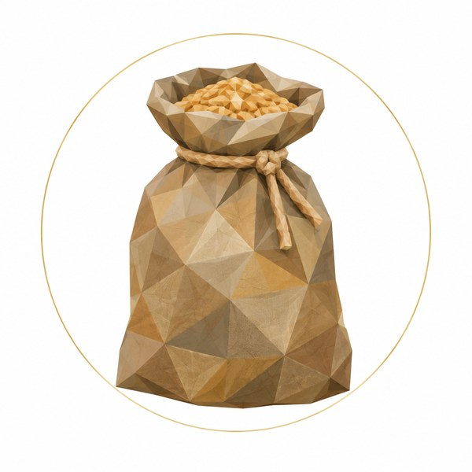
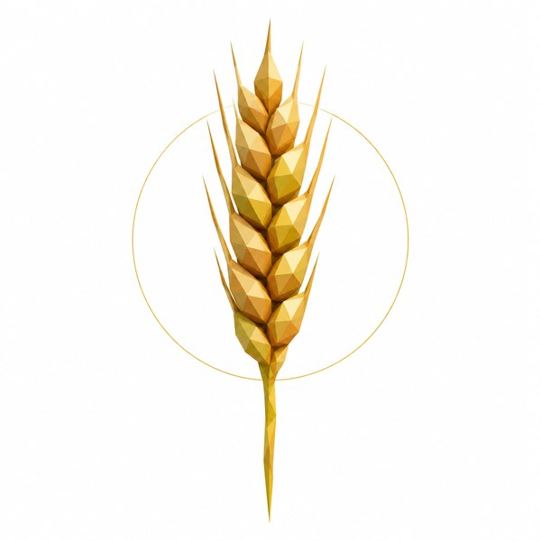
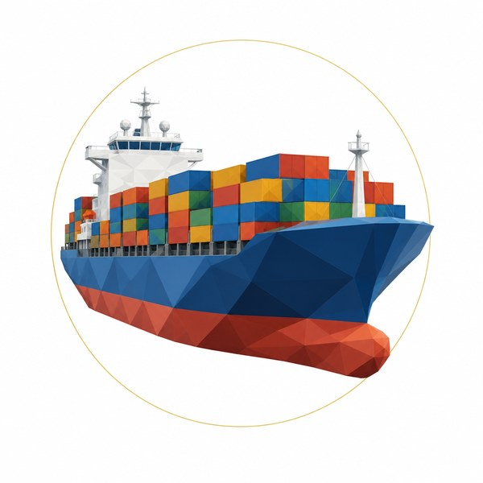
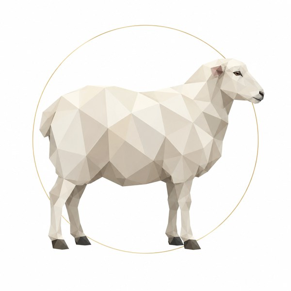

::: {.page .cover}
::: {.cover-top}
Planetary Council · Policy briefing · October 2026
:::

# Can Britain Feed Itself?

::: {.subtitle}
Store and grow: a simple plan to keep Britain fed
:::

::: {.cover-lede}
Everyone needs food, every day. Yet Britain grows just enough in a normal year, has no national food reserve, and relies on ships, gas, lorries and good weather. For about **£10 a person a year**, we could keep a national food cupboard for everyone. For about **£4.50 more**, we could care for the soil, water and seed that every future harvest needs. A meal today. A harvest tomorrow.
:::

::: {.cover-pillars}
::: {.pill}
**STORE** A national food cupboard ~£10.33 per person per year
:::
::: {.pill}
**GROW** Healthy soil, water and seed ~£4.46 per person per year of new money
:::
:::

::: {.cover-foot}
Want to check a number? Follow its footnote to the clickable sources at the bottom of the page. Our models, notes and full evidence file are open: github.com/planetarycouncil/food-security-climate-regeneration. **Tell us where this breaks.**
:::
:::

::: {.page}
::: {.head}
[Before we start]{.chapter-no}

## It starts with the next meal

::: {.kicker}
We all need to eat. So do the people we love.
:::
:::

::: {.story}
Imagine sitting down to dinner and finding nothing to serve. Food keeps every one of us going. An average woman needs about 2,000 calories a day and an average man about 2,500.^1^ We can wait for a new phone, a train or a pay rise. We cannot wait long for food. Neither can our children.

Full shelves feel ordinary. The lorries arrive at night; by morning, the shelves are restocked. Most of us hardly think about where the next meal comes from, because it has always been there. Yet shops keep only about ten days of food.^2^ Our kitchens hold less. Think of our food supply as a river: we are safe only while it keeps flowing.

We can prepare for that river slowing down. Unlike electricity, food can be **stored**. Dry grain lasts for years when kept cool and clean. The idea is ancient: in the Bible's story, Joseph tells Pharaoh to save grain in seven good years to feed Egypt through seven bad ones.^3^ Finland, Switzerland, Norway, Sweden, Germany, Japan and Singapore still do a version of this today.^4^ Britain does not.^5^
:::

::: {.grid}
::: {.card .quote}
"There are only nine meals between mankind and anarchy."

Alfred Henry Lewis, 1896^6^
:::

::: {.card .stat}
[~10 days]{.num} of food in the shops at any time. Beyond that, we need the next delivery to arrive.^2^
:::

::: {.card .spot}

#### :i-silo: Save some while we can
Put food aside in good years for the bad ones. Grain, rice, oats and dried beans keep well. Japan keeps rice for about five years before selling it on.^4^
:::

::: {.card .stat}
[0]{.num} national food stores in Britain, and "no plans to create these" (UK government, March 2026).^5^
:::
:::

::: {.thread}
**So:** we need food every day, and it is one of the few essentials we can save up. Should Britain set some aside for everyone? Here is the plan.
:::

::: {.refs}
1. [NHS, *Understanding calories*](https://www.nhs.uk/live-well/healthy-weight/managing-your-weight/understanding-calories/)
2. [Full Fact, the UK's food supply](https://fullfact.org/economy/uks-food-supply-hanging-balance/)
3. [Genesis 41 (NIV), Bible Gateway](https://www.biblegateway.com/passage/?search=Genesis%2041&version=NIV)
4. Country details and sources on page 12 (chapter 8)
5. [UK Parliament, written answer HL15829 (31 Mar 2026)](https://questions-statements.parliament.uk/written-questions/detail/2026-03-20/HL15829/)
6. [Quote Investigator, "nine meals from anarchy"](https://quoteinvestigator.com/2022/05/02/nine-meals/)
:::
:::

::: {.page}
::: {.head}
[The short version]{.chapter-no}

## The plan on one page

::: {.kicker}
Enough for a normal year leaves little room for a bad one. We can prepare.
:::
:::

::: {.story}
In a normal year, British farms grow about as many calories as the country eats: 101% of what we need. That leaves 31 calories per person per day, less than half a slice of bread.^1^ Even that sliver depends on things we do not control: fertiliser made from imported gas, animal feed from soya grown across the ocean, lorries arriving just in time, and weather that is getting less reliable.

Break one link and shelves can empty in days. Break several together and a bad season can become a bad year. The government says it holds no national food stocks.^2^ Our answer has two parts. Both are cheap. Both are needed.
:::

::: {.grid}
::: {.card .pillar}
#### :i-silo: 1 · STORE: a national food cupboard
**~£10.33** per person a year.^3^ Wheat to bake bread for everyone for months. A three-day pack of food that needs no cooking, for every person in the country. Baby milk and special foods for those who need them. Seed and fertiliser for next year's harvest. Rice, oil and sugar.

*Food to see us through weeks and months of blockades, power cuts, cyber attacks or failed imports.*
:::

::: {.card .pillar}
#### :i-sprout: 2 · GROW: soil, water and seed
**~£4.46** per person a year of new money, plus, over time, more of today's £4.87bn of farm support directed towards keeping us fed.^3,4^ Test the soil and help it heal. Save winter rain. Breed our own seed. Reuse plant nutrients. Grow more of our own protein.

*Stronger farms for years and decades, relying less on imports and coping better with drought.*
:::

::: {.card .stat}
[~£14.79]{.num} per person a year for both: **about 4p a day**.^3^
:::

::: {.card}
#### :i-ladder: Decide before the crisis
A clear plan, step by step: who gets what, and how everyone gets a fair share. Write it calmly now, so people know what to expect when a crisis comes.
:::

::: {.card .key}
#### :i-law: Where we start
1. Pass a law that sets a minimum food reserve and clear rules for releasing it.
2. Before buying anything, ask the official statisticians how the reserve would count towards government debt.
3. Test the mills and local deliveries. Have dietitians design the emergency food packs.
4. Start testing soil and storing rainwater on farms.
:::
:::

::: {.thread}
**How to read this.** Each page tells one part of the story. Its bold closing line takes you to the next. Look in the boxes for numbers and at the bottom of each page for sources.
:::

::: {.refs}
1. [Defra, *Nutritional supply of agriculture in the UK 2025* (15 Oct 2026)](https://www.gov.uk/government/statistics/nutritional-supply-of-agriculture-in-the-uk-2025/nutritional-supply-of-agriculture-in-the-uk-2025); bread comparison ours (a medium slice is roughly 80–100 calories)
2. [UK Parliament, written answer HL15829 (31 Mar 2026)](https://questions-statements.parliament.uk/written-questions/detail/2026-03-20/HL15829/)
3. [Our cost model, `reserve_basket.py`](https://github.com/planetarycouncil/food-security-climate-regeneration/blob/claude/focused-mendel-5qswh8/research/model/reserve_basket.py)
4. [Defra, *Agriculture in the UK 2025*, ch. 10–11](https://www.gov.uk/government/statistics/agriculture-in-the-united-kingdom-2025/chapter-11-agri-environment)
:::
:::

::: {.page .dense}
::: {.head}
[Why bother?]{.chapter-no}

## What is a little peace of mind worth?

::: {.kicker}
When safety works, life carries on. It is easy to forget what made that possible.
:::
:::

::: {.story}
A fire extinguisher may look like wasted money until the day it is needed. A food reserve works the same way. When it does its job, life carries on and the money seems to have bought nothing. We pay now to prevent a disaster that may arrive later and hurt someone else. Mark Carney, the former Governor of the Bank of England, called this the "tragedy of the horizon".^1^

We cannot promise huge benefits. We ask: **how small a benefit would cover the cost?** The figures below give that answer, without predicting what will happen. Any one would be enough on its own, so never add them together. Each uses the food cupboard's cost, £718m a year; the figure for STORE and GROW together is in brackets.
:::

::: {.grid}
::: {.card .stat}
#### :i-factory: Protecting the food industry
[44p in £100]{.num} The food industry, farm to café, adds £162bn a year to the economy and employs 4.1 million people. The cupboard costs £718m: 44p for every £100 the industry adds (63p with GROW).^2^
:::

::: {.card .stat}
#### :i-people: Lives protected
[~290 lives a year]{.num} To decide which road-safety schemes are worth paying for, the government values preventing one death at about £2.5m. £718m ÷ £2.5m ≈ 290. Preventing that many deaths a year, on average, would justify the cost by the government's own rule (~410 with GROW).^3^
:::

::: {.card .stat}
#### :i-chart: A steady economy
[1 week = 8 years]{.num} One week of the economy running 10% below normal costs about £5.6bn: as much as eight years of the cupboard (five with GROW).^4^
:::

::: {.card .stat}
#### :i-heart: Peace of mind
Even a tiny improvement in how people feel about their lives would cover the cost: too small to measure, using the Treasury's method for valuing wellbeing.^5^
:::

::: {.card}
#### :i-alert: Calm streets
Not counted in the figures. In the 2000 fuel blockade, supermarkets warned they were days from running out.^6^ Rising prices and unfair treatment do more to anger people than empty fields.
:::

::: {.card .stat}
#### :i-shield: Compared with defence
[~1p : £1]{.num} Britain spends about £890 per person a year on defence.^7^ The food cupboard costs about £10: roughly 1p to keep us fed for every £1 spent on military safety.
:::
:::

::: {.thread}
**So:** even a small benefit would cover the cost. The next question is how likely we are to need that protection.
:::

::: {.refs}
1. [M. Carney, *Breaking the tragedy of the horizon*, Bank of England (2015)](https://www.bankofengland.co.uk/speech/2015/breaking-the-tragedy-of-the-horizon-climate-change-and-financial-stability)
2. [Defra, *Food statistics in your pocket* (food industry value £162.3bn, 2024; 4.1 m jobs)](https://gov.uk/government/statistics/food-statistics-pocketbook/food-statistics-in-your-pocket); £718m ÷ £162bn (our arithmetic)
3. [DfT, RAS60: value of preventing road deaths](https://www.gov.uk/government/statistical-data-sets/ras60-average-value-of-preventing-road-accidents) (£1.8m in 2016 prices, raised to ~£2.5m: our update)
4. [Our model, `benefits()` in `reserve_basket.py`](https://github.com/planetarycouncil/food-security-climate-regeneration/blob/claude/focused-mendel-5qswh8/research/model/reserve_basket.py)
5. [HM Treasury, *Wellbeing guidance for appraisal*](https://assets.publishing.service.gov.uk/government/uploads/system/uploads/attachment_data/file/1005388/Wellbeing_guidance_for_appraisal_-_supplementary_Green_Book_guidance.pdf): break-even is 0.0008–0.0011 points on a 0–10 life-satisfaction scale
6. [CNN transcript, UK fuel protests (13 Sep 2000)](https://www.cnn.com/TRANSCRIPTS/0009/13/ee.10.html)
7. [House of Commons Library, CBP-8175, UK defence spending (2026)](https://researchbriefings.files.parliament.uk/documents/CBP-8175/CBP-8175.pdf) (~£62bn a year)
:::
:::

::: {.page}
::: {.head}
[Chapter 1]{.chapter-no}

## Enough, with little to spare

::: {.kicker}
Britain can feed itself on paper. There is little room for error.
:::
:::

::: {.story}
Forty years ago, Britain grew more than 80% of the food it ate. Today it is about 60%.^1^ There is plenty of British milk, lamb, oats and barley. But we grow only 83% of our wheat, just over half of our fresh vegetables and about one piece of fresh fruit in seven.^1^

Even food grown here can depend on ships arriving. Pigs and chickens eat about 1.1 million tonnes of protein a year from imported soya.^2^ Cows and sheep use most of our farmland.^3^ If the soya ships stopped, our small calorie surplus would shrink, as the government's own statisticians point out.^4^

The people feeding us are getting older. Four in ten farmers in England are over 65; only one in twenty is under 35.^5^ Food prices jumped in 2023, rising by almost a fifth in a single year.^6^
:::

::: {.grid}
::: {.card .stat}
[60%]{.num} of the food we eat is grown in the UK (by value, 2025). It was over 80% in the 1980s.^1^
:::

::: {.card .stat}
[101%]{.num} of the calories we need are grown here in a normal year. That leaves just 31 calories a day each to spare.^4^
:::

::: {.card .spot}

#### :i-wheat: What we grow, what we buy
We grow **83%** of our wheat, **56%** of our fresh vegetables and **14%** of our fresh fruit.^1^
:::

::: {.card .caveat}
#### :i-alert: What these figures mean
The 60% measures money, so changing import prices change the figure. The 101% assumes no food is wasted.
:::
:::

::: {.thread}
**So:** we grow just enough while gas, soya, lorries and weather all hold up. To build a safer system, start with the land itself.
:::

::: {.refs}
1. [Defra, *Agriculture in the UK 2025*, ch. 14: the food chain](https://www.gov.uk/government/statistics/agriculture-in-the-united-kingdom-2025/chapter-14-the-food-chain)
2. AIC soya report (~2.39 Mt of soya meal, 2024) and our arithmetic
3. [Defra, *Agriculture in the UK 2025*, ch. 2](https://www.gov.uk/government/statistics/agriculture-in-the-united-kingdom-2025/chapter-2-structure-of-industry): livestock use about 84% of farmland
4. [Defra, *Nutritional supply of agriculture in the UK 2025*](https://www.gov.uk/government/statistics/nutritional-supply-of-agriculture-in-the-uk-2025/nutritional-supply-of-agriculture-in-the-uk-2025)
5. [Defra, *Farming evidence pack* (Sep 2026)](https://www.gov.uk/government/publications/farming-evidence-pack-a-high-level-overview-of-the-uk-agricultural-industry)
6. [Defra, *Agriculture in the UK 2025*](https://www.gov.uk/government/statistics/agriculture-in-the-united-kingdom-2025): food inflation peaked at 19.2% in March 2023
:::
:::

::: {.page}
::: {.head}
[Chapter 2]{.chapter-no}

## A gift of good land

::: {.kicker}
Britain is one of the best places on Earth to grow wheat and grass. We have little land to spare per person.
:::
:::

::: {.story}
Our mild, wet weather is a gift to farming. Rain falls all year, hard freezes are rare, and there is no dry season.^1^ Wheat and grass thrive here. A typical British wheat field produces about twice the world average, and a farm in Lincolnshire holds the world record.^2,3^

But this gift has limits. Each of us has about a third as much cropland as a person in France.^4^ Much of our best land is in the east, where it is getting drier, and in the Fens, where dark peat soil is slowly wasting away. More than half of England's very best farmland is exposed to flooding from rivers or the sea.^5^

There is hope beneath our feet. At Rothamsted, a long-running experiment rested fields under grass and clover for some years. The soil slowly gained back carbon, which makes it rich and spongy.^6^ Worn-out soil can recover. It needs care, and it needs time.
:::

::: {.grid}
::: {.card .stat}
[2×]{.num} the world average: a typical British wheat harvest per hectare of land (~7.8 tonnes).^2^
:::

::: {.card .stat}
[0.09 ha]{.num} of cropland per person in the UK, about three and a half tennis courts. France has ~0.28 ha.^4^
:::

::: {.card .stat}
[~£1.2bn]{.num} a year: the cost of worn-out soil in England and Wales (2015 study).^7^
:::

::: {.card .spot}

#### :i-sprout: Soil can heal
At Rothamsted, resting fields raised carbon in the topsoil from **0.98% to 1.23%** over 28 years, then it levelled off. Fields cropped every year lost carbon.^6^
:::
:::

::: {.thread}
**So:** our land is good and our soil can heal. We must look after it carefully: there is little per person, and the weather is changing.
:::

::: {.refs}
1. [Met Office, UK climate zones](https://weather.metoffice.gov.uk/climate/climate-explained/climate-zones)
2. [AHDB, final harvest report (2026); UK average derived from the survey](https://ahdb.org.uk/news/final-harvest-report-confirms-cereal-yields-are-below-historic-averages-across-the-uk)
3. [Guinness World Records, highest wheat yield (17.95 t/ha, 2022)](https://guinnessworldrecords.com/world-records/highest-wheat-yield)
4. FAO arable land totals ÷ population (our arithmetic); a doubles tennis court is 261 m² (our comparison)
5. Environment Agency flood-risk mapping (2026): 59.2% of England's Grade 1 land lies in mapped river or sea flood-risk areas
6. [Johnston et al. 2017, Rothamsted ley-arable experiment](https://repository.rothamsted.ac.uk/item/8v42x/changes-in-soil-organic-matter-over-70-years-in-continuous-arable-and-ley-arable-rotations-on-a-sandy-loam-soil-in-england)
7. [Graves et al. 2015, *Ecological Economics* 119](https://ideas.repec.org/a/eee/ecolec/v119y2015icp399-413.html)
:::
:::

::: {.page}
::: {.head}
[Chapter 3]{.chapter-no}

## When bad weather piles up

::: {.kicker}
One bad week rarely hurts a harvest. A whole season of bad weather does, and that is happening more often.
:::
:::

::: {.story}
British wheat is tough. A cold snap or a wet week rarely defeats it. The trouble comes when bad weather follows bad weather: an autumn too wet to plant, a spring too dry for seeds to grow, a summer too wet to bring the harvest in.^1^

That pile-up is becoming normal. This year's UK harvest looks set to be the smallest on record, and four of the five worst on record have now come this decade.^2^ 2025 was the warmest year ever recorded in the UK.^3^ Warmer winters are also bringing new crop and animal diseases north.^4,5^

Buying from a neighbour seems an obvious answer to a bad harvest. But in 2026, drought hit Britain, France and Germany together.^6^ Our neighbours often have bad years when we do. If the country we would buy from has the same problem, trade cannot rescue everyone. Food already in store can help us through.
:::

::: {.grid}
::: {.card .stat}
[4 of 5]{.num} of the UK's worst harvests on record are likely to have come this decade: 2020, 2024, 2025 and 2026.^2^
:::

::: {.card .stat}
[−11%]{.num} wheat harvested per field in 2026, compared with the last five years.^7^
:::

::: {.card .stat}
[1.2%]{.num} a year: the chance of the world's main wheat-growing regions all failing together. It used to be 0.3%.^8^
:::

::: {.card .stat}
[~8 million tonnes]{.num} of grain lost in France alone in the 2026 drought.^6^
:::

::: {.card .caveat}
#### :i-alert: What the figures leave out
Average harvests may hold up for decades. The danger lies in the bad years. Weather alone did not cause all of 2026's losses: farmers also planted less because fertiliser was so expensive.
:::
:::

::: {.thread}
**So:** bad years are coming more often, and neighbours are being hit together. Weather is only part of the story. Follow a loaf of bread to see the rest.
:::

::: {.refs}
1. [Slater et al. 2022, *Earth System Dynamics* 13](https://esd.copernicus.org/articles/13/1377/2022/)
2. [ECIU, UK harvest even worse than previously thought (Oct 2026)](https://eciu.net/media/press-releases/uk-harvest-even-worse-than-previously-thought-new-data) (four crops, by volume)
3. [Met Office (2026)](https://www.metoffice.gov.uk/about-us/news-and-media/media-centre/weather-and-climate-news/2026/met-office-science-helps-protect-uk-plants-from-rising-pest-risks)
4. [EPPO, wheat stem rust in the UK and Ireland](https://pra.eppo.int/pra/c1804e50-2029-488f-b92f-d38429142e81)
5. [GOV.UK, bluetongue](https://gov.uk/bluetongue)
6. [Carbon Brief, Europe's 2026 heat and drought in six charts](https://carbonbrief.org/how-this-summers-heat-and-drought-impacted-crops-in-europe-in-six-charts)
7. [AHDB, final harvest report (2026)](https://ahdb.org.uk/news/final-harvest-report-confirms-cereal-yields-are-below-historic-averages-across-the-uk)
8. [Gaupp et al. 2020, *Nature Climate Change*](https://www.nature.com/articles/s41558-019-0600-z)
:::
:::

::: {.page}
::: {.head}
[Chapter 4]{.chapter-no}

## The long journey to a loaf

::: {.kicker}
Before bread reaches the table, it needs gas, diesel, ships, electricity and computers.
:::
:::

::: {.story}
Imagine following one loaf of bread back to its field. A farmer spread nitrogen fertiliser to help the wheat grow. That fertiliser is made from natural gas. Britain no longer makes it in any quantity: its last big fertiliser factory, at Billingham, closed in 2023.^1^ All our phosphate, another key plant food, is imported too.^2^

Next comes the lorry. Modern lorries need AdBlue, a fluid made from the same stuff as fertiliser. Keep driving without it and, after warnings, the engine loses power; in the end the lorry is held to bicycle speed.^3^ Then the mill needs electricity to make flour, and a computer takes the bread order. Much of our other food needs cold storage too: more than half of what we eat is chilled or frozen.^4^

These links have already broken somewhere. In 2025, a computer attack on one meat supplier stopped deliveries to most big supermarkets.^5^ That same spring, a blackout in Spain and Portugal stopped card payments, warehouses and fridges for 50–60 million people.^6^
:::

::: {.grid}
::: {.card .spot}

#### :i-ship: One short sea crossing
About **42%** of our imported dairy and eggs and **39%** of imported meat come across the short stretch of sea between France and Kent.^7^
:::

::: {.card .stat}
[>50%]{.num} of the food we eat must be chilled or frozen. Keeping it cold depends on power.^4^
:::

::: {.card .stat}
[20 km/h]{.num} the limit a modern lorry is finally held to if it keeps running without AdBlue.^3^
:::

::: {.card}
#### :i-shield: Find the places we depend on
Food is officially one of 13 national systems classed as "critical". Yet the government's spending watchdog says nobody has listed the mills, grain dryers and cold stores it depends on.^8^
:::
:::

::: {.thread}
**So:** good land cannot feed us without energy, fertiliser and transport. Our biggest single weak link is the food our animals eat.
:::

::: {.refs}
1. [Defra, *UK Food Security Report 2024*, theme 3](https://www.gov.uk/government/statistics/united-kingdom-food-security-report-2024/united-kingdom-food-security-report-2024-theme-3-food-supply-chain-resilience)
2. [Lancaster University, UK Phosphorus Transformation Strategy (2022)](https://www.lancaster.ac.uk/news/scientists-release-uk-roadmap-for-managing-key-ingredient-behind-all-the-food-we-eat)
3. [Reg. (EU) 582/2011, Annex XIII (retained in UK law)](https://www.legislation.gov.uk/eur/2011/582/annex/XIII/division/5/adopted)
4. [Cold Chain Federation, policy strategy 2026](https://www.coldchainfederation.org.uk/policy-strategy-2026/)
5. [Food Ingredients First, ransomware at a UK supermarket supplier (2025)](https://www.foodingredientsfirst.com/news/ransomware-uk-supermarket-supplier-food-security.html)
6. [Slimstock, the Iberian blackout and the supply chain](https://www.slimstock.com/blog/the-iberian-blackout-and-its-consequences-on-the-supply-chain/)
7. [Defra, *UK Food Security Report 2024*, theme 3](https://www.gov.uk/government/statistics/united-kingdom-food-security-report-2024/united-kingdom-food-security-report-2024-theme-3-food-supply-chain-resilience) (the "Short Straits": Dover and Folkestone to Calais and Dunkirk)
8. [National Audit Office, *Resilience of the food supply chain to disruptions* (Sep 2026)](https://www.nao.org.uk/reports/resilience-of-the-food-supply-chain-to-disruptions/)
:::
:::

::: {.page .dense}
::: {.head}
[Chapter 5]{.chapter-no}

## The grain we already have

::: {.kicker}
Grain fed to animals can also feed people. Our bigger worry is the soya we import to feed those animals.
:::
:::

::: {.story}
About half of Britain's wheat, barley and oats goes into animal feed.^1^ It comes back to us as food, but at a cost: a grain-fed animal needs several plates of grain to produce one plate of meat.^2^ In a shortage, we would need to think carefully about who eats that grain.

That makes animal feed a hidden reserve. Barley grown for feed can become porridge, flatbread and wholegrain food, though it cannot quite make today's soft white loaf.^3^ Our model shows that if imports stopped, British grain could keep people and animals going for two years, as long as we stopped most of the grain going into whisky and car fuel. Over three years, with a safety stock kept in hand, we would have to choose: feed animals about a tenth less, or store more grain.^4^

The real gap is protein. Pigs and chickens rely on imported soya. Cows and sheep do best on grass, on hills and wet land where crops cannot grow.^5^ There is food around our coasts too: we mostly sell our mackerel and herring abroad.^6^
:::

::: {.grid}
::: {.card .wide}
#### :i-chart: If imports stopped for three years (our grain model)^4^
Grain for whisky and fuel cut by three-quarters; 1 million tonnes always kept back. The bread wheat in the cupboard is separate and does not fill these gaps.

| What the harvests are like | Extra grain we would need |
|---------|-------|
| Normal harvests, animals fed as now | 2.3 million tonnes |
| Two harvests 15% down, animals get 80% of their feed | 2.5 million tonnes |
| A fertiliser shortage cuts one harvest by a third | 3.5 million tonnes |
| Three harvests 30% down, animals get 80% of their feed | 11.4 million tonnes: too much to store. With animal feed halved, almost nothing extra |
:::

::: {.card .stat}
[~52%]{.num} of UK wheat, barley and oats goes to feed animals.^1^
:::

::: {.card .spot}

#### :i-sheep: Animals on the right land
Keep cattle and sheep on grass that nothing else can use. Keep pig and chicken numbers in line with the protein we can grow at home.^5^
:::

::: {.card}
#### :i-sprout: Growing our own protein
Replacing all imported soya with field beans would take about a sixth of our cropland. Replacing a third within ten years is realistic.^4^
:::

::: {.card .stat}
#### :i-fish: Food from our own waters
[40%]{.num} of the fish we ate in 2019 was caught or farmed in the UK; it was 89% in 1975.^6^
:::
:::

::: {.thread}
**So:** planning ahead lets grain feed us in a crisis. Imported soya leaves a gap. Now look at what is happening along the routes that bring our food and fertiliser here.
:::

::: {.refs}
1. Defra cereal usage statistics (2023 data)
2. Our arithmetic: 3 kg of grain ≈ 9,900 calories, against ~1,500–2,500 in 1 kg of meat; for world context see [Mottet et al. 2017, *Global Food Security*](https://research.wur.nl/en/publications/livestock-on-our-plates-or-eating-at-our-table-a-new-analysis-of-)
3. [UK Flour Millers, annual review](https://www.ukflourmillers.org/the-industry/annual-review)
4. [Our grain model, `cereal_balance.py`](https://github.com/planetarycouncil/food-security-climate-regeneration/blob/claude/focused-mendel-5qswh8/research/model/cereal_balance.py): imports stop on 1 July; distilling and bio-fuel cut by 75%
5. Wilkinson 2011, *Animal* 5(7): only milk and upland suckler beef returned more human-edible protein than they ate
6. [Harrison et al. 2023, *Reviews in Fish Biology and Fisheries*](https://repository.essex.ac.uk/36032/1/s11160-023-09776-5.pdf)
:::
:::

::: {.page}
::: {.head}
[Chapter 6]{.chapter-no}

## Trouble abroad, prices at home

::: {.kicker}
In 2026 two key sea routes were disrupted. Britain buys little directly through either. We still feel the cost of both.
:::
:::

::: {.story}
Events far away can reach our dinner tables. This year the Strait of Hormuz, the narrow sea passage out of the Persian Gulf, was closed.^1^ Up to 30% of the world's traded fertiliser passes through it. Grain ships on the Black Sea also came under attack.^2^ Within weeks, a common nitrogen fertiliser more than doubled in price.^3^ World food prices are now the highest in almost four years.^4^

British shoppers have barely felt this yet: food prices rose only 1.3% in the year to September.^5^ But expensive fertiliser bought this winter feeds into next year's harvest and next year's food prices.

Having money does not guarantee food is for sale. In 2022, 32 countries banned or limited food exports.^6^ In a shortage, food already in store matters more than money waiting to buy it. Countries with stocks can avoid panic buying and help their friends.
:::

::: {.grid}
::: {.card .stat}
[up to 30%]{.num} of the world's traded fertiliser passes through the Strait of Hormuz.^1^
:::

::: {.card .stat}
[$400 → $850]{.num} per tonne of urea fertiliser, from early 2026 to April.^3^
:::

::: {.card .stat}
[77]{.num} food export bans or limits, by 32 countries, in 2022.^6^
:::

::: {.card .key}
#### :i-shield: Food in store helps our friends too
With food in store, a country can keep exporting and help its partners. In calm years it can sell older stock to aid agencies, at prices agreed in advance.
:::

::: {.card .caveat}
#### :i-alert: What we cannot be sure of
A promise to sell us food later can fail if a country bans exports. Food held at home comes first. We could not confirm whether Hormuz was open in late October 2026.
:::
:::

::: {.thread}
**So:** food in store matters more than money in a shortage. A plan must also say how everyone gets a fair share.
:::

::: {.refs}
1. [FAO, chief economist on disruption to the Strait of Hormuz (2026)](https://www.fao.org/newsroom/detail/fao-chief-economist-warns-of-severe-global-food-security-risks-from-disruption-to-strait-of-hormuz-trade-corridor/en)
2. [S&P Global, Black Sea grain trade factbox (Aug 2026)](https://www.spglobal.com/energy/en/news-research/latest-news/agriculture/082026-factbox-black-sea-grain-trade-strained-by-escalating-russia-ukraine-conflict)
3. [WTO data blog (10 Jul 2026)](https://www.wto.org/english/blogs_e/data_blog_e/blog_dta_10jul26_451_e.htm)
4. [Fastmarkets, FAO Food Price Index, September 2026 (136.0, highest since Nov 2022)](https://fastmarkets.com/insights/fao-food-price-index-rises-in-september-on-higher-cereal-vegoil-prices-and-benchmark-at-highest-since-november-2022)
5. [ONS, consumer price inflation, September 2026](https://www.ons.gov.uk/economy/inflationandpriceindices/bulletins/consumerpriceinflation/september2026)
6. [IFPRI, food export restrictions tracker](https://www.ifpri.org/blog/food-export-restrictions-have-eased-russia-ukraine-war-continues-concerns-remain-key/)
:::
:::

::: {.page}
::: {.head}
[Chapter 7]{.chapter-no}

## Everyone needs a fair share

::: {.kicker}
People accept shortage more readily when the rules are fair.
:::
:::

::: {.story}
When food gets dearer, people get angrier. Studies across many countries find that rising prices are followed by more unrest.^1^ In a rich country like Britain, deliveries can fail before harvests do. During the 2000 fuel blockade, supermarkets warned they would run out within days.^2^

A sense of unfairness can turn shortage into chaos. In Egypt in 1977, cutting support that kept bread cheap caused riots in almost every big city. The cut was reversed in two days.^3^ In Japan in 2025, rice prices nearly doubled, emergency rice reached shops too slowly, and the farm minister resigned.^4^ Britain offers another lesson: during the Second World War, rationing gave everyone the same basic share, and baby deaths fell.^5^

Many families have little room left for a crisis. One household in eight cannot always afford enough food.^6^ Only one in twenty-five has three days of water at home.^7^
:::

::: {.grid}
::: {.card .stat}
[12.2%]{.num} of UK households struggle to get enough food (July 2026).^6^
:::

::: {.card .stat}
[2.6 million]{.num} emergency food parcels given out by food banks in 2025.^8^
:::

::: {.card}
#### :i-law: The gaps in Britain's plans
The government's spending watchdog called local food emergency plans "insufficient". It also found the government has no power to direct food firms in a disaster.^9^ In October 2026, more than 150 experts wrote to the Prime Minister asking for national food stores.^10^
:::

::: {.card .caveat}
#### :i-alert: Keep the risk in perspective
In Britain, the likely problems are panic buying, empty shelves and lost trust. Riots are not the likely outcome. Unrest has many causes; prices are one.
:::
:::

::: {.thread}
**So:** open, fair preparation helps keep the peace. Other countries already do this. We can learn from them.
:::

::: {.refs}
1. [Bellemare 2015, *American Journal of Agricultural Economics* 97(1)](https://ideas.repec.org/a/oup/ajagec/v97y2015i1p1-21..html)
2. [CNN transcript, UK fuel protests (13 Sep 2000)](https://www.cnn.com/TRANSCRIPTS/0009/13/ee.10.html)
3. [NPR, protests and the price of bread (2011)](https://www.npr.org/sections/money/2011/02/01/133403007/protests-and-the-price-of-bread)
4. [Food Manufacturing, Japan's rice crisis (2025)](https://www.foodmanufacturing.com/supply-chain/news/22941833/japans-rice-crisis-prices-soar-supplies-dwindle-and-minister-resigns)
5. [Working paper citing Ministry of Health data (arXiv 2301.09982)](https://arxiv.org/pdf/2301.09982)
6. [Food Foundation, food insecurity tracker (Jul 2026)](https://foodfoundation.org.uk/news/food-prices-tracker-july-2026)
7. [UK public survey of risk perception and preparedness 2026](https://www.gov.uk/government/statistics/uk-public-survey-of-risk-perception-resilience-and-preparedness-2026/uk-public-survey-of-risk-perception-resilience-and-preparedness-2026-headline-findings-html) (4% have three days of water)
8. [Trussell, food banks provide over 2.6 million parcels](https://www.trussell.org.uk/news-and-research/news/food-banks-provide-over-2.6-million-food-parcels)
9. [National Audit Office, summary (Sep 2026)](https://www.nao.org.uk/wp-content/uploads/2026/09/Resilience-of-the-food-supply-chain-to-disruptions-summary.pdf)
10. [Global Government Forum, experts' letter (Oct 2026)](https://www.globalgovernmentforum.com/create-department-for-food-security-to-address-uk-government-complacency-on-impending-shocks-say-experts/)
:::
:::

::: {.page}
::: {.head}
[Chapter 8]{.chapter-no}

## Our neighbours keep a cupboard

::: {.kicker}
Many countries like Britain put food aside for hard times. Britain has no national reserve.
:::
:::

::: {.story}
Britain would be following a familiar path. Finland remembers hunger and war, and keeps at least six months of bread grain.^1^ Switzerland makes food firms hold two to four months of everyday basics on top of their normal stock.^2^ Norway is rebuilding a grain store it let go.^3^ Sweden passed a new law this year.^4^

This is the quiet work of careful government. In August 2026, when low rivers stopped barges reaching Switzerland, the Swiss released animal feed from their stores.^5^ But food must be able to leave the warehouse as well as enter it. Japan's experience shows why clear rules for releasing it quickly matter.^6^
:::

::: {.grid}
::: {.card .wide}
| Country | What it keeps | How |
|--|------|-----|
| **Finland** | At least 6 months of bread grain^1^ | A state agency, paid for by a small fee |
| **Switzerland** | 2–4 months of wheat, sugar, rice, oil, feed and fertiliser^2^ | Food firms must hold extra stock by law |
| **Norway** | ~3 months of bread grain by 2029^3^ | State grain, stored by millers |
| **Sweden** | Grain, seed, fertiliser, feed and spare parts^4^ | New law from 1 July 2026 |
| **Germany** | About 1 month of bread grain, plus rice and pulses^7^ | State reserve in ~150 private stores |
| **Japan** | Rice reserve, target 1 million tonnes^6^ | Bought by the state, kept ~5 years |
| **Singapore** | Two months of rice^8^ | Required of every rice importer |
| **UK** | **None**^9^ | |
:::

::: {.card .caveat}
#### :i-alert: What we can compare
Finland's and Switzerland's costs also cover fuel and medicines. They cannot tell us the cost of food stores alone in Britain.^10^ Much of the information about national reserves is incomplete or secret.
:::
:::

::: {.thread}
**So:** keeping food for hard times is normal in countries like ours. What would we put in a British cupboard, and what would it cost?
:::

::: {.refs}
1. [NESA (Finland), additional grain for emergency stockpiles](https://huoltovarmuuskeskus.fi/en/a/procurement-of-additional-grain-for-emergency-stockpiles-completed)
2. [réservesuisse, compulsory stocks (1 Jan 2026)](https://www.reservesuisse.ch/compulsory-stocks/?lang=en)
3. [Norwegian government, emergency grain storage](https://www.regjeringen.no/no/aktuelt/staten-ber-om-tilbod-pa-beredskaplagring-av-korn/id3028355/)
4. [Riksdag, committee report on food stockpiles](https://data.riksdagen.se/dokument/HD01MJU25.html) (SFS 2026:837)
5. [cash.ch, Swiss protein-feed release (Aug 2026)](https://www.cash.ch/news/notreserven-fur-protein-tierfutter-werden-freigegeben-964808)
6. [Asia News Network (2025)](https://asianews.network/japanese-government-criticised-for-slow-response-to-soaring-rice-prices/); [Adnkronos (Sep 2026)](https://english.adnkronos.com/2026/09/01/japan-govt-to-buy-back-210000-tons-of-rice-after-stockpile-release/)
7. [top agrar, Germany's grain reserves](https://www.topagrar.com/panorama/news/das-ist-uber-deutschlands-getreidevorrate-bekannt-20020375.html)
8. [MTI Singapore, reply on stockpiling](https://www.mti.gov.sg/newsroom/written-reply-to-pq-on-stockpiling-of-key-food-items)
9. [UK Parliament, written answer HL15829](https://questions-statements.parliament.uk/written-questions/detail/2026-03-20/HL15829/)
10. [NESA, funding](https://www.huoltovarmuuskeskus.fi/en/organisation/funding); [SRF, the Swiss pantry (2019)](https://www.srf.ch/news/schweiz/schweizer-vorratskammer-kein-kaffee-im-krisenfall) (~CHF 14 per person)
:::
:::

::: {.page .dense}
::: {.head}
[Chapter 9 · Pillar 1]{.chapter-no}

## STORE: a national food cupboard

::: {.kicker}
About £10 per person a year, under 3p a day. Bread, food that needs no cooking, and seed for next year. Enough to include everyone. Nobody left out.
:::
:::

::: {.story}
Imagine the power has been off for three days. Your oven is cold. You cannot pay by card. The shops are emptying. What will you eat? We built the reserve by starting with that meal, then working backwards.

**First, bread.** Four million tonnes of wheat suitable for flour, held by millers and grain merchants in addition to their normal stock. It would keep bakeries going for about ten months with no imports and no harvest, provided mills have power and staff. After about three months the strong wheat for today's soft sliced loaf runs out, and bread becomes heavier and more wholegrain.^1,2^ **Second, food that needs no cooking**: a three-day pack of crispbread, biscuits and oatcakes for every single person, stored close to home, plus vitamin tablets for 90 days. **Third, food for different needs**: baby milk, medical foods and soft food. **Fourth, the next harvest**: seed, safely stored fertiliser, animal feed, and months of rice, oil and sugar.^1^
:::

::: {.grid}
::: {.card .spot}

#### :i-wheat: Use it and replace it
About a fifth of the stock is used and replaced each year to keep it fresh. Older stock goes to schools, the armed forces and food banks.
:::

::: {.card .aside}
Think of it as the National Insurance (not National Insurance).

[Prof. Gen. Adm. F.L. Amingo, Battalion of Militarized Satire]{.by}
:::

::: {.card}
#### :i-box: Who owns it, who pays
The state owns part, paid for through taxes. Food firms must hold the rest as extra stock by law, as they do in Switzerland. That cost is added to food prices.^3^
:::

::: {.card .stat}
[~10 days]{.num} of food in the shops today. Wheat stocks before harvest fell to about 39 days of use.^4,5^
:::

::: {.card .wide}
#### :i-ladder: Start with the meal, build from there
If money is short, build in stages. Total cost per person a year at each step.^1^

| Up to | What it adds |
|-|--------|
| £2.71 | **Bread for everyone:** 4 million tonnes of milling wheat, strong wheat, vitamins for flour, sacks |
| £3.48 | + **no-cook food for everyone:** 3-day pack, vitamin tablets, bottled water |
| £6.92 | + running it: a small agency, local plans, fuel and backup power, delivery to the door |
| £7.55 | + babies and people with special diets |
| £9.19 | + next year's harvest: seed, fertiliser, animal feed |
| **£10.33** | + imported basics: rice, oil, sugar, beans, oats, milk powder, tinned fish |
:::
:::

::: {.thread}
**So:** start with what people can eat, and make sure everyone is covered. Here is the full cupboard, with its price tag.
:::

::: {.refs}
1. [Our cost model, `reserve_basket.py`](https://github.com/planetarycouncil/food-security-climate-regeneration/blob/claude/focused-mendel-5qswh8/research/model/reserve_basket.py)
2. [UK Flour Millers, annual review (4.8 Mt milled, 2025)](https://www.ukflourmillers.org/the-industry/annual-review)
3. [réservesuisse, compulsory stocks](https://www.reservesuisse.ch/compulsory-stocks/?lang=en)
4. [Full Fact, the UK's food supply](https://fullfact.org/economy/uks-food-supply-hanging-balance/)
5. [AHDB, end-of-season UK cereal supply and demand (Sep 2026)](https://ahdb.org.uk/end-of-season-uk-cereal-supply-and-demand-september-2026) (1.514 Mt)
:::
:::

::: {.page .dense}
::: {.head}
[Chapter 9 · Pillar 1 (continued)]{.chapter-no}

## What goes in, what it costs

::: {.kicker}
£718m a year, about 6.8 million tonnes of food, and plain answers to the things that could go wrong.
:::
:::

::: {.grid}
::: {.card .wide}
| What | How much | £ per person a year |
|--------|--|--|
| Wheat for flour, 4 million tonnes (half in new stores), plus strong wheat for bread | 4.35 million tonnes | 2.62 |
| No-cook food pack for everyone, 3 days (~500 grams a day) | 104 thousand tonnes | 0.40 |
| Vitamin tablets, flour vitamins, sacks, 90 million litres of bottled water | – | 0.46 |
| Running it: a small agency and inspectors (~£33m), local plans, fuel and power, delivery, security | – | 3.44 |
| Baby milk (~7,000 tonnes), medical foods, special no-cook food for 5 million people | – | 0.63 |
| Next harvest: seed, safely stored nitrogen fertiliser, 10 weeks of soya feed | 1.21 million tonnes | 1.64 |
| Imported basics: rice and oil (~4 months), sugar (~2 months), beans, oats, milk powder, tinned fish | 1.18 million tonnes | 1.14 |
| **Total** | **~6.8 million tonnes** | **~£10.33 (£718m)** |

Source: our cost model.^1^
:::

::: {.card .stat}
[£4.93 · £5.40]{.num} paid through taxes · through food prices.^1^
:::

::: {.card .stat}
[~£3.7bn]{.num} to buy the food and provide the stores at the start, paid by the state and firms over ~5 years.^1^
:::

::: {.card .wide .range}
**If costs rise:**^1^ cheapest case £9.40 · our central case **£10.33** · prices 30% higher £11.35 · firms borrow at 8% £11.92, at 10% £12.73 · grain and fertiliser prices double £13.73 · bad case £16.56 · very bad case £18.34 · worst case tested £25.57.
:::

::: {.card .wide}
#### :i-alert: Fair questions, clear answers
| Worry | Answer |
|----|--------|
| It adds to government debt | The ~£0.72bn public part counts. The firms' stock (~£2.2bn) may count too, especially if the state backs their borrowing. Ask the statisticians before buying; if firms borrow at normal rates, the cost is ~£12 a person |
| Firms count normal stock as reserve | Require extra stock above a registered normal level. Independent inspectors check it (£8m a year) |
| The first week fails without water and delivery | 90 million litres covers only about one person in seven for 3 days. The rest needs a published, tested water-company plan. Food packs must already be local; a national food drop would cost ~£400m more |
| The same wheat is counted twice | The 4 million tonnes is for bread only. Feeding animals through two bad harvests needs ~2.5 million tonnes more^2^ |
| Stored fertiliser explodes | Never store the explosive kind (ammonium nitrate, the Beirut chemical). Use only safer forms^3^ |
| Refilling is costly | Refill within three years, when prices and quality are right. Refilling 30% dearer costs ~£0.25bn |
| The reserve is used to fight inflation | Release only when published rules show a supply problem, never to manage prices |
:::
:::

::: {.thread}
**So:** stored food buys breathing space. To rely less on imports, we also need to care for the next harvest. That is GROW, our second pillar.
:::

::: {.refs}
1. [Our cost model, `reserve_basket.py` (central case and sensitivities)](https://github.com/planetarycouncil/food-security-climate-regeneration/blob/claude/focused-mendel-5qswh8/research/model/reserve_basket.py)
2. [Our grain model, `cereal_balance.py`](https://github.com/planetarycouncil/food-security-climate-regeneration/blob/claude/focused-mendel-5qswh8/research/model/cereal_balance.py)
3. [HSE, ammonium nitrate and COMAH](https://www.hse.gov.uk/explosives/ammonium/comah.htm)
:::
:::

::: {.page .dense}
::: {.head}
[Chapter 10 · Pillar 2]{.chapter-no}

## GROW: healthy soil, water and seed

::: {.kicker}
Stored food buys time. Soil, water and seed turn that time into the next harvest.
:::
:::

::: {.story}
Once the cupboard opens, it begins to empty. It can see us through a bad season, but every British harvest still relies on imports and luck. Our farms used about 904,000 tonnes of nitrogen fertiliser last year, made from gas. Britain no longer makes the key ingredient itself (chapter 4).^1^

Our second pillar cares for what makes the next meal possible. **Soil**: test it, check how wet it is, help it recover. **Water**: catch winter rain in farm reservoirs for dry summers. **Seed**: breed and grow our own. **Plant nutrients**: use manure and waste wisely; grow more beans and peas, which make their own nitrogen. Today about 50 stations measure how wet the soil is across the whole UK.^2^ We propose ten times as many.
:::

::: {.grid}
::: {.card .wide}
| Area | What the money buys | £ million a year |
|---|-------|-|
| **Soil and water checks** | ~500 soil moisture stations (from ~50), satellite checks, national soil health map, regular field tests | 35 |
| **Water storage** | Farm and local reservoirs that fill in winter | 100 |
| **Seed** | Seed banks; grow our own seed, including beans and peas; publicly funded plant breeding | 40 |
| **Plant nutrients** | Testing and careful use of manure; recovering phosphate; beans and peas; a trial of making fertiliser with green power | 60 |
| **Farming that rebuilds soil** | Independent advice, farmer groups, payments through the first lean years | 50 |
| **Home-grown protein** | Mills and plants to process beans and peas | 25 |

Source: our cost model.^3^
:::

::: {.card .stat}
[~£310m]{.num} a year of new money: **~£4.46 per person**.^3^
:::

::: {.card .spot}

#### :i-drop: Building on a small start
Reservoir grants have been £10–15m a round.^4^ The UK's vegetable seed bank holds about **14,000** samples.^5^
:::

::: {.card}
#### :i-pound: Make existing money work harder
Britain already spends about **£4.87bn** a year supporting farms, about £70 per person.^6^ Some of it is tax relief or contracts already signed, so it cannot all move at once. Over time, we want more of it to help keep us fed. Some farms will lose out. Say so openly.
:::

::: {.card .caveat}
#### :i-alert: What this money can do
£310m funds a start and a set of trials. It cannot buy full independence. Farming that rebuilds soil often becomes more profitable after 3–5 years, but takes about nine to repay the cost of switching without help.^7^ Pay for results we measure.
:::
:::

::: {.thread}
**So:** GROW invests where we rely most on others. Healthier soil can give us more than food. Here is what the evidence supports.
:::

::: {.refs}
1. [Defra, British Survey of Fertiliser Practice 2025](https://assets.publishing.service.gov.uk/media/6aa3fb1dc5796a7a179c6728/BSFP_2025_Stats_Notice.pdf)
2. [COSMOS-UK soil moisture network, *ESSD* (2021)](https://essd.copernicus.org/articles/13/1737/2021/essd-13-1737-2021.html)
3. [Our cost model, `reserve_basket.py`](https://github.com/planetarycouncil/food-security-climate-regeneration/blob/claude/focused-mendel-5qswh8/research/model/reserve_basket.py)
4. [Defra Farming blog, new drought support (Aug 2026)](https://defrafarming.blog.gov.uk/2026/08/15/new-drought-support-for-farmers/)
5. [Farming UK, Warwick seed bank](https://farming.co.uk/news/warwick-seed-bank-to-store-14,000-crop-seed-samples)
6. [Defra, *Agriculture in the UK 2025*, ch. 10–11](https://www.gov.uk/government/statistics/agriculture-in-the-united-kingdom-2025/chapter-11-agri-environment)
7. [WBCSD, *Closing the gap* (regenerative agriculture in Europe)](https://www.wbcsd.org/resources/closing-the-gap-an-analysis-of-the-costs-and-incentives-for-regenerative-agriculture-in-europe/)
:::
:::

::: {.page .infographic-page}
::: {.head}
[Chapter 10 · Pillar 2 (continued)]{.chapter-no}

## Healthy soil pays back twice

::: {.kicker}
We hear many promises about farming that rebuilds soil. Some have good evidence. Others depend on how the farming is done, or express what we value. Here is the difference.
:::
:::

{.infographic}

::: {.grid}
::: {.card}
#### :i-shield: What studies show
Healthier soil in the places studied. Less soil washed away. More wildlife in hedges and along field edges. Better mood from outdoor work.^1,2^
:::

::: {.card}
#### :i-scale: It depends how we farm
Land holding more water; lower costs; coping with drought; cleaner air, if less fertiliser is used. Local jobs: more work per field, but no proof of more jobs overall.^3^
:::

::: {.card}
#### :i-chart: Where the evidence has limits
More nutritious food: evidence is weak or mixed. Soil can store carbon, but only so much: the amount rises, then levels off.^1^
:::

::: {.card}
#### :i-heart: What we value
Learning, community, connection and a duty to the people who come after us.
:::
:::

::: {.thread}
**So:** we promise what the evidence supports. Now we need people to make the plan work.
:::

::: {.refs}
1. [Johnston et al. 2017, Rothamsted ley-arable experiment](https://repository.rothamsted.ac.uk/item/8v42x/changes-in-soil-organic-matter-over-70-years-in-continuous-arable-and-ley-arable-rotations-on-a-sandy-loam-soil-in-england)
2. [Coventry et al. 2021, nature-based outdoor activity and mental health](https://eprints.whiterose.ac.uk/id/eprint/178622)
3. [Organic farming and employment, review](https://orgprints.org/10178)
:::
:::

::: {.page}
::: {.head}
[Chapter 11]{.chapter-no}

## Who keeps the cupboard ready?

::: {.kicker}
A small team, helped by machines, working in the open. We cannot hide forty warehouses, so we make them visible.
:::
:::

::: {.story}
Someone has to be in charge. We propose a **small agency of about 65 people**, never more than 100 even in a crisis. Every job has a lead and two trained back-ups, so illness or holidays never stop the work.^1^ Independent inspectors check the stores.

Machines watch; people decide. Sensors in every store check temperature and damp. Computers follow stock, prices, weather and shipping day and night. People make decisions, check the work and answer to Parliament. Two people must sign before any public stock is released.

People should see what they are paying for: store locations, monthly stock levels, costs and things that went wrong. Anyone finding a real weakness gets a reward. Everything is open by default. A short, published list sets out exceptions, such as the exact sites of fuel, baby milk and fertiliser.
:::

::: {.grid}
::: {.card .spot}

#### :i-silo: Near ports, near people
**8–10 port stores** at grain ports such as Immingham, Liverpool and Avonmouth. **About 30 district stores** across all four nations, away from flood zones. **Thousands of local points**, including schools and council depots, holding food packs that need no cooking. **A guaranteed stock in Northern Ireland**, in case the ferries stop.
:::

::: {.card .stat}
[~£33m]{.num} a year for the agency, sensors, data and inspectors.^1^
:::

::: {.card .stat}
[~1,070]{.num} jobs in stores, labs, road transport and local planning.^1^
:::

::: {.card .caveat}
#### :i-alert: It must work when computers fail
65 is the starting team. Resize it when the real work is known. Computers can fail first in a blackout. Everything must also work on paper and radio, with practice to prove it.
:::
:::

::: {.thread}
**So:** a small, visible team keeps a large network ready. STORE and GROW also create work worth doing.
:::

::: {.refs}
1. [Our cost model and staffing plan, `reserve_basket.py`](https://github.com/planetarycouncil/food-security-climate-regeneration/blob/claude/focused-mendel-5qswh8/research/model/reserve_basket.py); [research note 23](https://github.com/planetarycouncil/food-security-climate-regeneration/blob/claude/focused-mendel-5qswh8/research/notes/23-lean-open-agency-and-decentralised-network.md)
:::
:::

::: {.page}
::: {.head}
[Chapter 12]{.chapter-no}

## A future in growing food

::: {.kicker}
Growing food should be work people are proud of. Let machines do the repetitive tasks, and grow enough to sell in good years.
:::
:::

::: {.story}
Two things are happening together. Computers and artificial intelligence (AI) are taking over many first jobs in offices: graduate job adverts are at their lowest since 2016.^1^ Meanwhile, farmers are getting older, with few young people following them.

STORE and GROW need store and lab staff, soil testers, water engineers, seed breeders and bean processors. Farm work is often lonely, seasonal and stressful. Nine in ten young farmers call poor mental health the industry's biggest hidden problem.^2^ Good pay, training, housing and teamwork can change that. Slogans alone cannot.

Outdoor work can help people too. A review of studies found that structured outdoor activity clearly reduced depression and anxiety.^3^ In the 1930s, young Americans who worked in the Civilian Conservation Corps lived longer and earned more over their lives.^4^
:::

::: {.grid}
::: {.card .stat}
[up to ~3,600]{.num} jobs across both pillars, including temporary building work, before counting jobs lost elsewhere.^5^
:::

::: {.card .stat}
[11%]{.num} of the 2020 harvest workforce were UK residents, despite the "Pick for Britain" campaign.^6^ Adverts alone cannot make people move.
:::

::: {.card .stat}
#### :i-ship: Grow what we grow best
[£25.6bn]{.num} of food and drink exported in 2025, against £66.9bn imported.^7^ We could sell more of what we grow best: oats, barley, dairy, lamb, seed potatoes.
:::

::: {.card .caveat}
#### :i-alert: What we cannot promise
No study yet shows people losing office jobs to AI moving into land work. Pride in farming needs pay, land and housing. Slogans cannot create it.
:::
:::

::: {.thread}
**So:** people matter as much as the grain. Looking after both fairly means being honest about who pays.
:::

::: {.refs}
1. [Adzuna data via VnExpress (Jul 2026)](https://e.vnexpress.net/news/news/education/uk-graduate-jobs-plunge-to-record-low-as-ai-reshapes-entry-level-employment-market-5127639.html)
2. [Farmers Guardian, Farm Safety Foundation survey (2025)](https://www.farmersguardian.com/news/4409724/mental-health-steadily-decreasing-farmers) (91%)
3. [Coventry et al. 2021, *SSM – Population Health*](https://eprints.whiterose.ac.uk/id/eprint/178622) (standardised effects −0.64 depression, −0.94 anxiety)
4. [NBER working paper w27103](https://www.nber.org/papers/w27103)
5. [Our jobs estimate, research note 25](https://github.com/planetarycouncil/food-security-climate-regeneration/blob/claude/focused-mendel-5qswh8/research/notes/25-work-prestige-and-a-food-producing-nation.md)
6. [FarmingUK, NFU harvest 2020 survey](https://www.farminguk.com/news/uk-residents-made-up-just-11-of-harvest-2020-workforce_56861.html)
7. [FDF, trade snapshot 2025](https://www.fdf.org.uk/fdf/resources/publications/trade-reports/fdf-trade-snapshot-2025/)
:::
:::

::: {.page}
::: {.head}
[Chapter 13]{.chapter-no}

## The costs beyond the till

::: {.kicker}
Charge for harm. Pay for protection. Give the money back to people.
:::
:::

::: {.story}
The price at the till is only part of the food bill. The rest appears in polluted rivers, worn-out soil, illness from poor diets and gases that heat the planet. Farming produces about an eighth of Britain's greenhouse gases.^1^ Worldwide, these hidden costs reach at least $10 trillion a year.^2^

Our position is simple: **polluters pay, and people who clean up get paid.** One fair price on carbon pollution, with free passes phased out. Every pound raised can only be spent once, so the law must say plainly how much goes back to families and how much to farms. Britain is already starting: from January 2027, imported fertiliser will face a carbon charge at the border.^3^

Farmers have to help shape the change. Denmark will charge for gases released by livestock from 2030, but let farms deduct 60% of it and spend the money on farming.^4^ That is a compromise, not a pure carbon price, and we say so. Europe's 2024 farmer protests showed what happens when change is forced on farmers: it fails.^5^
:::

::: {.grid}
::: {.card .stat}
[~12%]{.num} of UK greenhouse gases come from farming (2024).^1^
:::

::: {.card .stat}
[£0.4–1bn]{.num} a year from Danish-style charges on livestock in the UK: about £6–14 per person (our estimate).^4^
:::

::: {.card}
#### :i-alert: Pay for results we can check
In Australia, payments for storing carbon in soil have been shown to follow rainfall more than farming.^6^ Pay for measured results.
:::

::: {.card .caveat}
#### :i-alert: Families must get the money back
Fair carbon prices make food dearer, so the money must go back to people. If we charge British farms while leaving imports out, we simply move pollution abroad.
:::
:::

::: {.thread}
**So:** honest prices can fund the change, with money returned to people. Here is how to put the plan into action.
:::

::: {.refs}
1. [Defra, *Agriculture in the UK 2025*, ch. 10–11](https://www.gov.uk/government/statistics/agriculture-in-the-united-kingdom-2025/chapter-11-agri-environment)
2. [FAO, *The State of Food and Agriculture 2023*](https://openknowledge.fao.org/handle/20.500.14283/cc7724en)
3. [HM Treasury, carbon border adjustment factsheet](https://www.gov.uk/government/publications/factsheet-carbon-border-adjustment-mechanism-cbam/factsheet-carbon-border-adjustment-mechanism)
4. [The Local Denmark, livestock CO₂ tax (2024)](https://www.thelocal.dk/20241118/denmark-confirms-plan-for-world-first-livestock-co2-tax-by-2030); UK range: our estimate
5. [Euronews, EU withdraws pesticide law (Feb 2024)](https://www.euronews.com/my-europe/2024/02/06/von-der-leyen-announces-withdrawal-of-contentious-pesticide-law-the-first-defeat-of-the-gr)
6. [Mitchell et al. 2024, *Carbon Management*](https://doaj.org/article/caea2b9f2e8b4afa9934d7b36cbe5a7e)
:::
:::

::: {.page}
::: {.head}
[Chapter 14]{.chapter-no}

## From words to action

::: {.kicker}
Store and grow together. Agree the crisis rules while there is time to think calmly.
:::
:::

::: {.grid}
::: {.card .wide}
#### :i-clock: What happens when
| When | Store | Grow |
|--|-----|-----|
| **First year** | Pass the law; set minimum stock and release rules; check debt rules; buy grain only in good harvests; local food plans everywhere | Start soil tests and stations checking soil moisture; increase reservoir grants; direct farm support to soil, water and protein |
| **Years 1–3** | Firms start holding extra stock; build the public reserve and no-cook food packs; agree and practise crisis rules | Grow our own seed; first reservoirs filling; test manure; mills for beans and peas |
| **Years 3–10** | A full reserve in all four nations, used, replaced and audited | A third less imported soya; a national soil map; a trial of fertiliser made with green power |
:::

::: {.card .wide}
#### :i-ladder: Clear steps when a crisis comes
| Level | What is going on | What we do |
|---|----|-------|
| 0 · Normal | Everyday life | Use and replace stock; publish a monthly report; run practice drills |
| 1 · Disruption | Days to weeks: fuel blockade, cyber attack, power cut | Food that needs no cooking; fuel and power for mills and depots first; limits on how much one shopper buys |
| 2 · Long shortage | Months: imports cut, fertiliser shortage, one failed harvest | Release stock in stages; feed animal grain to people; use less grain for whisky and fuel; breed fewer animals |
| 3 · Severe | Two bad harvests plus a fertiliser shortage | **Fair Shares Guarantee**: the same basic share for all, extra for those who need it, price limits on basics, paper backup, a set end date |
| 4 · Catastrophe | Big volcano, war, a global crop disease | All grain we can eat goes to people; give and receive help across borders |
:::

::: {.card}
#### :i-sheep: Fewer animals, planned with care
Agree the plan with farmers and vets in advance. Stop new breeding first, so numbers fall without waste. Cut meat into simple bulk portions for schools and hospitals. Book freezer and abattoir space ahead. Pay farmers on recent prices, and never let animals starve.
:::

::: {.card}
#### :i-law: Put the plan into law
Today's emergency powers last only 30 days at a time.^1^ A Food Security Act should create a lasting reserve. Stock is released only when published triggers are met, never to hold down prices. The Cabinet Office gives the order; Defra runs it, with all four UK governments involved.
:::
:::

::: {.thread}
**So:** build STORE and GROW together, with crisis rules agreed in calm times. One related idea adds homes alongside the work.
:::

::: {.refs}
1. [Civil Contingencies Act 2004, Part 2 (ss. 26–27)](https://www.legislation.gov.uk/ukpga/2004/36/part/2): emergency regulations must be approved within 7 days and lapse after 30
:::
:::

::: {.page}
::: {.head}
[A related idea · not part of the costed plan]{.chapter-no}

## Homes, land and a living

::: {.kicker}
A home, land to work and a reason to stay. Build places where a new generation can make a living.
:::
:::

::: {.story}
Britain has made new places to live before: Letchworth and Welwyn garden cities, the post-war new towns, Milton Keynes, Cambourne near Cambridge,^1^ and now Salt Cross garden village in Oxfordshire, planned for about 2,200 homes.^2^ Since COVID, many people no longer need to live near an office.

The idea is modern, warm homes that are cheap to run, clustered beside an existing village with **shared** farmland around them. A community trust owns the land. People share tractors, a packing shed and a cold store. Residents can work in food and nature for some or all of the week, sharing tools, skills and the money needed to start.
:::

::: {.grid}
::: {.card .spot}

#### :i-house: A secure home comes first
Your home must never depend on keeping the farm job. How homes are owned keeps them affordable; a label cannot. Keep the best land for food. Never build on peat or flood plains. Test two or three sites first.
:::

::: {.card .stat}
[~9.6%]{.num} of UK farmland would go if a million homes each got four acres. Sharing the land avoids giving everyone a separate plot.^3^
:::

::: {.card .stat}
[~£500k]{.num} of sales a shared farm needs to pay four people; the village alone buys about £52k.^3^
:::

::: {.card .caveat}
#### :i-alert: What building homes can change
More homes help prices locally, but national house prices depend mostly on interest rates.^4^ Planning is slow and disputed.
:::
:::

::: {.thread}
**So:** test this idea in a pilot. Before moving ahead, there are questions to answer. Here is our list.
:::

::: {.refs}
1. [South Cambridgeshire District Council, new communities](https://www.scambs.gov.uk/planning/new-communities/)
2. [West Oxfordshire DC, Salt Cross plan adopted (Feb 2026)](https://www.westoxon.gov.uk/media/a23naehb/aap-adoption-statement-february-2026.pdf); [Salt Cross FAQs](https://www.saltcross.co.uk/faqs)
3. [Our land arithmetic, research note 26](https://github.com/planetarycouncil/food-security-climate-regeneration/blob/claude/focused-mendel-5qswh8/research/notes/26-homes-land-and-livelihoods.md)
4. [Miles & Monro 2019, Bank of England staff working paper](https://www.bankofengland.co.uk/-/media/boe/files/working-paper/2019/uk-house-prices-and-three-decades-of-decline-in-the-risk-free-real-interest-rate.pdf)
:::
:::

::: {.page .back}
::: {.head}
[Open to everyone]{.chapter-no}

## Help us find the weak points

::: {.kicker}
We put our doubts in the open. Finding a weakness now gives us a chance to fix it.
:::
:::

::: {.story}
You should be able to check what we say. Every number has a clickable source, and every source has been through four rounds of checking by reviewers looking for mistakes. In the full evidence file, each claim is labelled: an official source, a report based on other sources, our estimate, our opinion, or not yet checked.

Some answers need testing. Before anyone spends real money, do the following.
:::

::: {.grid}
::: {.card .key}
#### :i-alert: The work still to do
1. Ask official statisticians whether firms' stock counts as government debt, and check firms' real borrowing costs.
2. Check each mill can make emergency flour mixes and run on backup power.
3. Have dietitians design no-cook food packs for babies, pregnancy, coeliac disease, allergies and people who cannot chew, as well as everyone else.
4. Work out delivery and water costs; test door-to-door provision in a real local drill.
5. Get real quotes for storage, new stores, haulage, reservoirs and fuel.
6. Plan for Northern Ireland if the ferries stop, and for abattoir and freezer space if animal numbers must fall.
7. Check the full UK 2026 harvest figures (due December 2026) and the government's reply to our information request.^1^
:::

::: {.card}
#### :i-link: Read it, check it, challenge it
- The full evidence file: every claim, source and argument against it.^2^
- Two models: what both pillars cost, and grain stocks month by month.^3^
- 27 research notes.^4^
:::
:::

::: {.closing}
An army defends the border. A food reserve defends the dinner table.
:::

::: {.refs}
1. [WhatDoTheyKnow, FOI "Strategic food reserves and compound risk" (Oct 2026)](https://www.whatdotheyknow.com/request/strategic_food_reserves_and_comp)
2. [Full evidence file, `draft/briefing_full_context.md`](https://github.com/planetarycouncil/food-security-climate-regeneration/blob/claude/focused-mendel-5qswh8/draft/briefing_full_context.md)
3. [Models, `research/model/`](https://github.com/planetarycouncil/food-security-climate-regeneration/tree/claude/focused-mendel-5qswh8/research/model)
4. [Research notes, `research/notes/`](https://github.com/planetarycouncil/food-security-climate-regeneration/tree/claude/focused-mendel-5qswh8/research/notes)
:::
:::
